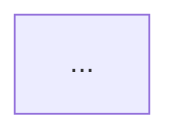

# Report template

The report has **exactly these five `##` sections, in this order, with these
headings**. Keep every table even when it has one row; an empty findings tier keeps
its heading and says "None found.". Sizes: KB under 1 MB, otherwise MB with one
decimal. `Source:` notes below tell you which collector field fills each part — they
are for you, do not print them.

````markdown
# Dependency Report — <repo> · <YYYY-MM-DD>

> <one sentence: the single most important result, e.g. "1 P0, 3 P1 — the biggest win is
> dropping the unused X (−N MB) and aligning Y across 3 packages.">

## 1. Scope

| Package | Name | Manager · lockfile | Prod | Dev | node_modules | Installed pkgs |
|---|---|---|---:|---:|---:|---:|
| server | @devdigest/api | pnpm · pnpm-lock.yaml | 23 | 10 | 263.8 MB | 411 |

- **Analyzed:** <packages>, offline / with `--online`.
- **Not analyzed:** <e.g. CVE + outdated (offline run) · packages not installed · design/, server/clones/>.
- **Data:** `collect.py` at `<git short sha>` <or "supplied by the user, not re-measured">.

## 2. Dependency Graph

### 2.1 Graph



Legend: solid arrow = internal path alias (label: alias · files using it) · cylinder =
vendored copy · dashed arrow = heaviest external npm deps (closure size) · red = version
drift · "⚠" = boundary violation.

### 2.2 Internal dependencies (path aliases — not npm)

| From | Alias | Target | Kind | Files | Note |
|---|---|---|---|---:|---|
| server | `@devdigest/reviewer-core` | reviewer-core/src | cross-package (source) | 26 | consumed as source |

Kinds: `cross-package` · `vendored` · `module-redirect` · boundary violation (relative import).

### 2.3 External dependencies by type

| Package | prod | dev | peer | optional | Also declared in other packages |
|---|---:|---:|---:|---:|---|
| server | 23 | 10 | 0 | 0 | zod, openai, typescript, vitest, … |

## 3. Size Breakdown

### 3.1 Per package

| Package | node_modules | Runtime (prod closure) | Tooling (rest) | Runtime share |
|---|---:|---:|---:|---:|

### 3.2 Heaviest dependencies

Top 10 across the repo by closure size (closures overlap — do not add them up).

| # | Dependency | Package | Type | Version | Own | With deps | Heaviest inside | Status |
|---:|---|---|---|---|---:|---:|---|---|
| 1 | next | client | prod | 15.5.19 | 133.0 MB | 290.4 MB | @next/swc-linux-x64-gnu 136.5 MB | used |

### 3.3 Where the weight comes from

2–4 bullets, each with a number: platform-native binaries, the same tool installed in
N packages (N × size), a single dependency dominating a package, dev vs prod split.

## 4. Findings & Priorities

### P0 — fix before the next merge

| ID | Finding | Where | Evidence | Action |
|---|---|---|---|---|
| DEP-P0-01 | <what is wrong, one line> | `<pkg>/package.json` · `<file>:<line>` | <grep result / versions / size> | <one concrete action + command> |

### P1 — fix this sprint

(same table)

### P2 — backlog

(same table)

### Info — no action needed

| ID | Observation | Where | Why no action |
|---|---|---|---|

## 5. Summary

1. **[P0] <action>** — <why, one clause> · `<command>`
2. **[P1] <action>** — …
3. …

3–5 items, ordered by priority then impact, each naming the package and dependency.

Nothing was changed — confirm which actions to apply. Re-run:
`python3 .claude/skills/dependency-checker/scripts/collect.py`
````

## Field sources

| Report part | Collector field |
|---|---|
| Scope table | `packages[].{dir,name,package_manager,lockfile,counts,size.node_modules_kb,size.installed_packages}` |
| Graph | `mermaid` (start from it verbatim) |
| 2.2 Internal | `packages[].internal[]` (skip rows with `files: 0` unless relevant), `boundary_violations[]`, `shared_drift` |
| 2.3 External | `packages[].counts` + `version_drift[].packages` |
| 3.1 Per package | `packages[].size.{node_modules_kb,prod_closure_kb,tooling_kb}` |
| 3.2 Heaviest | `packages[].dependencies[]` sorted by `closure_kb` (`own_kb`, `heaviest_members`, `status`) |
| Findings | verified candidates (SKILL.md step 2) + `version_drift` + `online.audit` / `online.outdated` |

## Writing rules

- One finding per row; the same root cause in several packages is **one** row listing them.
- "Action" is a verb + object + command: "Remove from server/package.json —
  `cd server && pnpm remove @fastify/autoload`". Never "consider …".
- IDs are stable within a report: `DEP-<tier>-<two digits>`; the Summary cites them.
- A removal or major upgrade is always phrased as a recommendation to confirm.
