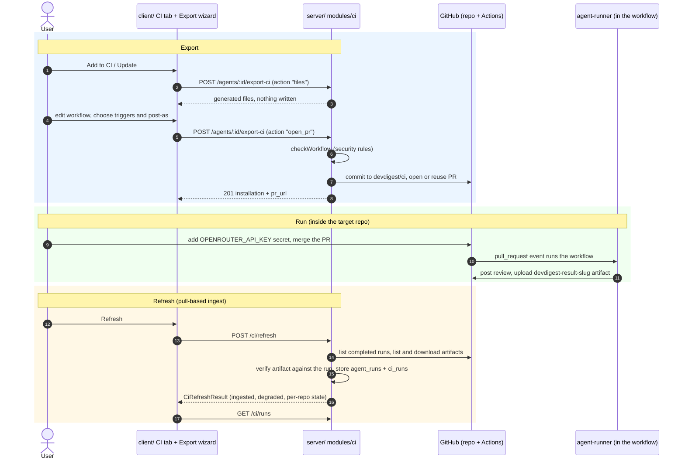

# Export to CI

Run a studio agent as a required check in a target repository's GitHub Actions, and pull
the results back into the local studio. Spec: [`../specs/export-to-ci.md`](../specs/export-to-ci.md).
Module internals: [`../server/src/modules/ci/README.md`](../server/src/modules/ci/README.md).
Runner: [`../agent-runner/README.md`](../agent-runner/README.md).

The studio is local, so GitHub cannot call it. Results travel **pull-based**: the workflow uploads
a result artifact, and the user presses **Refresh** to ingest it.

## Flow

## What is exported

`action: "files"` returns the file list with no GitHub call and no DB write. `open_pr` publishes
the same files as one commit on branch `devdigest/ci` and opens a PR (or reuses the open PR of
that branch). Paths (constants in `server/src/modules/ci/domain/constants.ts`):

| File | Source | Editable in Preview |
|---|---|---|
| `.devdigest/agents/<slug>.yaml` | agent manifest built from the agent | no |
| `.devdigest/skills/<skill-slug>.md` | linked **and enabled** skills of the agent | no |
| `.devdigest/memory.jsonl` | empty file | no |
| `.devdigest/runner/index.js` | built `agent-runner/dist/index.js` | no |
| `.github/workflows/devdigest-review-<slug>.yml` | generated hardened workflow | yes |

The slug is derived from the agent name (`^[a-z0-9][a-z0-9-]{0,39}$`) and is fixed per
(agent, repository) once exported. Only `target: "gha"` and agents on the `openrouter` provider
can be exported. The runner bundle must be built first: `cd agent-runner && pnpm build`
(otherwise `500 runner_bundle_missing`).

## Workflow security rules

Every workflow, generated or edited in the wizard, passes `checkWorkflow` before any GitHub
call; a violation is `422 workflow_insecure` with `details.rule`. Order (first broken rule wins):

| Rule id | Requirement |
|---|---|
| `invalid_yaml` | at most 64 KiB (checked before parsing), valid YAML, a map with at least one job |
| `forbidden_trigger` | only `pull_request`, with types from `opened` / `synchronize` / `reopened` |
| `permissions` | top level exactly `contents: read` + `pull-requests: write`; no job-level write except `pull-requests`; no `write-all` / `read-all` |
| `secrets` | only `secrets.OPENROUTER_API_KEY` and `secrets.GITHUB_TOKEN`; no job `secrets:` (`inherit`) |
| `unpinned_action` | every `uses:` is `owner/repo[/path]@<40-hex SHA>`; local actions rejected |
| `fork_guard` | every job has `if: github.event.pull_request.head.repo.full_name == github.repository` |
| `untrusted_expression` | no PR title, body, head ref/label, `github.head_ref`, comment, or whole-event dump inside any expression or `if:` |

The generated workflow also checks out the PR head SHA with `persist-credentials: false`, uses
only `pull_request` (never `pull_request_target`), and uploads the result artifact with
`if: always()`. The export PR body names the secret but never contains a secret value. The studio
never holds `OPENROUTER_API_KEY` for CI: the user adds it as a repository Actions secret.

The studio's GitHub token needs classic scopes `repo` + `workflow`, or fine-grained Contents,
Workflows and Pull requests write; otherwise `422 github_permission_denied`.

## Result artifact and ingest

The runner writes `devdigest-result.json` (artifact `devdigest-result-<slug>`, `version: "2"`):
counts and metadata only, never finding text; fields are listed in the runner README.
Refresh (`POST /ci/refresh`, one agent or all) per installation:

1. List the newest 30 completed `pull_request` runs of the workflow file. A 404 means the
   workflow is not on the default branch yet: state `not_installed`.
2. Skip runs already stored (`github_run_id` + `run_attempt`) and runs concluded `skipped` /
   `cancelled`.
3. List the run's artifacts, take the newest named `devdigest-result-<slug>`. Expired or over
   1 MiB (zip) is skipped; the entry limit is 64 KiB, enforced before inflating.
4. Verify the artifact against GitHub's facts about the run: `commit_sha` = run head SHA,
   `repository_id` = run repository id, run workflow path = the installation's workflow file.
   A mismatch is skipped (`artifact_mismatch`); nothing is stored for a skipped run.
5. Store one `agent_runs` (source `ci`) + one `ci_runs` row in one transaction. A completed run
   with no artifact is stored as `failed`. Status is `succeeded` / `no_findings` by findings count;
   the verdict is `blocked` when `blockers > 0`, else `passed`.

A refresh has a 45 s budget; installations not reached report `not_checked` and the result is
`degraded`. GitHub failures per installation become `github_permission_denied`,
`github_rate_limited` or `github_unavailable`; error text is never logged or returned.

## UI

- Agent editor, **CI** tab: installations (repo, last run, deployed manifest version, **outdated**
  badge when the agent moved past it), Add / Update (opens the wizard), Refresh, newest 20 runs,
  and the "Fail CI on" policy.
- Export wizard, four steps: Target (repo) → Preview (generated files, workflow editable;
  changing an option regenerates it, an edit locks the options) → Configure (triggers, post as)
  → Install (open the PR, or download a zip built in the browser).
- `/ci-runs` (nav: CI Runs): all CI runs with Refresh. Agent names, models and repo names render
  as plain text; run links are only `http(s)`.

Client code: `client/src/lib/hooks/ci.ts` (hooks), `client/src/lib/ci-runs.ts` (formatting, safe
links, refresh failures), `client/src/app/agents/[id]/_components/AgentEditor/_components/CiTab/`,
`client/src/app/ci-runs/`.

## Not verified yet

- A live run from a fork PR (spec AC38) was not exercised against real GitHub.
- Ingest accepts a run `path` with an `@ref` suffix by comparing the part before `@` to the
  workflow file; that GitHub reports the path this way is an assumption, not confirmed live.
