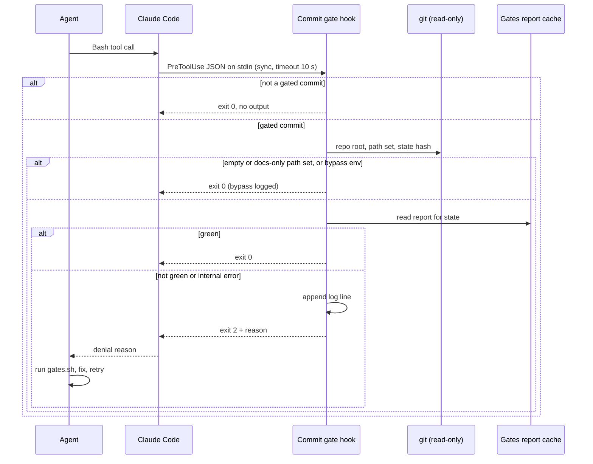

# Commit test gate — deterministic PreToolUse hook
Spec: 2026-10-15-commit-test-gate · Modules: harness (`.claude/`, `scripts/`), no package · Status: ready-for-planning
Design sources: request text (stretch task "PreToolUse hook — a deterministic gate in the harness"); template examples `upstream/evals-example:.claude/settings.json` and `.claude/settings.json` + `.claude/hooks/engineering-insights.py`; `scripts/gates.py`; Claude Code hooks docs https://code.claude.com/docs/en/hooks (read 2026-10-15; installed Claude Code 2.1.300).
Related: `docs/pr-self-review-plan.md` §9 — a planned review gate on push/PR, deliberately not installed (`.claude/skills/pr-self-review/SKILL.md:21`). This spec is a test gate on commit; it neither implements nor supersedes §9.

## 1. Goal
Evals measure probabilistic behaviour against a threshold; some rules must hold every time. One deterministic PreToolUse command hook shall block any `git commit` issued by Claude Code (main session or subagent) unless the cached gates report for the current working-tree state shows green tests for every package the commit touches. The block reason tells the agent what to run. Blocks are logged locally, and one real catch is documented: evals for the probabilistic, hooks for the critical.

## 2. Context
- Existing hooks: Python `command` hooks, fail-open on any internal error (`.claude/hooks/engineering-insights.py:153-158`, `.claude/settings.json:14-37`).
- Template 1 is a `prompt` hook (an LLM decision) with `matcher: "Bash(git push*)"`. The docs say `matcher` matches tool names only (argument patterns go in `if`), so this matcher never fires. `git push*` is already denied (`.claude/settings.json:11`).
- `gates.sh` caches `.devdigest/gates/<state>.json`; state = HEAD + `git diff HEAD` + untracked, `*.md` excluded (`scripts/gates.py:2-18,41-52`). Entry `exit`: 0 pass, non-zero fail, null skipped (`:180-193`). Test gates: `server:unit`, `client:test`, `reviewer-core:test`, `mcp:test`; `e2e` has typecheck and lint only (`:72-100`). `--only`/`--packages` produce partial reports (`:159-178`). `client:test` takes about 89 s (`.devdigest/gates/latest.json`).
- Docs: stdin carries `tool_name`, `tool_input.command`, `cwd`, `session_id`, `agent_type` (subagents). Exit 2 blocks, and stderr becomes Claude's reason. Exit 0 with no output = no decision. Other exit codes and timeouts do not block without `onFailure: "block"`. Subagent calls fire the hook too. `if` is best-effort for Bash.
- `.devdigest/` is ignored per subdirectory (`.gitignore:16-20`). `python3` is 3.9.21.

## 3. Scope
### In scope
The hook and its registration; a local block log; the hook's tests; one documented real caught case.
### Out of scope
- The hook never runs gates, tests or package scripts itself.
- No `prompt`-type hook or LLM call takes part in the decision.
- The pr-self-review push/PR gate (`docs/pr-self-review-plan.md` §9) is not installed or changed.
- No git-native hook (`pre-commit`, `core.hooksPath`) is added; commits a human makes outside Claude Code are not gated (`--no-verify` is irrelevant: the gate lives in Claude Code, not git).
- `git merge`, `cherry-pick`, `revert`, `rebase`, `am`, `stash` are not gated (D5).
- git started from another interpreter or a script file (`python -c`, `node -e`, `./x.sh`) is not detected.
- `scripts/gates.py` behaviour and its report format are unchanged.
- No source file of `server`, `client`, `reviewer-core`, `e2e` or `mcp` changes.

## 4. User scenarios
- US1 — As the developer, every commit Claude makes carries green tests, whatever the model decides.
- US2 — As an agent, a blocked commit tells me which gates are missing or failing and the exact command, so I fix and retry.
- US3 — As the developer, I can let Claude commit without gates (WIP) through an escape hatch the agent cannot set.
- US4 — As the course reviewer, I can read one real caught case.

## 5. Functional requirements
- FR1 — A PreToolUse `command` hook in project `.claude/settings.json`, matcher `Bash`, shall inspect every Bash call; the existing hooks and `permissions` stay unchanged. (US1)
- FR2 — A call is a **gated commit** when any simple command in it is git with subcommand `commit` or `commit-tree`. Detection covers `&&`/`||`/`;`/`|`/newline, leading `VAR=value`, `cd x && …`, global options (`-C`, `-c`, `--git-dir`, `--work-tree`, `--no-pager`), a path to git, `$(…)`/backticks, the argument of `sh -c`/`bash -c`/`eval`, and aliases that expand to `commit` (`-c alias.X=` or git config). (US1)
- FR3 — Quoted arguments of other commands (`grep "git commit"`) and other git subcommands (`log --grep commit`, `commit-graph`) shall be allowed unchecked. (US1)
- FR4 — An unparseable command containing the words `git` and `commit` is a gated commit. (US1)
- FR5 — **Path set** = staged paths + tracked changes with `-a`/`--all` (incl. `-am`) + explicit pathspecs, in the repo of `-C`, the `cd` target or `cwd`. A `commit-tree` call is never docs-only. (US1)
- FR6 — An empty path set (message-only `--amend`, `--allow-empty`), or one where every path ends in `.md`, shall be allowed. (US1)
- FR7 — Otherwise allow only if the report for the current state (equal to `./scripts/gates.sh --state` in that repo root) exists and: (a) no gate has a non-zero `exit`; (b) `root:drift` has exit 0; (c) every package with a non-`.md` path in the set has its test gate at exit 0 (`server:unit`, `client:test`, `reviewer-core:test`, `mcp:test`; `e2e:typecheck` for `e2e`). Paths outside packages need (a)+(b) only. Null (skipped) gates do not fail (a). (US1)
- FR8 — A block shall exit 2 with the §7 reason on stderr, naming the missing/failing gates and the command to run. (US2)
- FR9 — An allow shall exit 0 with empty stdout; the hook never emits `allow`, so the permission flow and deny rules still apply. (US1)
- FR10 — When the hook's own environment (inherited from the Claude Code process) has `DEVDIGEST_COMMIT_GATE=off`, gated commits are allowed and logged `bypassed`; the variable set inside the command text has no effect. (US3)
- FR11 — An internal error before a call is identified as a gated commit shall allow it; an error after identification (git failure, unreadable report) shall block with `internal-error`. (US1)
- FR12 — Every block, bypass and internal error shall append one JSON line (§8) to a git-ignored log under `.devdigest/`; allows are not logged. (US4)
- FR13 — After real sessions, repo docs shall hold ≥ 1 real caught case taken from the log (§8 format), a 3–5 line eval-vs-hook note, the §9 distinction and the residual risks (EC9, EC11). (US4)
- FR14 — Automated tests shall feed fake PreToolUse JSON on stdin against temporary git repos with fixture reports and assert exit code and stderr; one command from the repo root runs them, python3 stdlib only. (US1)

## 6. Workflow and communication

Claude Code → hook: synchronous, once per Bash call. If the hook crashes, times out or `python3` is missing, Claude Code lets the call proceed (docs). The hook only reads from git and the report.

## 7. Contracts
**Input** (stdin JSON): `tool_name` string (only `Bash` acted on), `tool_input.command` string, `cwd` string, `session_id` string, `agent_type` string optional.
**Registration**: event `PreToolUse`, matcher `Bash`, no `if`, type `command`, timeout 10 s, no `onFailure`.
**Output**: allow = exit 0, empty stdout. Block = exit 2, stderr ≤ 1,200 chars:
```
commit-gate: BLOCKED (<reason>) state <hash>
packages: <comma list | none>
missing: <gate ids | none> · failing: <gate ids | none>
run: ./scripts/gates.sh [--packages <list>] — then retry the commit. Do not bypass this gate.
```
`<reason>`: `no-report` (no report for the state) · `missing-test-gate` (FR7 b/c gate absent) · `gates-failed` (a gate exit ≠ 0) · `internal-error`. `--packages` appears when the report lacks a package.
**Env**: `DEVDIGEST_COMMIT_GATE=off` → bypass; unset or any other value → enforce.
**Report read** (existing, unchanged): `.devdigest/gates/<state>.json`, `gates.<id>.exit` int | null.

## 8. Data model (logical)
- **Gate log entry** (append-only, local, git-ignored, never pruned or committed): `ts` ISO-8601 with offset, `session_id`, `agent_type` | null, `decision` blocked | bypassed | internal-error, `reason`, `state`, `packages[]`, `missing[]`, `failing[]`, `command` (first 500 chars).
- **Caught case** (curated doc): date, task, agent (main or subagent type), command attempted, verbatim hook reason, agent's next action, outcome, lesson.
- The green decision is derived per call from the report; the hook caches nothing.

## 9. States and UX
n/a — no UI; the agent-facing block message is specified in §7.

## 10. Edge cases
- EC1 — Files edited after gates ran → new state, no report → `no-report` (FR7).
- EC2 — Partial report (`--only client:lint`) for a commit touching client → `missing-test-gate`, `--packages client` (FR7).
- EC3 — Partial staging with other non-`.md` changes unstaged → the tested state includes them; allowed when the whole state is green (accepted limitation, D4) (FR7).
- EC4 — Flaky failed gate in the report → `gates-failed`; the next `gates.sh` re-runs only failed gates (`scripts/gates.py:11-14`) (FR7).
- EC5 — Commit in a git worktree of this repo → judged against that worktree's own report; a repo that is not this project or its worktree (e.g. `server/clones/*`) → allowed (FR5).
- EC6 — `git commit` that concludes a merge → gated like any commit (FR5).
- EC7 — `DEVDIGEST_COMMIT_GATE=off git commit …` typed by the agent → still blocked (FR10).
- EC8 — Repeated retries without running gates → each blocked and logged; no lockout (FR12).
- EC9 — Hook timeout or missing `python3` → call proceeds (docs); residual risk, documented (FR13).
- EC10 — A subagent (e.g. implementer) commits → gated identically; log has `agent_type` (FR1).
- EC11 — Agent edits `.claude/settings.json` or the hook to disable the gate → not prevented here; documented residual risk (D6) (FR13).

## 11. Non-functional requirements
- NFR1 — Latency: non-commit calls ≤ 150 ms p95, with no git subprocess; a commit decision ≤ 2 s on this repo.
- NFR2 — Determinism: same command, repo state and report → same decision; no network, LLM or clock in the decision.
- NFR3 — Security: the command text is untrusted data; it is never executed or passed to a shell; git runs with argument vectors only.
- NFR4 — Portability: python3 ≥ 3.9, standard library only.
- NFR5 — Privacy: log is local and git-ignored, command truncated to 500 chars, no environment values recorded.

## 12. Dependencies and rollout
No shared-contract or persisted-data change. Depends on the gates report format and gate ids; a rename makes commits block (`missing-test-gate`), never pass. Needs a `.gitignore` entry for the log directory. Order: hook tests green → register → verify in a fresh session (AC20) → work sessions → document the case (AC14). No feature flag beyond the FR10 escape hatch.

## 13. Acceptance criteria
- AC1 — Given the new settings, when parsed, then PreToolUse has one `command` handler with matcher `Bash`, timeout 10 s, and the other hooks and `permissions` are byte-identical to before. Traces: FR1 · Verify: unit
- AC2 — Given no report, when each FR2 form runs (`git commit -m x`, `cd s && git commit -am x`, `git -C s commit`, `FOO=1 git commit`, `/usr/bin/git commit`, `bash -c "git commit"`, `git -c alias.ci=commit ci`, `git commit-tree`), then each exits 2. Traces: FR2 · Verify: unit
- AC3 — Given `grep "git commit" f`, `echo git commit`, `git log --grep commit`, `git commit-graph write`, then each exits 0 with empty stdout and starts no git process. Traces: FR3, NFR1 · Verify: unit
- AC4 — Given `git commit -m "x` (unbalanced quote), then exit 2. Traces: FR4 · Verify: unit
- AC5 — Given only `.md` staged, or `-am` with only `.md` modified, or `--amend` with nothing staged, then exit 0 without reading a report; given `-am` with a modified `.ts`, then gated. Traces: FR5, FR6 · Verify: unit
- AC6 — Given a report for another state only, when committing a server file, then exit 2, reason `no-report`, current state in line 1. Traces: FR7, EC1 · Verify: unit
- AC7 — Given a report with `client:test` exit 1, then exit 2, `gates-failed`, `failing: client:test`. Traces: FR7, EC4 · Verify: unit
- AC8 — Given a report without `server:unit`, when committing a server file, then `missing-test-gate`, `missing: server:unit`, `--packages server`. Traces: FR7, EC2 · Verify: unit
- AC9 — Given a green report incl. `root:drift` and the package test gate, then exit 0 with empty stdout. Traces: FR7, FR9 · Verify: unit
- AC10 — Given any block, then stderr follows the 4-line §7 format and is ≤ 1,200 chars. Traces: FR8 · Verify: unit
- AC11 — Given `DEVDIGEST_COMMIT_GATE=off` in the hook env, then exit 0 and one `bypassed` log line; given it only inside the command text, then exit 2. Traces: FR10, EC7 · Verify: unit
- AC12 — Given a forced internal error on `ls`, then exit 0; given a corrupt report JSON on a gated commit, then exit 2, `internal-error`. Traces: FR11 · Verify: unit
- AC13 — Given a block with a 2,000-char command, then the log gains one JSON line with all §8 fields, `command` length 500, no env values, and `git check-ignore` reports the log path ignored. Traces: FR12, NFR5 · Verify: unit
- AC14 — Given real sessions, then a docs page holds ≥ 1 caught case with all §8 fields matching a real log line, the eval-vs-hook note, the §9 distinction and the EC9/EC11 risks. Traces: FR13, EC9, EC11 · Verify: manual
- AC15 — Given a clean checkout with python3 3.9, when the single test command runs, then all hook tests pass with no package installed. Traces: FR14, NFR4 · Verify: unit
- AC16 — Given a green whole-tree state, when staging one of two changed `.ts` files and committing, then exit 0. Traces: EC3 · Verify: unit
- AC17 — Given a worktree with its own green report, then its commit exits 0 while the main tree has none; given an unrelated repo, then exit 0. Traces: EC5 · Verify: unit
- AC18 — Given a merge in progress and no report, when `git commit --no-edit`, then exit 2. Traces: EC6 · Verify: unit
- AC19 — Given three blocked attempts in a row, then three `blocked` log lines. Traces: EC8 · Verify: unit
- AC20 — Given a fresh session on a red state, when a subagent runs `git commit`, then the commit is refused, the agent sees the reason, and the log line has `agent_type`. Traces: EC10, FR1, FR8 · Verify: manual
- AC21 — Given 50 non-commit calls and 10 gated commits, then p95 ≤ 150 ms and ≤ 2 s respectively. Traces: NFR1 · Verify: manual
- AC22 — Given `git commit -m "$(touch <tmp>/pwn)"`, then `<tmp>/pwn` does not exist and 3 runs give the same decision. Traces: NFR2, NFR3 · Verify: unit

## 14. Traceability
| Source | Module | FR | EC / NFR | AC |
|---|---|---|---|---|
| Request "test gate before commit", US1 | harness | FR1–FR7, FR9, FR11 | EC1–EC6, EC10, NFR1–NFR3 | AC1–AC9, AC12, AC16–AC18, AC20–AC22 |
| US2 | harness | FR8 | — | AC10, AC20 |
| US3 | harness | FR10 | EC7, NFR5 | AC11, AC13 |
| Request "document a caught case", US4 | harness, docs | FR12, FR13 | EC8, EC9, EC11 | AC13, AC14, AC19 |
| Template 2 conventions | harness | FR14 | NFR4 | AC15 |

## 15. Design review
| # | Gap / proposal | Source | Module | Decision |
|---|---|---|---|---|
| G1 | Matcher `Bash`, not template 1's `Bash(git push*)` | docs | harness | accepted |
| G2 | Command hook, not a probabilistic prompt hook | request | harness | accepted |
| G3 | Own detection, not the best-effort `if` | docs | harness | accepted |
| G4 | `onFailure: "block"` blocks every Bash call on a crash | docs | harness | rejected |
| G5 | Cache vs in-hook tests; staged snapshot; more subcommands; deny edits; tests in gates | §2 | harness | accepted (D3–D7) |

## 16. Decisions
- D1 — Spec location → root `specs/`, as harness tooling (caller, 2026-10-15).
- D2 — Gate type → deterministic `command` hook, not `prompt` (request, 2026-10-15).
- D3 — Source of "green" → the cached gates report only; the hook never runs tests (user, 2026-10-15).
- D4 — Whole tree or staged snapshot → whole-tree gates state; the partial-commit gap is accepted and documented (EC3) (user, 2026-10-15).
- D5 — Gated subcommands → `commit` and `commit-tree` only (user, 2026-10-15).
- D6 — Self-protection of settings/hook files → none; recorded as a residual risk (EC11) (user, 2026-10-15).
- D7 — Hook tests in `gates.sh` → no; standalone single command (user, 2026-10-15).
- D8 — Escape hatch → `DEVDIGEST_COMMIT_GATE=off` in Claude Code's launch environment (user, 2026-10-15).
- D9 — Fail mode → open until a commit is identified, closed after (FR11) (user, 2026-10-15).
- D10 — Locations → log under `.devdigest/commit-gate/`; tests beside the hook; caught case on a root `docs/` page linked from `.claude/agents/README.md` (user, 2026-10-15).

## 17. Open questions
None — all resolved in §16 (D3–D10).
