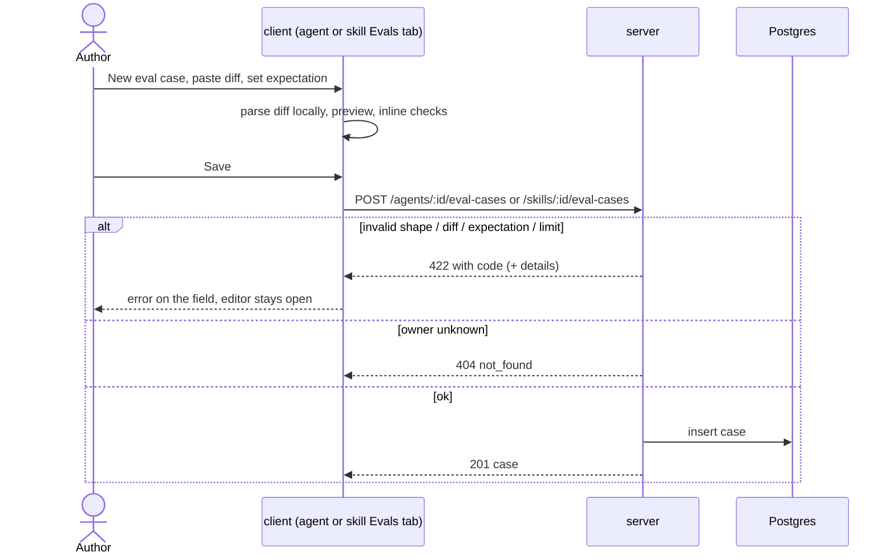
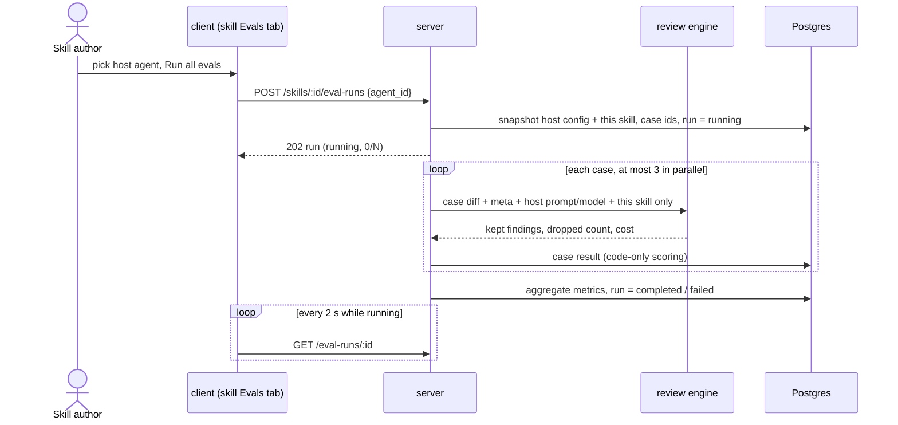

# Case Editor — manual eval cases for agents and skills
Spec: 2026-10-15-eval-case-editor · Modules: server, client · Status: ready-for-planning
Design sources: request text (stretch task "Case Editor"); screenshots from `specs/briefs/eval-pipeline/` — [S5] `05-agent-evals-tab.png` (Evals tab: "New eval case" primary button next to "Run all evals"), [S6] `06-eval-case-modal.png` (modal "Eval case · <name>": Name*, Input tabs Diff / Files / PR meta, Expected output JSON + "Finding skeleton", last-run banner, "Run on save", Cancel · Run case · Save); unused copy in `client/messages/en/eval.json` (`caseEditor.*`, `evalsTab.*`). User answers 2026-10-15 (section 16). Code at `f385adc` + working tree.
Related: `specs/eval-pipeline.md` — delta on its FR4–FR7, FR11, FR12, FR13, FR17, FR18, FR21, FR22 and §7; supersedes its Out-of-scope lines "No manual New eval case from scratch" and "No skill-owned eval cases", the "manual new case" part of its D4 and its Q1 (kind not editable). `specs/2026-10-15-eval-metric-trends.md` unaffected. `server/specs/03-skills.md` (legacy) gains an Evals tab here.

## 1. Goal
"Turn into eval case" only captures what an agent has already found or flagged. Bugs the agent has never seen — another team's incident, an edge case from a colleague's review — cannot become cases, and skills cannot be evaluated at all. An author shall create and edit eval cases from scratch for an agent or a skill: paste a diff fragment with a live diff preview, choose the expectation kind, file and line range. Agent cases join the agent's set and run through the existing agent run; skill cases run through a skill run that reuses the same pipeline on a chosen host agent with only that skill attached. The dataset grows from two sources: past decisions and predicted failures.

## 2. Context
Server paths under `server/src/modules/evals/`.
- Cases come only from a decided finding; PATCH edits name, notes, lines; the 200-case limit (`eval_case_limit`) and 200 000-char diff limit (`patch_too_large`) sit in the from-finding path (`http/routes.ts:43-76`, `application/eval-cases-service.ts:29-69`, `domain/case-builder.ts:66-110`).
- The runner reads expectation, input diff and input meta only; it sends the diff, `pr_description`, a task line from `pr_number` + `pr_title`, and the snapshot's prompt, model, strategy and rendered skill blocks (`application/run-executor.ts:215-235`, `domain/run-input.ts:138-147`). Scoring matches file + line intersection only (`domain/scoring.ts:34`).
- A run snapshot = agent version, provider, model, system prompt, strategy and the agent's enabled linked skills (name, description, body, version) (`infrastructure/agent-snapshots.ts:21-48`). Skills reach a review only as `### <name>` blocks in the prompt (`modules/skills/domain/skill.ts:82-94`), linked to agents many-to-many (`server/src/db/schema/agents.ts:64-80`); live reviews use the same blocks (`modules/reviews/application/run-executor.ts:345`).
- Runs belong to an agent: one running run per agent, deleted with the agent (`server/src/db/schema/eval.ts:75-102`). Owner kind `skill` exists on cases, but no route creates, lists or runs skill cases; skill deletion only deletes skill-owned cases (`routes.ts:24-36`, `modules/skills/application/skills-service.ts:154-158`).
- `EvalCaseInputMeta` requires `pr_title`, `repo`, `pr_number` (`vendor/shared/contracts/eval-pipeline.ts:70-76`). The diff parser drops hunks before any `+++` header; new-side lines = `+` and context lines (`server/src/adapters/git/diff-parser.ts:32-78`).
- Client: the agent Evals tab has no create entry and a read-only diff (`EvalsTab/EvalsTab.tsx:68-100`, `EvalCaseModal/EvalCaseModal.tsx:106-117`); the skill editor has tabs Config, Context, Preview, Versions, Stats (`client/src/app/skills/[id]/_components/SkillEditor/SkillEditor.tsx:31-43`); `caseEditor.*` keys are unused; a diff viewer with line highlight exists (`client/src/components/diff-viewer/DiffViewer/DiffViewer.tsx:16-31`); the vendored Modal has no Escape handling (`client/INSIGHTS.md:28`). No MCP tool reads eval routes (`grep eval mcp/src`).

## 3. Scope
### In scope
- Create eval cases from scratch for an agent (agent Evals tab) or a skill (new skill Evals tab); edit every field of any case; delete via the existing flow.
- Skill runs: a skill's whole case set executed on a chosen host agent with only that skill, with progress, metrics and history on the skill page.
- Server-side validation shared with the from-finding path (size, case limit) plus diff and expectation checks.
### Out of scope
- No "Run case" (single-case run) and no "Run on save" toggle.
- No raw JSON "Expected output" editor and no "Finding skeleton" button; one structured expectation per case.
- No multi-expectation cases (one kind + one file + one line range per case).
- No conversion of pasted plain code (without `@@` hunk headers) into a diff.
- No import of cases from files, URLs, GitHub or other repositories.
- Skill cases and skill runs do not appear on `/eval` (overview, agent view, recent runs) and are not started by "Run all agents".
- No compare dialog and no trend chart on the skill page.
- "Turn into eval case" still creates agent cases only.
- No change to scoring, metrics, the regression alert or the agent dashboard.
- No LLM call is made to create, validate or preview a case.

## 4. User scenarios
- US1 — As an agent author, I click "New eval case", paste a diff fragment, see it rendered as a diff, set the expectation and save, so that a bug the agent never saw becomes a regression case.
- US2 — As an author, I open any case and change its diff, expectation or PR meta, so that the case stays correct, and I still see when a case from a finding was edited.
- US3 — As an agent author, I run all evals and manual cases are executed, scored and compared like finding-derived ones.
- US4 — As a skill author, I add eval cases to a skill, run them on an agent of my choice with only this skill attached, and see recall, precision, citation accuracy and history per skill version.

## 5. Functional requirements
- FR1 [server] — The system shall create a case for an agent or a skill from a request with name, optional notes, expectation (kind, file, start/end line, optional severity, category, title), input diff and optional PR title/description; it has no source finding/review/PR (US1, US4).
- FR2 [server] — A pasted diff without any file header (`diff --git` / `+++`) shall be stored as a single-file diff for the expectation's file; a diff with headers is stored as given (any number of files); CRLF line endings are stored as LF (US1).
- FR3 [server] — Create, and every edit that changes the diff, file or lines of any case, shall reject: a stored diff > 200 000 characters (`patch_too_large`), a diff with no file containing a hunk (`diff_invalid`), an expectation file not among the diff's files (`expectation_file_not_in_diff`), a line range intersecting no new-side line of that file (`expectation_lines_not_in_diff`); create rejects a 201st case of the owner (`eval_case_limit`) (US1, US2).
- FR4 [server] — A blank or missing PR title shall be stored as the case name; repository, PR number and head commit of a manual case are null (US1).
- FR5 [server] — Every case returned shall carry `origin`: `manual` when it has no source finding, else `finding` (US1, US2).
- FR6 [server] — PATCH of any case (manual, finding-derived, skill) shall accept kind, file, severity, category, title, input diff, PR title and PR description in addition to name, notes and lines; FR2–FR4 apply to the merged values; merged end < start stays 400 `validation_error` (US2).
- FR7 [server] — An eval run shall execute manual cases with the same fixed inputs and scoring as finding-derived ones; when the PR number is null the task line names the PR title only (no number) (US3).
- FR8 [client] — The agent Evals tab header shall show a primary "New eval case" button after "Run all evals" ([S5]); the empty state and the "Run all evals" disabled tooltip shall mention both sources (findings on a PR and "New eval case") (US1).
- FR9 [client] — "New eval case" shall open the case editor: Name* (1–120), Notes, Expectation (kind Must find / Must not flag, File*, Start line*, End line*, Severity, Category, Title), Input with tabs Diff (monospace text area) and PR meta (title, description), a live Preview, Cancel and Save (US1, US4).
- FR10 [client] — The preview shall render the pasted diff with the app's existing diff viewer, updated within 300 ms of the last keystroke, with the expectation's line range highlighted; when the diff has file headers the File field offers the diff's files (first preselected); without headers the preview uses the typed file path (US1).
- FR11 [client] — The editor shall show inline, before saving: "no hunk found", file not in diff, lines outside the diff, end < start, and a character counter "N / 200 000"; Save is disabled while any of these holds or a required field is empty. Server errors of FR3 are shown on the matching field (US1, US2).
- FR12 [client] — On save success the editor closes, the case list shows the new case first with status "never run"; in the agent list manual cases carry a "manual" tag, finding-derived rows do not (US1).
- FR13 [client] — Opening any case shall show the editor prefilled with all fields editable, its latest result and Delete; a finding-derived case also shows "From a finding" (US2).
- FR14 [client] — Closing the editor (Cancel, close button, Escape) with unsaved changes shall ask "Discard changes?"; without changes it closes at once (US1, US2).
- FR15 [server] — A case shall carry `content_edited_at`: null at creation, set at the first PATCH that changes kind, file, lines, severity, category, title, diff or PR meta, never cleared; source ids are kept unchanged (US2).
- FR16 [client] — A finding-derived case shall show an "edited" marker in its row and editor when `content_edited_at` is set; manual and skill cases show none (US2).
- FR17 [server] — The system shall list a skill's cases newest first, each with its result in the latest finished skill run that contained it, or "never run" (US4).
- FR18 [server] — Starting a skill run shall take a host agent id of the same workspace and snapshot: the host agent's version, name, provider, model, system prompt and strategy, and this skill's name, description, body and version as the only skill (the host's own linked skills are excluded); then persist the run as `running`, return it immediately and execute the skill's cases with the agent-run executor, concurrency, timeout, scoring, aggregation and progress (US4).
- FR19 [server] — Skill run start shall be rejected when the skill has no cases (`no_eval_cases`), already has a `running` run (`eval_run_active`), or the host agent is unknown or of another workspace (`host_agent_not_found`) (US4).
- FR20 [server] — The system shall list a skill's runs newest first (`limit` 1–100, default 20); the single-run read (results, progress) serves skill runs too (US4).
- FR21 [server] — Agent-scoped reads and actions (agent case list, agent runs list, agent dashboard, overview, recent runs, run-all, the `last_result` of agent cases) shall exclude skill cases and skill runs; compare accepts two finished runs of the same owner only (`runs_not_comparable` otherwise) (US3, US4).
- FR22 [server] — Deleting a skill shall delete its cases and runs; deleting an agent shall also delete the skill runs it hosted (the skill's cases stay); skill runs left `running` at server stop are marked `failed` "interrupted" at the next start (US4).
- FR23 [client] — The skill editor shall have an "Evals" tab: tiles recall, precision, citation accuracy, cases passed of the latest finished run with deltas vs the previous finished run; the case list with "New eval case" and "Run all evals"; a "Run with" agent picker defaulting to the first agent that uses the skill, else the first agent by name; progress "Running x / N"; run history rows with skill version ("v3"), host agent name, model, metrics, cases passed, cost (US4).
- FR24 [client] — On the skill Evals tab "Run all evals" shall be disabled with a reason when there are 0 cases ("Add an eval case first") or no agent in the workspace ("Create an agent first") (US4).

## 6. Workflow and communication

- client → server calls are synchronous except the run execution (background). On a failed save the client keeps the form and re-enables Save; 404 on edit → "This case no longer exists"; polling failure → retry notice, the run continues (eval-pipeline §6). Case failures inside a skill run follow eval-pipeline EC10.

## 7. Contracts
Both `@devdigest/shared` copies change; the existing error envelope carries `code` and `details`.

- Case `AgentEvalCase` (name kept, now used for both owners) gains `owner_kind: "agent" | "skill"`, `owner_id: string`, `origin: "finding" | "manual"` (derived), `content_edited_at: ISO string | null`; `agent_id` becomes `string | null` (null for skill cases).
- `EvalCaseInputMeta.repo: string | null`, `EvalCaseInputMeta.pr_number: int | null` (were non-null); `pr_title: string` stays required.
- `EvalRunSummary` gains `owner_kind: "agent" | "skill"`, `skill_id: string | null`, `skill_version: int | null`, `agent_name: string`; for a skill run `agent_id`, `agent_version`, `model` describe the host agent.
- `EvalErrorCode` gains `diff_invalid`, `expectation_file_not_in_diff`, `expectation_lines_not_in_diff`, `host_agent_not_found`.

**`EvalCaseCreateInput`**: `{name: string 1–120 (trimmed, non-empty), notes?: string | null, expectation: {kind: "must_find" | "must_not_flag", file: string 1–1000, start_line: int ≥ 1, end_line: int ≥ start_line, severity?: "CRITICAL" | "WARNING" | "SUGGESTION" | null, category?: "bug" | "security" | "perf" | "style" | "test" | null, title?: string ≤ 300 | null}, input_diff: string 1–200 000, input_meta?: {pr_title?: string ≤ 300 | null, pr_description?: string ≤ 20 000 | null}}`.

**`AgentEvalCaseUpdateInput`** (extended, all optional): `name`, `notes`, `start_line`, `end_line` plus `kind`, `file`, `severity`, `category`, `title`, `input_diff`, `pr_title`, `pr_description` with the create limits.

| Method · path | Request | Response | Errors |
|---|---|---|---|
| POST `/agents/:id/eval-cases` (new) | `EvalCaseCreateInput` | 201 case (`owner_kind: "agent"`, `origin: "manual"`, null source ids, `last_result: null`) | 404 `not_found`; 422 `validation_error` (shape, incl. end < start), `patch_too_large`, `diff_invalid`, `expectation_file_not_in_diff` (`details.files`: the diff's paths, ≤ 50), `expectation_lines_not_in_diff` (`details.ranges`: `[{start, end}]`), `eval_case_limit` |
| POST `/skills/:id/eval-cases` (new) | `EvalCaseCreateInput` | 201 case (`owner_kind: "skill"`, `agent_id: null`) | as above |
| GET `/skills/:id/eval-cases` (new) | — | 200 `{cases}` newest first | 404 |
| PATCH `/eval-cases/:id` (extended) | `AgentEvalCaseUpdateInput` | 200 case | 404; 422 `validation_error` (shape); 400 `validation_error` (merged end < start); 422 `patch_too_large`, `diff_invalid`, `expectation_file_not_in_diff`, `expectation_lines_not_in_diff` |
| POST `/skills/:id/eval-runs` (new) | `{agent_id: uuid}` | 202 `EvalRunSummary` (running) | 404 (skill); 409 `eval_run_active`; 422 `no_eval_cases`, `host_agent_not_found`, `validation_error`; 429 (shared limit 10/min/workspace) |
| GET `/skills/:id/eval-runs` (new) | `?limit` 1–100, default 20 | 200 `{runs}` newest first | 404 |
| GET `/eval-runs/:id`, GET `/eval-runs/compare` | unchanged | serve both owners | compare of different owners → 422 `runs_not_comparable` |
| agent case/run lists, dashboards, run-all | unchanged | agent-owned rows only | unchanged |

- Line numbers are new-side (post-change) numbers, as for findings.
- Consumers: the client case lists, editor, run history and dashboards; no MCP tool or other package reads these routes. Legacy `EvalCase` / `EvalRunRecord` contracts are unchanged.

## 8. Data model (logical)
- **Eval case** (existing): owned by an agent or a skill; manual cases have no source finding/review/PR and meta with repo/PR number/head commit null; gains "content edited at". Deleted with its owner or by the user.
- **Eval run** (existing, extended): owned by an agent or a skill. A skill run holds the skill id and the snapshot of the skill (name, description, body, version) and of its host agent (id, name, version, provider, model, system prompt, strategy); it is deleted with its skill or its host agent. At most one running run per owner.
- Derived, not stored: `origin`, the diff's file list and new-side ranges, skill tile deltas.

## 9. States and UX
| Screen / element | Loading | Empty | Error | Degraded | Success | Notes |
|---|---|---|---|---|---|---|
| "New eval case" (agent and skill tab) | disabled while cases load | enabled at 0 cases | enabled when cases failed to load | disabled at 200 cases, tooltip "Limit of 200 eval cases reached" | opens editor | [S5] |
| Case editor | Save spinner "Saving…", form disabled | new: empty form, placeholder diff `caseEditor.diffPlaceholder` | server error on the field, or form-level message | — | closes, list refreshed | [S6] minus Run case / Run on save / JSON |
| Preview | — | "Paste a unified diff to preview it" | "No hunk found — paste a diff with @@ headers" | header-less diff, no file typed: "Enter the file path to preview" | diff with expectation lines highlighted | |
| Case row | — | — | — | — | "manual" tag (agent list), "edited" marker (FR16) | |
| Skill Evals tab — tiles | skeleton | "No runs yet" | error + Retry | metric "—" when null | values with deltas | |
| Skill Evals tab — cases | skeleton rows | "No eval cases yet — add one with New eval case" | error + Retry | — | rows as on the agent tab | |
| Skill Evals tab — Run with / Run all evals | picker disabled while agents load | disabled + reason (FR24) | toast with error text | — | "Running x / N", disabled until done | |
| Skill Evals tab — run history | skeleton | "No runs yet" | error + Retry | failed run row shows "Failed" | rows (FR23) | |

- Pasted diff, PR meta, title, notes and skill text are rendered as plain text.

## 10. Edge cases
- EC1 [server] — Header-less hunks pasted with file `src/a.ts` → stored diff starts with a `src/a.ts` file header and parses to that file (FR2).
- EC2 [server] — Multi-file `git diff` pasted, expectation on the second file → accepted, all files stored and sent to the engine (FR2).
- EC3 [server] — Text with no `@@` header or only a deleted-file diff (`+++ /dev/null`) → 422 `diff_invalid` (FR3).
- EC4 [server] — Range only in deleted lines or beyond the hunks → 422 `expectation_lines_not_in_diff` with the file's ranges (FR3).
- EC5 [server] — File typed as `b/src/a.ts` or with a different letter case → 422 `expectation_file_not_in_diff` listing the paths (FR3).
- EC6 [server] — Hunk header counts that do not match the lines present → accepted; new-side numbers follow the lines present (FR2).
- EC7 [server] — Owner at 200 cases → 422 `eval_case_limit`; the check also applies to cases from findings (FR3).
- EC8 [server] — Agent or skill of another workspace or deleted → 404 (FR1).
- EC9 [client] — Double click on Save → exactly one create request (Save disabled while pending) (FR11).
- EC10 [server] — Case created or edited while its owner has a running run → allowed; a new case is not in that run; an edited case not yet executed runs with the content stored at its execution start (FR7).
- EC11 [server] — Case edited after it ran → earlier results and `last_result` stay as recorded (FR6).
- EC12 [server] — CRLF diff pasted → stored with LF; line numbers unchanged (FR2).
- EC13 [server] — Name of spaces only → 422 `validation_error` (FR1).
- EC14 [server] — Line-only PATCH of a finding-derived case to a range outside its diff → 422 `expectation_lines_not_in_diff` (FR3, FR6).
- EC15 [server] — Skill edited during its run → the run uses its snapshot and records the old skill version (FR18).
- EC16 [server] — Disabled skill or disabled host agent → skill run allowed (FR18).
- EC17 [server] — Host agent links other skills → only the evaluated skill is in the run (FR18).
- EC18 [server] — Host agent unknown or of another workspace → 422 `host_agent_not_found` (FR19).
- EC19 [server] — Host agent deleted → the skill runs it hosted are deleted, the skill's cases stay (FR22).
- EC20 [server] — A skill run is running with host agent A → agent A's own run can start; agent A's dashboard does not show the skill run (FR21).

## 11. Non-functional requirements
- NFR1 [client] — Pasted diff, PR title/description, title, notes and skill text are rendered as plain text; no HTML or markdown is interpreted (eval-pipeline NFR7) (FR10, FR13, FR23).
- NFR2 [server] — All new routes are workspace-scoped; a case, agent or skill of another workspace is a 404, never a 403 (`routes.ts:37`) (FR1, FR6, FR18).
- NFR3 [server] — Diff content, PR text, notes and skill bodies are never written to logs; one info line per case created (case id, owner kind, owner id, diff length); skill runs log start/end lines as agent runs plus skill id, skill version, host agent id (FR1, FR18).
- NFR4 [client] — Preview of a 200 000-character diff updates within 300 ms of the last keystroke without blocking typing for more than 100 ms per keystroke (FR10).
- NFR5 [client] — The editor is keyboard-operable: focus moves to Name on open, returns to the opener on close, Escape triggers FR14 (the vendored Modal does not, `client/INSIGHTS.md:28`); every field and the "Run with" picker have a label; errors are announced with the field (FR9, FR14, FR23).
- NFR6 [client] — All new strings come from the `en` message files; the existing unused `caseEditor.*` keys are the intended copy where they fit (FR8, FR9, FR23).
- NFR7 [server] — Validation of FR2–FR3 is deterministic code; a create or edit makes zero LLM calls (FR3).
- NFR8 [server] — Skill run start shares the run start limit of 10 per minute per workspace with agent runs (429 beyond) (FR18).

## 12. Dependencies and rollout
- Shared contract change: yes — case owner fields, `origin`, `content_edited_at`, nullable `agent_id`, `repo`, `pr_number`; run owner fields and `agent_name`; create input; extended update input; four error codes; both copies, drift check green. Response fields must exist in the shared contract, or the route's response schema strips them (`server/INSIGHTS.md:68`).
- Persisted data change: yes — runs gain an owner (agent or skill) with the skill snapshot; cases gain "content edited at"; migration required (`pnpm db:migrate`, not run on boot). Existing runs become agent-owned; existing cases get null "content edited at".
- No feature flag. Server and client ship together (the client reads the new fields and nullable meta).

## 13. Acceptance criteria
- AC1 [server] — Given an agent, when POST `/agents/:id/eval-cases` with a header-less hunk, file `src/a.ts`, lines inside the hunk and kind `must_find`, then 201 returns `origin: "manual"`, `owner_kind: "agent"`, null source ids, `last_result: null`, `content_edited_at: null`, `input_meta.pr_title` = name, null repo/PR number, and `input_diff` that parses to one file `src/a.ts`. Traces: FR1, FR2, FR4, FR5, EC1 · Verify: integration
- AC2 [server] — Given a two-file `git diff` with CRLF endings and an expectation on the second file, when POST, then 201 and the stored diff has both files and no `\r`. Traces: FR2, EC2, EC12 · Verify: integration
- AC3 [server] — Given POST bodies with 200 001 characters / plain code without `@@` / a `+++ /dev/null` only diff / file `b/src/a.ts` / lines only on deleted lines, then 422 `patch_too_large` / `diff_invalid` / `diff_invalid` / `expectation_file_not_in_diff` with `details.files` / `expectation_lines_not_in_diff` with `details.ranges`. Traces: FR3, EC3, EC4, EC5 · Verify: integration
- AC4 [server] — Given an agent with 200 cases, when POST, then 422 `eval_case_limit` and still 200 cases. Traces: FR3, EC7 · Verify: integration
- AC5 [server] — Given an agent or skill of another workspace or an unknown id, when POST, then 404 `not_found`; given name "   " or end < start, then 422 `validation_error`. Traces: FR1, NFR2, EC8, EC13 · Verify: integration
- AC6 [server] — Given hunk headers whose counts do not match the lines present, when POST with lines on a present `+` line, then 201. Traces: EC6 · Verify: unit
- AC7 [server] — Given a manual case, when PATCH `input_diff`, `file` and lines together to a valid new diff, then 200 with the new values; when PATCH only `file` to a path not in the stored diff, then 422 `expectation_file_not_in_diff`; when PATCH `pr_title: ""`, then `pr_title` = name. Traces: FR6, FR3, FR4 · Verify: integration
- AC8 [server] — Given a finding-derived case, when PATCH `{kind: "must_not_flag"}`, then 200 with the new kind, unchanged `source_finding_id` and `content_edited_at` set; a later PATCH keeps the first `content_edited_at`; a PATCH of only `name` on another case leaves `content_edited_at` null; a line-only PATCH outside its diff gives 422 `expectation_lines_not_in_diff`. Traces: FR6, FR15, EC14 · Verify: integration
- AC9 [server] — Given cases listed for an agent with one finding-derived and one manual case, then their `origin` is `finding` and `manual`. Traces: FR5 · Verify: integration
- AC10 [server] — Given an agent with 2 finding-derived and 2 manual cases and an LLM double that returns a finding matching one manual `must_find` case, when a run completes, then `cases_total: 4`, the manual case is `passed` and metrics include the manual cases. Traces: FR7 · Verify: integration
- AC11 [server] — Given an LLM double that records its input, when a manual case without PR description runs, then the input contains the case diff and its PR title, contains no PR number and no "null", and has no PR description block. Traces: FR7 · Verify: integration
- AC12 [server] — Given a run is running, when a case is created for its owner, then 201 and the running run's `cases_total` is unchanged; given a case that ran and is then edited, then its `last_result` is unchanged. Traces: EC10, EC11 · Verify: integration
- AC13 [server] — Given an LLM double that throws on any call, when cases are created and edited, then all requests succeed and the double records 0 calls; the log has one line per created case with id, owner and diff length and no diff text. Traces: NFR7, NFR3 · Verify: integration
- AC14 [client] — Given the agent Evals tab with cases, then "New eval case" appears after "Run all evals"; with 0 cases the empty text mentions findings and "New eval case"; with 200 cases the button is disabled with the limit tooltip. Traces: FR8 · Verify: component
- AC15 [client] — Given the editor, when a header-less hunk is pasted and file `src/a.ts`, lines 11–12 are entered, then within 300 ms the preview shows `src/a.ts` with lines 11–12 highlighted; when a two-file diff is pasted, the File field offers both paths with the first selected. Traces: FR9, FR10, NFR4 · Verify: component
- AC16 [client] — Given the editor, when the diff has no `@@`, or lines are outside the hunks, or end < start, or the text exceeds 200 000 characters, then the matching inline message shows and Save is disabled. Traces: FR11 · Verify: component
- AC17 [client] — Given the server answers 422 `expectation_lines_not_in_diff`, when Save is clicked, then the message is shown at the line fields and the form keeps its content; given a double click on Save, then one POST is sent. Traces: FR11, EC9 · Verify: component
- AC18 [client] — Given a successful save on the agent tab, then the editor closes and the list shows the case first with "never run" and a "manual" tag; finding-derived rows have no tag. Traces: FR12 · Verify: component
- AC19 [client] — Given a finding-derived case with `content_edited_at` set, when opened, then all fields including the diff and kind are editable, "From a finding" and "edited" are shown, and its row shows "edited"; a manual case shows no "edited" marker. Traces: FR13, FR16 · Verify: component
- AC20 [client] — Given an edited form, when Escape or Cancel is pressed, then "Discard changes?" is asked and confirming closes it; given an untouched form, Escape closes at once and focus returns to "New eval case". Traces: FR14, NFR5 · Verify: component
- AC21 [client] — Given a diff, PR title, notes and skill name containing ``, when previewed, reopened and shown in the skill run history, then the text is shown literally and no `img` element exists. Traces: NFR1 · Verify: component
- AC22 [client] — Given the editor and skill Evals tab rendered with a test message bundle, then no visible string is hard-coded, and every field and the "Run with" picker have an accessible label. Traces: NFR6, NFR5 · Verify: component
- AC23 [manual] — Given the seeded app, when a manual `must_find` case is created from a pasted incident diff for the Security Reviewer and "Run all evals" is clicked, then the case shows passed or failed with the run, and the compare view lists it. Traces: FR7, FR12 · Verify: manual
- AC24 [server] — Given a skill, when POST `/skills/:id/eval-cases` with a valid body, then 201 with `owner_kind: "skill"`, `agent_id: null`; GET `/skills/:id/eval-cases` lists it with `last_result: null`, and the agent case lists do not contain it. Traces: FR1, FR17, FR21 · Verify: integration
- AC25 [server] — Given a skill with 3 cases and host agent A that links 2 other skills, and an LLM double that records its input, when POST `/skills/:id/eval-runs {agent_id: A}`, then 202 `owner_kind: "skill"`, `skill_id`, `skill_version`, `agent_id: A`, `agent_name`, `cases_total: 3` within 500 ms; polling ends `completed` with 3 results; every recorded input has A's system prompt and model and exactly one skill block, the evaluated skill's. Traces: FR18, FR20, EC17 · Verify: integration
- AC26 [server] — Given a skill run running, when the skill body is changed, then the run's snapshot keeps the old body and version and the next run records the new version; given a disabled skill and disabled host agent, then a run starts with 202. Traces: EC15, EC16, FR18 · Verify: integration
- AC27 [server] — Given a skill with 0 cases / with a running run / a host agent of another workspace, when POST `/skills/:id/eval-runs`, then 422 `no_eval_cases` / 409 `eval_run_active` / 422 `host_agent_not_found`; an unknown skill gives 404. Traces: FR19, EC18 · Verify: integration
- AC28 [server] — Given two finished runs of a skill, then GET `/skills/:id/eval-runs` returns them newest first and GET `/skills/:id/eval-cases` shows each case's result from the newer one. Traces: FR20, FR17 · Verify: integration
- AC29 [server] — Given agent A with its own run and a skill run hosted by A, then A's runs list, A's dashboard, the overview, recent runs and run-all ignore the skill run; A's own run starts while the skill run is running; compare of the skill run with A's run gives 422 `runs_not_comparable`. Traces: FR21, EC20 · Verify: integration
- AC30 [server] — Given a skill with cases and runs, when the skill is deleted, then its cases and runs are gone; given host agent A of a skill run, when A is deleted, then that skill run is gone and the skill's cases remain; given a skill run `running` at server start, then it becomes `failed` "interrupted". Traces: FR22, EC19 · Verify: integration
- AC31 [server] — Given 10 agent run starts and 1 skill run start within one minute in one workspace, then the skill run start gets 429; a skill run writes one start and one end log line with skill id, skill version and host agent id and no skill body or diff. Traces: NFR8, NFR3 · Verify: integration
- AC32 [client] — Given a skill used by agent B and a workspace with agents A and B, when the skill Evals tab opens, then the tab exists after the existing tabs, "Run with" preselects B, tiles show the latest run with deltas, and run history rows show skill version, host agent name, model, metrics and cost. Traces: FR23 · Verify: component
- AC33 [client] — Given the skill Evals tab, when "Run all evals" is clicked, then the button shows "Running x / N" and is disabled until the run finishes, after which tiles and rows refresh; with 0 cases or no agents it is disabled with "Add an eval case first" / "Create an agent first". Traces: FR23, FR24 · Verify: component
- AC34 [client] — Given the skill Evals tab, when "New eval case" is used and saved, then the case appears first in the skill's list with "never run" and no "manual" tag. Traces: FR9, FR12, FR23 · Verify: component

## 14. Traceability
| Source (request / design frame / US) | Module | FR | EC / NFR | AC |
|---|---|---|---|---|
| "form … paste a diff, expectation type, file, line range" / [S6] / US1 | server | FR1–FR5 | EC1–EC8, EC12, EC13, NFR2, NFR3, NFR7 | AC1–AC6, AC9, AC13 |
| "…and editing" / D4 / US2 | server, client | FR6, FR13, FR15, FR16 | EC11, EC14 | AC7, AC8, AC12, AC19 |
| "same set, same route" / US3 | server | FR7 | EC10 | AC10–AC12, AC23 |
| "New eval case" button / [S5] | client | FR8, FR12 | — | AC14, AC18 |
| "DiffView preview" / [S6] | client | FR9–FR11, FR14 | EC9, NFR1, NFR4–NFR6 | AC15–AC17, AC20–AC22 |
| Skill cases and runner / D3 / US4 | server, client | FR17–FR24 | EC15–EC20, NFR8 | AC24–AC34 |

## 15. Design review
| # | Gap / proposal | Source | Module | Decision |
|---|---|---|---|---|
| 1 | Header-less hunks are dropped by the parser → unpassable case | `diff-parser.ts:62,78` | server | accepted (default) — FR2 |
| 2 | Expectation outside the diff; meta needs repo/PR number | Context | server, client | accepted — D5, D6 |
| 3 | [S6] JSON expected output, Finding skeleton, Run case, Run on save | [S6] | client | rejected — eval-pipeline D4; structured single expectation |
| 4 | [S6] "Files" tab | [S6] | client | accepted as the diff's file list (File picker, FR10) |
| 5 | Pasted diff lost on misclick; origin invisible in the list | gap register | client | accepted (default) — FR14, FR12 |
| 6 | Duplicate manual cases have no natural key | gap register | server | accepted — no server dedup; Save disabled while pending (EC9) |
| 7 | A skill is prompt text, not a reviewer → needs a base agent to run | `agent-snapshots.ts:21-48`, `skill.ts:82-94` | server | accepted (default) — host agent with only this skill (D3, Q10) |
| 8 | Skill runs stored per agent would leak into the host agent's dashboard | `eval.ts:75-102` | server | accepted — run owner, FR21 |
| 9 | Provenance after editing a finding-derived case | D4 | server, client | accepted (default) — source ids kept + "edited" marker (FR15, FR16) |

## 16. Decisions
- D1 — Entry point → a "New eval case" button for agents in the Evals tab, as in [S5] (request, 2026-10-15).
- D2 — Manual cases live in the same case set and run through `POST /agents/:id/eval-runs` (request, 2026-10-15).
- D3 — Q1 skill cases → in scope for agents and skills, and skill cases must be runnable through a skill run that reuses the agent run pipeline; results on the skill page (user, 2026-10-15). Proposed run base: chosen host agent + only this skill (Q10).
- D4 — Q2 editability → finding-derived and manual cases are both fully editable; `eval_case_locked` dropped; provenance = kept source ids + "edited" marker (user, 2026-10-15).
- D5 — Q3 → reject with 422 when the expectation lines miss the diff's changed lines; applied to every edit touching diff, file or lines of any case, including line-only edits (user, 2026-10-15; line-only extension chosen by the spec: finding-derived lines already lie in their grounded hunk, so the rule only blocks edits that would make a case unpassable). This replaces the Q5 default.
- D6 — Q4 → `input_meta.repo` / `pr_number` nullable (user, 2026-10-15).
- D7 — Q5–Q9 → defaults kept unless changed by D3–D5 (user, 2026-10-15).

## 17. Open questions
- ~~Q1–Q4~~ — answered, see D3–D6. ~~Q5~~ — replaced by D5.
- Q6 — Block content edits while the owner has a running run? — default: no (EC10).
- Q7 — Reset `last_result` after a content edit? — default: no (EC11).
- Q8 — Offer "treat pasted code as a new file" when no `@@` header exists? — default: no (Out of scope).
- Q9 — Text limits: title / PR title ≤ 300, PR description ≤ 20 000, file ≤ 1 000 characters; notes unbounded as today — default as stated (§7).
- Q10 — Skill run base: host agent with only the skill (prompt, model, strategy of the agent) vs a bare skill-only reviewer with a selectable model? — default: host agent with only the skill (reuses snapshot and executor; measures the skill on a real reviewer).
- Q11 — Show skill runs on `/eval`? — default: no, skill page only.
- Q12 — Keep skill runs when their host agent is deleted? — default: no, deleted with the host agent (same lifetime rule as agent runs).
