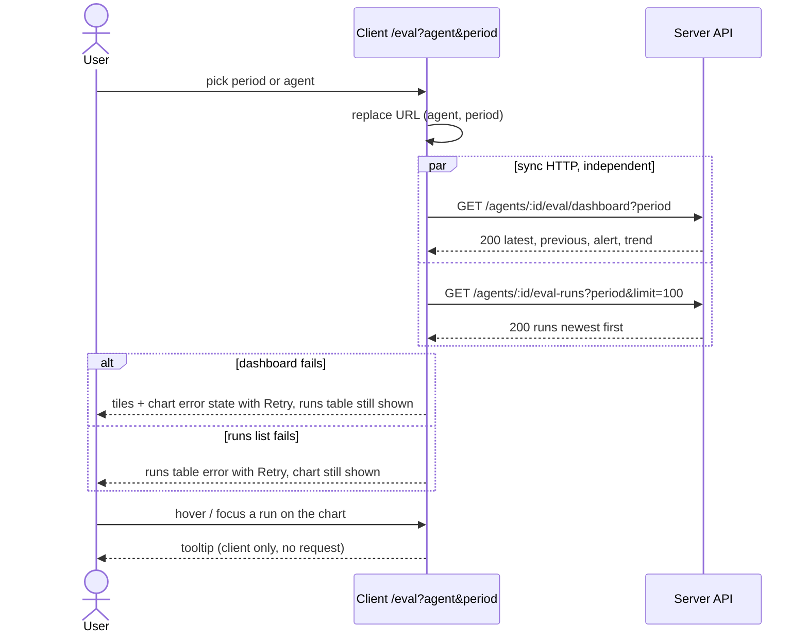

# Eval metric trends and dashboard mockup parity
Spec: 2026-10-15-eval-metric-trends · Modules: server, client · Status: ready-for-planning
Design sources: request text ("Metric trend charts", "match the mockups exactly"); mockups [M3] `3.png` `/eval` overview, [M4] `4.png` `/eval?agent=<id>`, [M5] `5.png` picker open. Code at `f385adc`.
Related: `specs/eval-pipeline.md` — delta on its FR14, FR15, FR23, FR24 and §9; supersedes only its exclusion of the "30 days" filter (its D4). Everything else stays valid.

## 1. Goal
Comparing two runs shows a jump, not the dynamics: precision slowly degrading version to version is only visible on a chart. The per-agent trend chart becomes the primary signal ("CI as a trend" — dynamics first, thresholds later): one point per run over a chosen period, a tooltip with prompt version and cost; `/eval` overview and agent view match [M3]–[M5].

## 2. Context
Paths under `client/src/app/eval/_components/` unless noted.
- Overview = agents table; subtitle "Recall, precision and citation accuracy of every agent's eval cases" (`AgentsOverview/AgentsOverview.tsx:22-40`, `client/messages/en/eval.json:206`).
- Agent view: no model badge, subtitle "N eval cases · gold set · N runs", icon-less picker, "Configure eval cases →", "Run eval (N)", four tiles incl. Cases passed, no period control (`AgentEvalView/AgentEvalView.tsx:49-86`, `eval.json:5-7`; excluded by `eval-pipeline.md` D4).
- Trend chart: y 0–100 % with gridlines 0/50/100 %, a dot per run and metric, tooltip without cost, legend below (`AgentEvalView/_components/TrendChart/constants.ts:6`, `TrendChart.tsx:39-56`).
- Trend = last 20 finished (completed or failed) runs, oldest first; contract caps it at 20; runs list has `?limit` 1–100 and no time filter; `cost_usd` exists on every run (`server/src/modules/evals/domain/dashboard.ts:30-33`, `infrastructure/run-queries.ts:16,35-48`, `client/src/vendor/shared/contracts/eval-pipeline.ts:130,163-165,255`).
- Runs table has a MODEL column, text metrics, locale dates (`client/src/components/eval-run-history/RunsTable.tsx:169-182`, `helpers.ts:6-9`). Tile delta "▲ +4pt", tiles shared with the Evals tab (`eval.json:93-95`, `EvalsTab.tsx:13`). Banner = title + list "Precision ▼ −2pt" (`eval.json:247-250`).
- `/eval` view state lives in the URL (`EvalDashboardView/EvalDashboardView.tsx:1-4`); the sparkline primitive marks its last point (`client/src/vendor/ui/charts/Sparkline.tsx:21-25`); no MCP tool reads eval routes (grep `mcp/src`).

## 3. Scope
### In scope
- Period filter end to end; trend chart redesign with run tooltip; agent view header, tiles, banner, runs table; overview cards, subtitle and recent runs table — all per [M3]–[M5].
### Out of scope
- The AgentEditor Evals tab is unchanged (keeps "▲ +4pt" deltas and the Cases passed tile).
- No thresholds, target lines or pass/fail gating on the chart.
- The banner names no cause: the clause "a new false positive slipped in" from [M4] is not rendered.
- No custom date range; only the four presets of FR4.
- The trend chart has no x-axis labels, zoom, pan or data export.
- `GET /eval/dashboard` (overview) is not period-filtered.
- No change to scoring, run storage, the regression threshold (0.02) or the compare dialog.
- No persisted data change and no migration.
- No LLM call is added.

## 4. User scenarios
- US1 — As an agent author, I see recall, precision and citation accuracy of every run of an agent in a period as lines, so that I spot slow degradation across versions.
- US2 — As an agent author, I hover or focus a run on the chart and see its version, date, metrics and cost.
- US3 — As an agent author, I switch the period (7 / 30 / 90 days / all time) and the chart, sparklines and runs table follow.
- US4 — As a reviewer, I scan agent cards on `/eval` and open one agent with one click.

## 5. Functional requirements
- FR1 [server] — The agent dashboard shall accept an optional `period` (`7d`, `30d`, `90d`, `all`); with it, `trend` = finished runs started within the last N × 24 h of server time (`all`: no bound), the newest 100 at most, oldest first; without it, behaviour is unchanged (last 20 finished runs). (US1, US3)
- FR2 [server] — `latest`, `previous`, `alert` and `cases_total` shall not depend on `period`. (US1)
- FR3 [server] — The runs list shall accept the same optional `period` and return only runs (any status) started within it, newest first, capped by `limit`. (US3)
- FR4 [client] — The agent view shall have a period control (calendar icon + label) with options "7 days", "30 days", "90 days", "All time", default "30 days", kept in the URL as `period` next to `agent`; switching agent keeps the period. It scopes the trend chart, tile sparklines, runs table (up to 100 rows) and the subtitle run count. (US3)
- FR5 [client] — The trend panel shall show a trend icon and "METRIC TREND" at top left and the legend at top right: "Recall", "Precision", "Citation", each with a short line swatch (recall blue accent, precision green, citation orange). One point per finished run of the period, oldest left, newest right, equally spaced; consecutive defined values are joined by a line. (US1)
- FR6 [client] — The y axis shall top at 1.0 with a gridline and a label every 0.1, labels as one-decimal numbers ("1.0" … "0.6"); the bottom is 0.6 when every plotted value ≥ 0.6, else the largest multiple of 0.1 not above the lowest plotted value (minimum 0.0). (US1)
- FR7 [client] — Only the newest point of each series shall be drawn as a dot; other points have no marker until their run is hovered or focused. (US1)
- FR8 [client] — Hovering or keyboard-focusing a run shall show a vertical guide, a dot on each series at that run and one tooltip: "v<version>", run date, Recall / Precision / Citation as whole percent ("—" when null), and cost ("$0.23"; "—" when null); a failed run's tooltip also says "Failed". (US2)
- FR9 [client] — The agent view shall show exactly three tiles: RECALL, PRECISION, CITATION ACCURACY — value as whole percent with a smaller muted "%", delta vs the previous finished run as arrow + two-decimal ratio ("↑ 0.04" green, "↓ 0.02" red, "→ 0.00" muted; the difference of the shown percents ÷ 100), and the period's sparkline at top right in the series colour. (US1)
- FR10 [client] — The regression banner (eval-pipeline FR15) shall be one line: bold "<Metric> dipped <N>pts" (several metrics joined with "and"), then "on v<latest version> —", then a sentence on the other non-null metrics ("Recall and citation both up." / "Recall up, citation unchanged."), omitted when no such metric remains. (US1)
- FR11 [client] — The agent view header shall show "‹ All agents"; the agent name with a monospace model badge (agent's current model); subtitle "Regression harness · <R> runs on the <C>-trace gold set" (R = runs in the period, C = case count); at right, in order: agent picker, period control, primary "Run eval" with a play icon (running: "Running x / N"). The existing "Configure eval cases →" link to the agent's Evals tab stays, as a text link in the title block (outside the toolbar). (US1, US3)
- FR12 [client] — The agent picker trigger shall show an agent icon, the current agent name and a chevron; each option shows the agent icon before the name ([M5]). (US1)
- FR13 [client] — The agent runs table shall have columns: checkbox, RAN AT, VERSION, RECALL, PRECISION, CITATION, PASS, COST; each metric cell is a horizontal bar (fill = value, series colour) plus whole percent; VERSION is "v7" in accent colour; PASS is bold "17/20" ("Running x / N" while running, "Failed" when failed); no MODEL column. Its heading row shows "RECENT RUNS", the caption "Select two runs to compare" and a secondary "Compare" button with icon at right. (US1)
- FR14 [client] — The overview shall show subtitle "Regression harness across all reviewer agents · pick an agent to see its runs" and section headings "AGENTS" (agent icon) and "RECENT EVAL RUNS · ALL AGENTS" (clock icon). (US4)
- FR15 [client] — The overview shall show one card per agent: agent icon tile, name, model badge, "Last run v<version> · <date> · <passed>/<total> pass" ("Never run" without a finished run), recall sparkline (≥ 2 points), labelled RECALL / PREC / CITE as large whole percents in blue / green / orange ("—" when null), and a chevron; the whole card is one link to `/eval?agent=<id>`. (US4)
- FR16 [client] — The overview recent runs table shall show per row: agent name (bold), ran at, version (accent), recall / precision / citation bars with percent, pass "17/20"; no model or cost column; column headers exist for assistive technology but are visually hidden. (US4)
- FR17 [client] — Run dates on `/eval` (cards, tables, tooltip) shall be local time `YYYY-MM-DD HH:mm`, 24 h, monospace. (US2, US4)

## 6. Workflow and communication

- Both GETs run on open and on period/agent change; each section fails independently (error + Retry); 404 keeps the existing error state. Run start/polling unchanged (eval-pipeline FR24); a finished run refreshes both and becomes the newest point.

## 7. Contracts
Shared contracts change in **both** `@devdigest/shared` copies (additive):
- New enum `EvalPeriod`: `"7d" | "30d" | "90d" | "all"`.
- `EvalAgentDashboard.trend`: max length raised from 20 to 100 (oldest first).

| Method · path | Request | Response | Errors |
|---|---|---|---|
| GET `/agents/:id/eval/dashboard` | `?period` optional `EvalPeriod` | 200 `EvalAgentDashboard` — `trend` ≤ 20 without `period`, ≤ 100 with it; `latest`, `previous`, `alert`, `cases_total` independent of `period` | 404 `not_found`; 422 `validation_error` (unknown `period`) |
| GET `/agents/:id/eval-runs` | `?limit` 1–100 (default 20), `?period` optional `EvalPeriod` | 200 `{runs: EvalRunSummary[]}` newest first, runs started within the period | 404 `not_found`; 422 `validation_error` (bad `limit` or `period`) |

- Period window: `started_at ≥ now − N × 24 h` (server clock, UTC); `all` = no lower bound.
- Consumers: `/eval` agent view (sends `period`); AgentEditor Evals tab (sends none — unaffected). No MCP consumer.

## 8. Data model (logical)
n/a — no persisted change; the period is a read filter and a URL parameter.

## 9. States and UX
| Screen / element | Loading | Empty | Error | Degraded | Success | Notes |
|---|---|---|---|---|---|---|
| Overview agent cards | skeleton | existing "No eval runs yet" | existing error + Retry | never run: "Never run", metrics "—", no sparkline | cards per FR15 | [M3] |
| Overview recent runs | with cards | "No runs yet." | with cards | metric null: empty bar + "—" | rows per FR16 | [M3] |
| Agent header + toolbar | title skeleton | — | picker disabled when agents fail | model badge hidden when unknown | FR11, FR12 | [M4], [M5] |
| Metric tiles | skeleton | "No runs yet" (existing) | error + Retry | "—", no delta, sparkline hidden < 2 points | FR9 | [M4] |
| Trend chart | skeleton | "No finished runs in the last <period>" | with tiles | 1 run: one dot per series; null values: gaps | FR5–FR8 | [M4] |
| Runs table | skeleton rows | "No runs in this period" | error + Retry | running row not selectable | FR13 | [M4] |

## 10. Edge cases
- EC1 [client] — Runs exist but none finished in the period → tiles show the latest run; chart shows its empty text naming the period; the "All time" option stays available (FR2, FR4).
- EC2 [client] — A metric is null for a run (failed run, zero denominator) → gap in that series, "—" in the tooltip; a series with no defined value draws nothing, its legend entry stays (FR5, FR8).
- EC3 [client] — A plotted value below 0.6 → the axis bottom moves down per FR6 and no point is clipped (FR6).
- EC4 [server] — More than 100 finished runs in the period → the newest 100 are returned (FR1).
- EC5 [client] — The runs list returns 100 rows → subtitle reads "100+ runs" (FR11).
- EC6 [client] — Unknown `period` value in the URL → treated as `30d` (FR4).
- EC7 [server] — Unknown `period` on either route → 422 `validation_error` (FR1, FR3).
- EC8 [client] — Long agent name on a card or the header → one line with ellipsis, full name in a native tooltip (FR11, FR15).
- EC9 [client] — Cost null (unpriced model) → "—" in tooltip and COST column (FR8, FR13).

## 11. Non-functional requirements
- NFR1 [client] — The chart is reachable by Tab; ←/→ move between runs, the tooltip content is exposed to screen readers; series are named by legend text and tooltip, not colour alone (eval-pipeline NFR8).
- NFR2 [client] — Agent picker, period control and Run eval render at equal height (difference ≤ 1 px) (`client/INSIGHTS.md:29`).
- NFR3 [client] — Picker and period popups follow the app theme in dark and light (`client/INSIGHTS.md:34`).
- NFR4 [client] — Card names and all text meet WCAG AA contrast 4.5:1 ([M3] renders card names dimmed — not reproduced).
- NFR5 [client] — All new strings come from the `en` message files (eval-pipeline NFR9).
- NFR6 [server] — `GET /agents/:id/eval/dashboard?period=all` with 100 finished runs responds in ≤ 300 ms on the local dev database.

## 12. Dependencies and rollout
- Shared contract change: yes — `EvalPeriod`, `trend` max 100, both copies (`./scripts/check-shared-drift.sh`).
- Persisted data change: no. Feature flag: none.
- Backwards compatible: requests without `period` behave as today. Release server before (or with) client.

## 13. Acceptance criteria
- AC1 [server] — Given 30 finished runs, 25 of them started within 30 days, when GET `/agents/:id/eval/dashboard?period=30d`, then `trend` has 25 runs oldest first; without `period` it has 20. Traces: FR1 · Verify: integration
- AC2 [server] — Given 120 finished runs within 7 days, when `?period=7d`, then `trend` has the newest 100. Traces: FR1, EC4 · Verify: integration
- AC3 [server] — Given the latest two finished runs are older than 7 days, when `?period=7d`, then `latest`, `previous` and `alert` equal the response without `period`. Traces: FR2 · Verify: integration
- AC4 [server] — Given runs inside and outside 30 days incl. one running, when GET `/agents/:id/eval-runs?period=30d&limit=100`, then only runs started within 30 days are returned, newest first, the running one included. Traces: FR3 · Verify: integration
- AC5 [server] — When either route gets `period=14d`, then 422 `validation_error`. Traces: EC7 · Verify: integration
- AC6 [client] — Given `/eval?agent=a1`, then the period control reads "30 days"; when "7 days" is picked, the URL has `period=7d`, and picking another agent keeps it; given `period=bogus`, the control reads "30 days". Traces: FR4, EC6 · Verify: component
- AC7 [client] — Given 5 runs, then the chart shows "METRIC TREND", legend "Recall", "Precision", "Citation" at top right, axis labels "1.0" to "0.6" and exactly one dot per series (the newest). Traces: FR5, FR6, FR7 · Verify: component
- AC8 [client] — Given a run with recall 0.55, then the lowest axis label is "0.5". Traces: FR6, EC3 · Verify: component
- AC9 [client] — Given run v7 with recall 0.82, precision 0.91, citation 0.95 and cost 0.23, when its position is focused by keyboard, then a tooltip shows "v7", its date, "82%", "91%", "95%" and "$0.23"; with cost null it shows "—". Traces: FR8, EC9, NFR1 · Verify: component
- AC10 [client] — Given a failed run with null metrics between two completed runs, then each series has a gap there and its tooltip shows "Failed" and "—". Traces: FR8, EC2 · Verify: component
- AC11 [client] — Given latest recall 0.82 vs previous 0.78 and precision 0.91 vs 0.93, then the tiles show "82%" with "↑ 0.04" and "91%" with "↓ 0.02", and no Cases passed tile. Traces: FR9 · Verify: component
- AC12 [client] — Given an alert for precision −0.02 on v7 with recall and citation up, then the banner reads "Precision dipped 2pts on v7 — Recall and citation both up." with "Precision dipped 2pts" bold. Traces: FR10 · Verify: component
- AC13 [client] — Given agent "Security Reviewer" (gpt-4.1), 20 cases and 5 runs in the period, then the header shows the model badge "gpt-4.1", "Regression harness · 5 runs on the 20-trace gold set", then picker, "30 days", "Run eval" in that order, and a "Configure eval cases →" link to `/agents/<id>?tab=evals`; given 100 runs it says "100+ runs". Traces: FR11, EC5 · Verify: component
- AC14 [client] — When the agent picker opens, then every agent option shows the agent icon and its name. Traces: FR12, NFR3 · Verify: component
- AC15 [client] — Then the agent runs table headers are exactly RAN AT, VERSION, RECALL, PRECISION, CITATION, PASS, COST plus the checkbox column, metric cells have a bar and a percent, and the heading shows "Select two runs to compare". Traces: FR13 · Verify: component
- AC16 [client] — Given 3 agents, then `/eval` shows the new subtitle, 3 cards each a single link to `/eval?agent=<id>` with model badge, "Last run v7 · 2026-05-29 09:14 · 17/20 pass" and RECALL / PREC / CITE; a never-run agent shows "Never run" and "—". Traces: FR14, FR15, FR17 · Verify: component
- AC17 [client] — Then the overview recent runs rows show agent, date, version, three bars with percents and pass, no model or cost, and column headers exist but are visually hidden. Traces: FR16 · Verify: component
- AC18 [client] — Given runs exist but none finished in 7 days, when "7 days" is selected, then tiles show the latest run, the chart says "No finished runs in the last 7 days" and the runs table says "No runs in this period". Traces: EC1 · Verify: component
- AC19 [client] — Given a 120-character agent name, then the card shows it on one line with ellipsis and a native tooltip with the full name. Traces: EC8 · Verify: component
- AC20 [client] — In the running app, dark and light theme: picker, period control and Run eval heights differ by ≤ 1 px, card names meet 4.5:1 contrast, and the layout matches [M3]–[M5]. Traces: NFR2, NFR4 · Verify: manual
- AC21 [client] — No hard-coded user-visible string is added outside the `en` message files (client lint/test gates). Traces: NFR5 · Verify: unit
- AC22 [server] — Given 100 finished runs, `?period=all` responds in ≤ 300 ms on the local dev database. Traces: NFR6 · Verify: manual

## 14. Traceability
| Source | Module | FR | EC / NFR | AC |
|---|---|---|---|---|
| Request: trend, point = run / US1, US3 | server, client | FR1–FR7 | EC1–EC7 | AC1–AC8, AC18 |
| Request: tooltip version + cost / US2 | client | FR8, FR17 | EC2, EC9, NFR1 | AC9, AC10 |
| [M4] tiles, banner, header, table | client | FR9–FR11, FR13 | EC5, EC8, NFR2, NFR4 | AC11–AC13, AC15, AC19, AC20 |
| [M5] picker | client | FR12 | NFR3 | AC14 |
| [M3] overview / US4 | client | FR14–FR17 | EC8, NFR4, NFR5 | AC16, AC17, AC19–AC21 |
| Performance | server | FR1 | NFR6 | AC22 |

## 15. Design review
| # | Gap / proposal | Source | Module | Decision |
|---|---|---|---|---|
| 1 | Agents table → cards; one run tooltip with cost | [M3], request | client | accepted (D1) |
| 2 | Period filter: server filter, trend cap 100 | [M4] | server, client | accepted (D3) |
| 3 | Y axis 0.6–1.0, extends below 0.6 | [M4] | client | accepted (D4) |
| 4 | No tooltip / keyboard access in mockup | [M4] | client | accepted — NFR1 |
| 5 | Banner cause clause needs per-case data | [M4] | client | rejected (D5) |
| 6 | "Configure eval cases" link absent in mockup | [M4] | client | rejected — link kept (D6) |
| 7 | Dimmed card names; overview table without header | [M3] | client | accepted — NFR4, FR16 |
| 8 | Tile delta format diverges from Evals tab | [M4], `eval.json:93` | client | accepted — agent view only (D7) |
| 9 | Flat delta, empty period not in mockup | gap register | client | accepted — FR9, EC1, D8 |

## 16. Decisions
- D1 — Fidelity → match [M3]–[M5] exactly, except where D3–D8 say otherwise (user, 2026-10-15).
- D2 — Spec location → root `specs/` because the period filter changes server routes (specreator, 2026-10-15).

- D3 — Period filter → server `period` param (7d/30d/90d/all, default 30d), ≤ 100 points (user, 2026-10-15, Q1).
- D4 — Y axis → 0.6–1.0, extended downward in 0.1 steps when needed (user, 2026-10-15, Q2).
- D5 — Banner cause clause → not rendered (user accepted default, 2026-10-15, Q3).
- D6 — "Configure eval cases →" → kept on the agent view, overriding [M4] (user, 2026-10-15, Q4).
- D7 — "↑ 0.04" delta format → agent view only; Evals tab unchanged (user accepted default, 2026-10-15, Q5).
- D8 — Flat delta → "→ 0.00" muted (user accepted default, 2026-10-15, Q6).

## 17. Open questions
None — all resolved (D3–D8).
