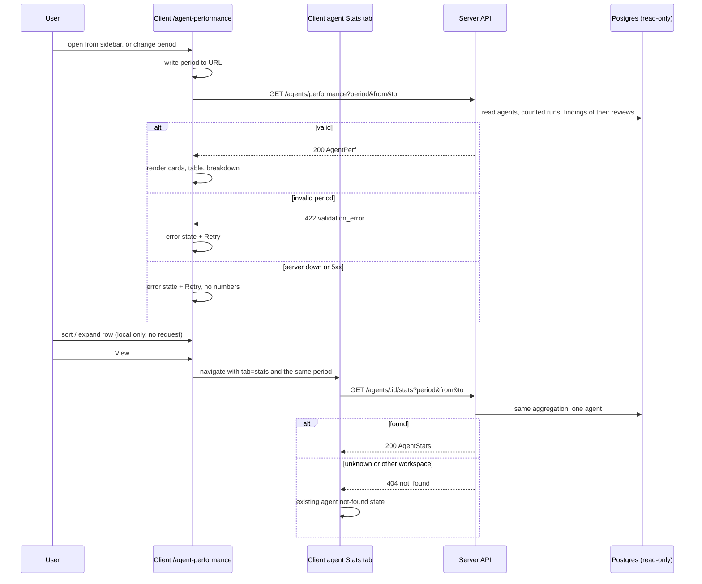

# Agent Performance dashboard and agent Stats tab
Spec: 2026-10-16-agent-performance · Modules: server, client · Status: ready-for-planning
Design sources: request text (lab task "Agent Performance", translated from Ukrainian); design mockup `design/DevDigest Design (standalone).html`, artboards "Agent Performance (N11)" and "Agent Editor · Stats" (decoded screen sources; layout reference only, sample data ignored); reference branch `upstream/reference/full-build` (`server/src/modules/performance/*`, `client/src/app/agent-performance/**`, `AgentStatsTab/**`) as inspiration, not truth.
Related: none of the existing root specs covers this feature. This spec replaces the unused shared contracts `AgentStats` (`contracts/observability.ts:138-161`) and `AgentPerf`/`AgentPerfRow`/`PerfCostSegment` (`contracts/productionize.ts:139-186`).

## 1. Goal
Agent authors cannot see how their review agents perform: there is no per-agent Stats tab and no cross-agent view. This feature adds a per-agent **Stats** tab and a global **Agent Performance** dashboard. Both are computed by one server aggregation over stored runs and findings, for a selected period (last 24 hours, last 30 days or a custom date range). The user can compare runs, estimated cost, duration and accept rate across agents. Every number on the dashboard matches the same agent's Stats tab, and every cost is labelled as a DevDigest estimate. Opening, reloading, sorting or expanding never calls a model.

## 2. Context
- **Runs.** `agent_runs` (`server/src/db/schema/runs.ts:14-57`) is written by:
  - the local review executor, for single-agent and multi-agent runs (`source='local'`; multi-agent children carry `multi_agent_run_id`). Source: `modules/reviews/repository/run.repo.ts:157-175`, `review-service.ts:68-86`.
  - CI ingest (`source='ci'`, status `done|failed`, `ran_at` = GitHub workflow `created_at`, no tokens, no review or findings). Source: `modules/ci/infrastructure/repository.ts:158-174`, `ingest-service.ts:212-258`.
  - the seed: two `done`/`local` runs (`db/seed.ts:330-349`, `db/seed-eval-demo.ts:355-374`).
  - Eval runs never write `agent_runs`; they use `eval_suite_runs`/`eval_runs` (`modules/evals/infrastructure/run-queries.ts:218-295`).
- **`ran_at`** is the row-creation (start) time and is never updated (`runs.ts:23`, research report). There is no finished-at column.
- **Run status.** A run is `running` from creation until it ends.
  - `done` writes `duration_ms`, tokens, `cost_usd`, `findings_count` and the review, in one transaction (`modules/reviews/application/run-executor.ts:414-441`; `server/INSIGHTS.md:52`).
  - `failed`/`cancelled` write the duration, the partial usage and cost, and no review (`run.repo.ts:220-238`).
  - The boot reaper turns leftover `running` rows into `failed` with NULL stats (`run.repo.ts:145-152`).
- **Cost.** `cost_usd` covers every LLM response a run received, including failed and cancelled runs. NULL means unpriced, orphaned, or recorded before cost tracking (`runs.ts:29-32`). It starts at 0 and becomes NULL once any response is unpriced (`modules/reviews/domain/usage-meter.ts:12-19`). Its source is not stored: provider-reported for OpenRouter, a price-book estimate otherwise (`server/src/platform/price-book.ts:7-20`). No reconciled billing data exists anywhere.
- **Findings** link to runs through `reviews.run_id → agent_runs` (cascade) and `findings.review_id` (`db/schema/reviews.ts:45-109`).
  - Accept and dismiss are mutually exclusive, and the last action wins. There is no undo back to "undecided" (`modules/reviews/repository/review.repo.ts:111-133`, `modules/reviews/routes.ts:136-144`).
  - The existing accept rate is `accepted / (accepted + dismissed)`, null when 0, counting all finding kinds (`modules/skills/domain/stats.ts:15-17`, `skills/infrastructure/repository.ts:116-134`).
- **Deleting an agent** sets `agent_runs.agent_id` and `reviews.agent_id` to NULL; the runs and findings stay (`runs.ts:21`, `reviews.ts:55-56`).
- **Workspace** comes from the auth context and never from the request (`modules/_shared/context.ts:14-23`).
- **Missing today.**
  - No `GET /agents/:id/stats` or `GET /agents/performance` route exists (grep, research report).
  - The agent editor tabs are `config, skills, context, evals, ci`, kept in `?tab=`; an unknown tab falls back to config (`client/src/app/agents/[id]/_components/AgentEditorView/constants.ts:1-5`, `AgentEditor/constants.ts:10-16`).
  - The sidebar GLOBAL group has Multi-Agent Review and CI Runs (`client/src/vendor/ui/nav.ts:39-45`).
  - `client/messages/en/agentPerformance.json` holds unused leftover keys.
- **Conventions to mirror.**
  - Range-aware skill stats: `?days=` (1–365, default 30), window `now − days × 24 h` (`modules/skills/http/routes.ts:44`, `skills/domain/stats.ts:20-22`).
  - The `/eval` period control: a `Select` with a calendar icon, kept in the URL; unknown values fall back to 30d (`client/src/app/eval/helpers.ts:11-14`, `AgentHeader.tsx:85-95`).
  - URL state in page `searchParams` (`client/INSIGHTS.md:47`); dates formatted with `toLocaleString` (`client/INSIGHTS.md:69`).
  - Cost text: "—" for unknown (`client/src/lib/format-usage.ts:10-26`).
  - The client sends no time zone to the server (research report).
- **Design** (mockup):
  - The sidebar shows "Agent Performance" (Activity icon) between Multi-Agent Review and CI Runs.
  - Title "Agent Performance", subtitle "Which agents earn their keep — accept rate is the quality signal".
  - Four cards: Total runs, Total cost, Avg accept rate, Most-active agent.
  - Table columns: Agent, Runs, Avg cost, Avg dur., Accept, Last run, View.
  - A click on a row expands it.
  - "Cost breakdown" has two donuts, By agent and By model.
  - The mockup has no period options, no loading, empty or error states, no estimate copy, no sample-size text, and no target for "View".

## 3. Scope
### In scope
One shared, period-aware aggregation. Two read-only endpoints. The global Agent Performance screen with its sidebar item. The agent Stats tab. A period control (1d, 30d, custom) on both screens. Loading, empty and error states. Estimate labelling for every cost. Both shared-contract copies.
### Out of scope
- No LLM, model or provider call is made by either endpoint or either screen.
- Neither endpoint writes to the database or enqueues a job.
- No database migration and no new persisted entity.
- Billing reconciliation is not built: no provider billing import, no "reconciled" cost field, no estimate-vs-billed comparison.
- The cost source (provider-reported vs price-book) is not stored or shown per run.
- No trend charts, sparklines or period-over-period deltas (e.g. the mockup's "-$1.20") on either screen.
- No run history table, skills or memory usage bars, or findings-by-severity/category charts on the Stats tab.
- No token totals on either screen.
- No presets other than `1d`, `30d` and `custom`.
- No pagination or server-side sorting of the agent table.
- No filtering by repository, PR, source (local/CI) or model.
- No CSV or other export.
- Eval runs (`eval_suite_runs`/`eval_runs`) are not counted.
- `running` runs are not counted.
- The agents list cards (`AgentCard`) do not show stats.
- No MCP tool is added or changed.
- No automatic refresh or polling: data loads on open, on a period change and on Retry.

## 4. User scenarios
- US1 — As an agent author, I open Agent Performance from the sidebar to see, for one period, the total runs, estimated cost, pooled accept rate and most-active agent across all agents.
- US2 — As an agent author, I compare agents in a sortable table and expand a row for its breakdown, so that I can find the agent that is expensive, slow or noisy.
- US3 — As an agent author, I see each accept rate with its denominator and a small-sample marker, so that I do not trust "100%" from 2 decisions.
- US4 — As an agent author, I see where the estimated cost goes, by agent and by model.
- US5 — As an agent author, I open "View" on a row and land on that agent's Stats tab for the same period, with the same numbers.
- US6 — As an agent author, I switch between the last 24 hours, the last 30 days and a custom date range on both screens.

## 5. Functional requirements
- FR1 [server] — **Counted runs.** For a period P, the counted runs are the workspace's `agent_runs` with `ran_at` in P, status `done`, `failed` or `cancelled`, and source `local` or `ci`. Running runs and rows with a NULL status are not counted. Every run, cost and duration metric uses counted runs only. (US1, US2)
- FR2 [server] — **Per-agent metrics** over an agent's counted runs. The same object is returned by both endpoints (§7 `AgentPeriodMetrics`). (US1, US2, US5)
  - Runs: `runs` (all counted runs), `runs_done`, `runs_failed`, `runs_cancelled`, `runs_local`, `runs_ci`.
  - Cost:
    - `priced_runs` = runs with a non-NULL `cost_usd`; `unpriced_runs` = the rest.
    - `total_cost_usd` = the sum of the known costs; null when `priced_runs` = 0.
    - `avg_cost_usd` = `total_cost_usd / priced_runs`.
  - Duration: `avg_duration_ms` = the mean `duration_ms` of `done` runs with a non-NULL duration, rounded to whole ms; null when there are none.
  - `last_run_at` = the latest `ran_at` among counted runs; null when there are none.
- FR3 [server] — **Findings and accept rate.** A finding belongs to P when its review's run is a counted run of P. The anchor is the run's `ran_at`, not the decision time. All finding kinds count, as in skill stats. (US3)
  - `findings_total`; `accepted` (accepted_at set); `dismissed` (dismissed_at set); `pending` = the rest; `decisions` = accepted + dismissed.
  - `accept_rate` = accepted / decisions; null when decisions = 0.
  - `small_sample` = true when 0 < decisions < `min_decisions`.
  - `min_decisions` = 5, returned in the response.
- FR4 [server] — `GET /agents/:id/stats` shall return the agent's metrics for P and the agent's cost-by-model breakdown (FR7) (§7). (US5)
- FR5 [server] — `GET /agents/performance` shall return one row per agent currently in the workspace (enabled or disabled, including agents with zero counted runs). It adds one "deleted agents" row (`agent_id` null) when counted runs with a NULL `agent_id` exist. Rows are ordered by agent name ascending, with the deleted-agents row last. Each row's metrics come from the same aggregation as FR4. (US1, US2)
- FR6 [server] — **Summary.** (US1, US3)
  - `runs`, `priced_runs`, `unpriced_runs`, `accepted`, `dismissed`, `pending` and `decisions` are sums over all rows.
  - `total_cost_usd` = the sum of the known costs of all counted runs; null when no counted run is priced.
  - `avg_accept_rate` is **pooled**: Σaccepted / Σdecisions; null when Σdecisions = 0.
  - `most_active` = the existing agent with the most counted runs. Ties go to the later `last_run_at`, then the agent name ascending. It is null when no existing agent has a counted run. The deleted-agents row is never most active.
- FR7 [server] — **Cost breakdowns.** Both are taken over the priced counted runs; only segments with value > 0 are listed, ordered by value descending, then key ascending. (US4)
  - `cost_by_agent`: one segment per row, key = agent id; null = deleted agents.
  - `cost_by_model`: one segment per distinct stored run `model`, key = model id; null = unknown model. The key is the run's own model, not the agent's current model.
  - Σ segments = `total_cost_usd`.
- FR8 [server] — **Period.** (US6)
  - Query `period` = `1d` (window [now − 24 h, now]), `30d` (window [now − 720 h, now]) or `custom`. The default is `30d`.
  - `custom` takes `from` and `to` as ISO-8601 instants with an offset, as the window [from, to): `from` inclusive, `to` exclusive.
  - The server clock defines `now`. The response echoes the resolved `period`.
  - Invalid input → 422 (§7).
- FR9 [server] — Both endpoints shall only read stored data. They shall not call an LLM or provider adapter, start a review, enqueue a job, or write any row. (US1, US5)
- FR10 [client] — The sidebar GLOBAL group shall show "Agent Performance" with the Activity icon, between "Multi-Agent Review" and "CI Runs", linking to `/agent-performance`. (US1)
- FR11 [client] — **Period control** on both screens. (US6)
  - Options "Last 24 hours", "Last 30 days" (the default) and "Custom range…".
  - The custom range has two date inputs (start, end, inclusive, in the browser's time zone) and an Apply button.
  - The period lives in the URL: `period=1d|30d|custom`, plus `from=YYYY-MM-DD&to=YYYY-MM-DD` for custom. A missing or invalid URL value resolves to `30d`.
  - For custom, the client sends `from` = local midnight of the start date and `to` = local midnight of the day after the end date.
  - The applied period's label is shown next to the control (e.g. "Oct 1 – Oct 15, 2026").
- FR12 [client] — **Summary cards** on the dashboard. (US1, US3)
  - **Total runs**: the run count, with "in <period label>" and "<n> failed or cancelled" when n > 0.
  - **Total cost**: the cost, labelled "DevDigest estimate", with "<n> runs without a cost estimate" when `unpriced_runs` > 0.
  - **Avg accept rate**: the pooled rate as a whole percent, with "<accepted> accepted of <decisions> decisions · <pending> pending", and the small-sample marker when 0 < decisions < 5.
  - **Most-active agent**: the name and "<runs> runs".
- FR13 [client] — **Agent table** with the columns Agent, Runs, Avg cost, Avg duration, Accept rate, Last run, View. (US2, US3)
  - Avg cost has the header suffix "(est.)" and uses the shared cost format.
  - Avg duration is shown in seconds with one decimal, e.g. "6.2 s".
  - Accept rate is a whole percent plus the denominator "of <decisions>". It shows the small-sample marker (text "small sample", tooltip "fewer than 5 decisions") when `small_sample` is true, and "—" with "0 decisions" when decisions = 0.
  - Last run is a local date-time.
  - View is a link (FR16).
  - Any null value is shown as "—", never as 0.
  - The deleted-agents row is labelled "Deleted agents", is muted, and has no View link.
- FR14 [client] — **Sorting.** (US2, US3)
  - Each column header except View sorts the table client-side; sort key and direction live in the URL (`sort`, `dir`). The default is accept rate descending.
  - Null values are always last. Ties sort by agent name ascending.
  - Sorting by accept rate ranks three tiers in a fixed order: rows with ≥ 5 decisions, then small-sample rows, then rows with 0 decisions. The direction applies inside each tier.
- FR15 [client] — **Expanding a row.** A click, or Enter/Space, on a row toggles a read-only panel; one row is open at a time. The panel holds data already in the response: (US2)
  - runs by status (done, failed, cancelled) and by source (local, CI);
  - decisions (accepted, dismissed, pending);
  - priced and unpriced runs.

  An agent with no counted runs shows "No runs in this period".
- FR16 [client] — "View" shall open `/agents/<id>?tab=stats` with the same `period`, `from` and `to`. (US5)
- FR17 [client] — **Cost breakdown section** with two panels, "By agent" and "By model". Each lists its segments: label (agent name, "Deleted agents", model id or "Unknown model"), estimated cost, and share of the total as a whole percent. (US4)
  - The section shows one note: "All costs are DevDigest estimates recorded per run (provider-reported or price-book). Reconciled billing data is not stored."
  - With no priced runs, both panels show "No cost estimate recorded in this period".
- FR18 [client] — **Agent editor Stats tab** (`?tab=stats`), placed between Evals and CI. (US5, US6)
  - It has the period control (FR11) and five cards: Runs, Total cost (est.), Avg cost (est.), Avg duration, Accept rate. Card formats and denominators are as in FR12/FR13.
  - Below the cards: the FR15 breakdown, the agent's cost-by-model list (FR17 format), and the FR17 note.
- FR19 [client] — Both screens shall issue only GET requests: on open, on a period change and on Retry. Sorting, expanding and switching rows issue no request. (US1)

## 6. Workflow and communication

- Client → server: synchronous HTTP GET. Both calls are idempotent and side-effect free (FR9). There is no retry loop; the user retries with Retry.
- When the period changes while a request is in flight, only the response for the latest period is rendered.
- Server → Postgres: read-only queries in the request. A DB failure → 500; the client shows its error state.
- No module calls reviewer-core, the LLM adapters, the job queue or the MCP server.

## 7. Contracts
**Period query** (both endpoints):

| Param | Type | Rule |
|---|---|---|
| `period` | `"1d" \| "30d" \| "custom"` | optional, default `30d` |
| `from`, `to` | ISO-8601 instant with offset | required when `period=custom`, rejected otherwise; `from < to`; `to − from ≤ 366 days` |

Window: `1d` = `[now − 24 h, now]`; `30d` = `[now − 720 h, now]`; `custom` = `[from, to)`. A run is in the window when its `ran_at` is.

**Errors.**
- 422 `validation_error`, when any of these holds:
  - `period` is unknown;
  - `period=custom` without `from` or `to`;
  - `from`/`to` are sent with `1d` or `30d`;
  - a `from`/`to` value cannot be parsed or has no offset;
  - `from ≥ to`;
  - the span is longer than 366 days.
- 404 `not_found`: an unknown agent, or an agent of another workspace (stats only).
- 500: database failure.

**New shared object `AgentPeriodMetrics`:**
- Runs: `runs`, `runs_done`, `runs_failed`, `runs_cancelled`, `runs_local`, `runs_ci` int.
- Cost:
  - `priced_runs`, `unpriced_runs` int;
  - `total_cost_usd` number | null;
  - `avg_cost_usd` number | null.
- Duration and recency: `avg_duration_ms` int | null; `last_run_at` ISO string | null.
- Findings: `findings_total`, `accepted`, `dismissed`, `pending`, `decisions` int; `accept_rate` number 0..1 | null; `small_sample` boolean.
- Invariants:
  - `runs = runs_done + runs_failed + runs_cancelled = runs_local + runs_ci = priced_runs + unpriced_runs`;
  - `findings_total = accepted + dismissed + pending`.

Money values are rounded to 6 decimals.

**`PeriodInfo`:** `key` `"1d"|"30d"|"custom"`, `from` ISO, `to` ISO (the resolved window).

**`CostSegment`** (replaces `PerfCostSegment`): `key` string | null, `label` string | null (agent name or model id; null = deleted agents / unknown model, labelled by the client), `value` number > 0, `runs` int.

**`GET /agents/:id/stats`** → 200 `AgentStats` (replaces the current shape):
- `agent_id`, `agent_name` string;
- `period` PeriodInfo;
- `min_decisions` int (5);
- `cost_basis` `"estimate"`;
- `metrics` AgentPeriodMetrics;
- `cost_by_model` CostSegment[].

**`GET /agents/performance`** → 200 `AgentPerf` (replaces the current shape):
- `period` PeriodInfo, `min_decisions` int, `cost_basis` `"estimate"`.
- `summary`:
  - `runs`, `priced_runs`, `unpriced_runs`, `accepted`, `dismissed`, `pending`, `decisions` int;
  - `total_cost_usd` number | null;
  - `avg_accept_rate` number | null (pooled);
  - `most_active` `{agent_id, agent_name, runs}` | null.
- `agents`: `AgentPerfRow[]`, where `AgentPerfRow` = `{agent_id string | null, agent_name string, metrics AgentPeriodMetrics}`. For the deleted-agents row, `agent_id` is null and the client renders the label.
- `cost_by_agent` CostSegment[], `cost_by_model` CostSegment[].

**Invariants:**
- `summary.runs = Σ agents[].metrics.runs`.
- `summary.total_cost_usd = Σ cost_by_agent.value = Σ cost_by_model.value`, within $0.000001.
- For any existing agent A and period P, `stats(A, P).metrics` equals the `agents[]` row of A in `performance(P)`.

**Removed fields** (both shapes, no consumers today): `trend`, `findings_by_severity`, `dismiss_rate`, `avg_findings_per_run`, `avg_latency_ms`, `provider`, `model`.

**Client URLs:**
- `/agent-performance?period&from&to&sort&dir`, where `sort` ∈ `agent|runs|avg_cost|avg_duration|accept_rate|last_run` and `dir` ∈ `asc|desc`.
- `/agents/<id>?tab=stats&period&from&to`.
- `from`/`to` are `YYYY-MM-DD` dates in the URL.

**Consumers:** the two new client screens only. There is no MCP or reviewer-core consumer. Both `@devdigest/shared` copies change identically.

## 8. Data model (logical)
No persisted change. Everything is derived per request from these stored entities:
- an **Agent**: id, name, workspace;
- an **Agent run**: agent (nullable after delete), `ran_at`, status, source, model, duration, cost estimate;
- a **Review**, linked to its run;
- a **Finding**, linked to its review, with its decision state.

The period, the metrics, the summary and the breakdowns are computed for each request and never stored.

## 9. States and UX
| Screen / element | Loading | Empty | Error | Degraded | Success | Notes |
|---|---|---|---|---|---|---|
| Dashboard (whole) | skeleton cards, rows and panels; no digits | (a) no agents in the workspace: "No agents yet" + link to Agents; (b) agents exist, 0 counted runs: "No runs in <period label>" + hint "Pick a longer period or run a review"; the period control stays | "Could not load agent performance." + Retry; no cards, table or zeros | — | cards, table, breakdown | a period change shows the skeleton, never the old period's numbers |
| Summary cards | skeleton | not shown (dashboard empty state) | not shown | cost "—" with "<n> runs without a cost estimate"; accept "—" with "0 decisions"; most active "—" when only deleted agents ran | values + denominators | "DevDigest estimate" on Total cost |
| Agent row | — | agent with 0 runs: Runs "0", other cells "—", expand shows "No runs in this period" | — | small-sample marker; unpriced → avg cost "—" | values | the deleted-agents row is muted and has no View |
| Cost breakdown | skeleton | "No cost estimate recorded in this period" | with the dashboard | — | two lists with share % | estimate note always visible |
| Stats tab | skeleton cards | "No runs in <period label>" + period control | "Could not load stats." + Retry; no zeros | as summary cards | five cards + breakdown | 404 → the existing agent not-found view |
| Custom range form | — | — | inline "End date must be on or after start date" / "Range can be at most 366 days" / "Start date cannot be in the future"; Apply disabled | — | the applied label replaces the control text | the dates use the browser time zone |

## 10. Edge cases
- EC1 [server] — A run started before `from` that finished inside P is not counted, because `ran_at` is its start time. (FR1, FR8)
- EC2 [server] — A `running` run is not counted. After it finishes, a reload counts it in the period of its `ran_at`. (FR1)
- EC3 [server] — A boot-reaped run (`failed`, NULL cost and duration) counts as failed and unpriced, and does not affect avg duration. (FR1, FR2)
- EC4 [server] — A CI run counts in runs and cost and adds no findings. A CI run with a NULL model contributes to the unknown-model segment only when it has a cost. (FR1, FR3, FR7)
- EC5 [server] — Multi-agent child runs count per agent, exactly like single runs. (FR1)
- EC6 [server] — A finding of an in-period run that is decided after P ended counts with its current decision. Flipping accept ↔ dismiss moves it between the counts, and never double-counts it. (FR3)
- EC7 [server] — An agent whose model changed: past cost stays with the run's stored model in `cost_by_model`. (FR7)
- EC8 [server] — A priced run with `cost_usd = 0` (e.g. the diff failed before any LLM call) is priced, adds $0, and creates no segment. (FR2, FR7)
- EC9 [server] — When agents tie for most active, the later `last_run_at` wins, then the agent name ascending. (FR6)
- EC10 [server] — A run exactly at `from` is counted; a run exactly at `to` (custom) is not. (FR8)
- EC11 [server] — A deleted agent's runs and findings appear only in the deleted-agents row and the null-key segment, never under a current agent. (FR5, FR7)
- EC12 [client] — Two period changes in quick succession, or a double click on Apply: only the last period's data is shown, and its label matches the response `period`. (FR11, FR19)
- EC13 [client] — Garbage URL params (`period=7d`, `from=abc`, `to` before `from`) resolve to `30d` without an error request. (FR11)
- EC14 [client] — A custom range whose end date is today covers the runs up to now. A range that crosses a DST change uses local midnights, so each day boundary is local. (FR11)
- EC15 [client] — The agent is deleted while the dashboard is open. View on its stale row → the Stats tab gets 404 and shows the existing agent not-found view; a reload moves its runs to "Deleted agents". (FR16, FR5)
- EC16 [client] — With 50 or more agents, all rows render without pagination. A long agent name is truncated with an ellipsis, and the full name is in a tooltip. (FR13)
- EC17 [client] — The API is unreachable → the error state with Retry. No card, row or zero renders. (FR12, FR18)

## 11. Non-functional requirements
- NFR1 [server] — **No model calls.** A dashboard or Stats request triggers 0 LLM/provider adapter calls, 0 jobs and 0 inserts or updates in any table.
- NFR2 [server] — **Consistency.** Both endpoints derive their metrics from one aggregation rule set (FR1–FR3, FR7). Both return money rounded to 6 decimals, and their sums meet the §7 invariants within $0.000001.
- NFR3 [server] — **Performance.** p95 ≤ 1 s per request, for a workspace with 20 agents and 20,000 counted runs in a 366-day window, on the dev setup. No migration is planned for this.
- NFR4 [server] — **Security.** The workspace comes from the auth context only. Data of another workspace's agent is never returned (404). The period values are validated before any query.
- NFR5 [client] — **Cost labelling.** Every cost figure on both screens is accompanied by "DevDigest estimate" or "(est.)", and the reconciliation note (FR17) is visible whenever a cost is shown.
- NFR6 [client] — **Accessibility.**
  - Sort headers are buttons with `aria-sort`.
  - Expandable rows are focusable, toggle with Enter/Space and expose `aria-expanded`.
  - The period control and the date inputs have accessible labels.
  - The small-sample marker is text, not colour only.
- NFR7 [client] — **i18n.** Every user-facing string is in `messages/en/*.json`, except the sidebar label, which follows the literal-label convention (`client/INSIGHTS.md:29`). Dates and times are shown in the browser's locale.
- NFR8 [client] — **No fake zeros.** While a request is loading or has failed, no numeric value (including 0, "$0.00" or "0%") is rendered for runs, cost, duration or accept rate.

## 12. Dependencies and rollout
- **Shared contracts:** yes. `AgentStats`, `AgentPerf`, `AgentPerfRow` and `PerfCostSegment` are replaced; `AgentPeriodMetrics`, `PeriodInfo` and `CostSegment` are added. The server copy is the source; the client copy must match it (`./scripts/check-shared-drift.sh`). There are no existing consumers, so nothing breaks.
- **Persisted data:** no change and no migration.
- **Feature flag:** none.
- **Release order:** server and client ship in one PR. The client screens need both endpoints.
- **Demo:** a seeded or real workspace showing the dashboard with data, a cross-check of one agent against its Stats tab for the same period, and one empty or error state.

## 13. Acceptance criteria
- AC1 [server] — Given an agent with done, failed, cancelled and running runs in P (local and CI), when its stats are requested, then `runs` counts every run except the running one, and each by-status and by-source count matches the fixture. Traces: FR1, FR2, EC2, EC5 · Verify: integration
- AC2 [server] — Given counted runs with costs 0.10, 0.02, NULL and 0, then `priced_runs` = 3, `unpriced_runs` = 1, `total_cost_usd` = 0.12 and `avg_cost_usd` = 0.04. Given only NULL-cost runs, then both cost fields are null. Traces: FR2, EC8 · Verify: unit
- AC3 [server] — Given done runs of 4000 ms and 6000 ms, plus a failed run of 1000 ms and a reaped run with a NULL duration, then `avg_duration_ms` = 5000 and the reaped run counts in `runs_failed` and `unpriced_runs`. Traces: FR2, EC3 · Verify: unit
- AC4 [server] — Given the findings of in-period runs (3 accepted, 1 dismissed, 2 pending) and a finding of a run outside P, then `findings_total` = 6, `decisions` = 4, `accept_rate` = 0.75 and `small_sample` = true. Traces: FR3 · Verify: integration
- AC5 [server] — Given a finding whose decision flips from accepted to dismissed after P ended, when stats for P are requested, then it counts once, as dismissed. Traces: EC6, FR3 · Verify: integration
- AC6 [server] — Given agents A (10 runs), B (10 runs, later last run) and C (0 runs), and 3 runs of a deleted agent, when performance is requested, then rows are A, B, C by name, then the deleted row (`agent_id` null, 3 runs); `summary.runs` = 23 and `most_active` is B. Traces: FR5, FR6, EC9, EC11 · Verify: integration
- AC7 [server] — Given agent A with 2/2 accepted and agent B with 1/10 accepted, then `summary.avg_accept_rate` = 3/12 = 0.25 (pooled) and `summary.decisions` = 12. Traces: FR6 · Verify: unit
- AC8 [server] — Given priced runs across two agents, two stored models, a NULL model and a deleted agent, then Σ `cost_by_agent.value` = Σ `cost_by_model.value` = `summary.total_cost_usd` within $0.000001; the NULL model has a null key; zero-value segments are absent. Traces: FR7, NFR2, EC4 · Verify: integration
- AC9 [server] — Given agent A ran on model M1, was switched to M2, and ran again, then `cost_by_model` holds M1 and M2 with their own run costs. Traces: EC7, FR7 · Verify: integration
- AC10 [server] — For each agent of a mixed fixture and each of `1d`, `30d` and a custom range, `GET /agents/:id/stats` `metrics` deep-equals that agent's `GET /agents/performance` row `metrics`. Traces: FR4, FR5, NFR2 · Verify: integration
- AC11 [server] — Given runs at now−23 h, now−25 h and now−29 d, then `1d` counts 1 run and `30d` counts 3. Given `custom` [from, to), a run at `from` counts and a run at `to` does not; the response echoes the resolved `period`. Traces: FR8, EC10, EC1 · Verify: integration
- AC12 [server] — For each invalid input in §7 (unknown period, custom without `to`, `from` with `30d`, no offset, `from ≥ to`, span of 367 days), the response is 422 `validation_error`. Traces: FR8, NFR4 · Verify: integration
- AC13 [server] — Given an unknown id or an agent of another workspace, then `GET /agents/:id/stats` returns 404 `not_found`. Traces: FR4, NFR4 · Verify: integration
- AC14 [server] — Given the LLM adapters replaced by spies, when both endpoints are called for all three periods, then there are 0 adapter calls, 0 jobs, and the row counts of all tables are unchanged. Traces: FR9, NFR1 · Verify: integration
- AC15 [server] — Given 20 agents and 20,000 counted runs over 366 days, when each endpoint is called 20 times, then p95 latency ≤ 1 s. Traces: NFR3 · Verify: manual
- AC16 [client] — Given the app shell, then the GLOBAL group lists Multi-Agent Review, Agent Performance, CI Runs in that order, and Agent Performance links to `/agent-performance`. Traces: FR10 · Verify: component
- AC17 [client] — Given `/agent-performance` without params, then the request has `period=30d`. Given "Custom range…" with Oct 1–Oct 15, then the URL has `period=custom&from=2026-10-01&to=2026-10-15` and the request has `from` = local midnight of Oct 1 and `to` = local midnight of Oct 16. Traces: FR11, EC14 · Verify: component
- AC18 [client] — Given URL `period=7d` or `from=abc`, then the screen requests `period=30d`; given end before start in the form, then the inline error shows and Apply is disabled. Traces: EC13, FR11 · Verify: component
- AC19 [client] — Given a response, then the cards show the total runs, the total cost with "DevDigest estimate", the pooled accept rate with "accepted of decisions · pending", and the most-active name with its run count; with `unpriced_runs` = 2, then "2 runs without a cost estimate" shows. Traces: FR12, NFR5 · Verify: component
- AC20 [client] — Given rows with 12 decisions (60%), 3 decisions (100%) and 0 decisions, then the cells read "60% of 12", "100% of 3 · small sample" and "— 0 decisions". Sorted by accept rate descending, the 12-decision row comes first, then the 3-decision row, then the 0-decision row. Traces: FR13, FR14 · Verify: component
- AC21 [client] — Given each sortable header clicked, then rows reorder per FR14 with nulls last, the URL holds `sort` and `dir`, and no request is issued. Traces: FR14, FR19 · Verify: component
- AC22 [client] — Given a row toggled with a click and with Enter, then the panel shows the status/source/decision/priced counts from the response, a second row's toggle closes the first, `aria-expanded` follows, and no request is issued. Traces: FR15, FR19, NFR6 · Verify: component
- AC23 [client] — Given a row with `period=custom&from=2026-10-01&to=2026-10-15`, when View is clicked, then the location is `/agents/<id>?tab=stats&period=custom&from=2026-10-01&to=2026-10-15`; the deleted-agents row has no View link. Traces: FR16, FR13 · Verify: component
- AC24 [client] — Given breakdown segments, then each panel lists label, cost and share %, null keys read "Deleted agents" / "Unknown model", and the estimate note is visible; with no priced runs, both panels read "No cost estimate recorded in this period". Traces: FR17, NFR5 · Verify: component
- AC25 [client] — Given an agent with runs, when `?tab=stats` opens, then the tab sits between Evals and CI and shows the five cards, the breakdown, the cost-by-model list and the note, using the URL period. Traces: FR18, FR11 · Verify: component
- AC26 [client] — Given a pending request and then a failed request, then the dashboard and the Stats tab show the skeleton and then the error state with Retry, and no digit, "$0.00" or "0%" is rendered in either state. Traces: NFR8, EC17 · Verify: component
- AC27 [client] — Given a workspace with no agents, then "No agents yet" shows. Given agents but `summary.runs` = 0, then "No runs in <period>" shows with the period control. Given runs where one agent has 0 runs, then that agent's row shows "0" runs and "—" elsewhere, and the tab for that agent shows "No runs in <period>". Traces: FR5, FR12, FR18 · Verify: component
- AC28 [client] — Given two period changes before the first response resolves, then only the second period's data and label render. Traces: EC12 · Verify: component
- AC29 [client] — Given a Stats tab request that returns 404, then the existing agent not-found view renders; given 60 rows with one 120-char name, then all 60 render and the name is truncated with a full-name tooltip. Traces: EC15, EC16 · Verify: component
- AC30 [client] — Given the full dashboard flow (open, reload, sort, expand, View), then the network log has only GET requests to `/agents/performance` and `/agents/:id/stats`. Traces: FR19, NFR1 · Verify: e2e
- AC31 [client] — Given both screens rendered with pseudo messages, then no stray user-facing literal appears except data values. Traces: NFR7 · Verify: component
- AC32 [client] — Given the custom range form, then the date inputs, period control and sort headers have accessible names and `aria-sort`, and the small-sample marker contains text. Traces: NFR6 · Verify: component
- AC33 [server] — Given seeded data in a real workspace, when the demo compares one agent's dashboard row with its Stats tab for the same period, then runs, total cost, avg cost, avg duration and accept rate (with its denominator) are identical. Traces: NFR2, FR4 · Verify: manual

## 14. Traceability
| Source | Module | FR | EC / NFR | AC |
|---|---|---|---|---|
| Request "same API and aggregation rules", "match Stats" | server | FR1–FR4, FR9 | EC1–EC3, EC5, EC6, NFR1, NFR2 | AC1–AC5, AC10, AC14, AC33 |
| Request "Total cost = Σ, breakdowns sum to total" | server | FR2, FR7 | EC4, EC7, EC8, EC11, NFR2 | AC2, AC8, AC9 |
| Request "Most-active = most runs", US1 | server | FR5, FR6 | EC9, EC11 | AC6, AC7 |
| Request "1 day, 30 days, custom", US6 | server, client | FR8, FR11 | EC10, EC12–EC14, NFR4 | AC11, AC12, AC17, AC18, AC28 |
| Request sidebar, cards, table; mockup N11 | client | FR10, FR12, FR13 | EC16, NFR6, NFR7 | AC16, AC19, AC20, AC29, AC31, AC32 |
| Request "denominator, small sample", US3 | server, client | FR3, FR14 | — | AC4, AC20, AC21 |
| Mockup row expand, US2 | client | FR15 | NFR6 | AC22 |
| Mockup "View", US5 | client | FR16, FR18 | EC15 | AC23, AC25, AC29 |
| Request cost breakdown, estimate vs billing, US4 | client | FR17 | NFR5 | AC19, AC24 |
| Request states, "no made-up zeros" | client | FR12, FR18 | EC17, NFR8 | AC26, AC27 |
| Request "no model calls", "sort/expand start nothing" | server, client | FR9, FR19 | NFR1 | AC14, AC21, AC22, AC30 |
| Workspace scoping | server | FR4 | NFR4 | AC12, AC13 |
| Performance budget | server | — | NFR3 | AC15 |

## 15. Design review
| # | Gap / proposal | Source | Module | Decision |
|---|---|---|---|---|
| G1 | The mockup has only a static "30 days" button; the request needs 1d, 30d and custom | mockup, request | client | accepted (FR11) |
| G2 | No loading, empty or error states in the mockup | mockup | client | accepted (§9) |
| G3 | The mockup "Avg accept rate" (61%) is a simple mean of agents; a pooled rate cannot be skewed by small samples | mockup | server | accepted, pooled (D5) |
| G4 | Accept rate has no denominator or sample marker in the mockup | request | client | accepted (FR13) |
| G5 | The mockup's "View" has no target | mockup | client | accepted → Stats tab with the same period (FR16) |
| G6 | The mockup's donut legends disagree (by agent $10.75 vs by model $8.74) | mockup | server | accepted, invariant (§7) |
| G7 | The reference keys cost by model on the agent's current model, which misattributes past cost | reference | server | rejected; the run's stored model is used (FR7) |
| G8 | The reference counts runs of all statuses but cost of done runs only (mismatched populations) | reference | server | rejected (FR1, D3) |
| G9 | Trend sparklines, deltas, run history and severity charts in the mockup | mockup | client | out of scope (D2) |
| G10 | Relative "4m ago" vs absolute last run | mockup | client | absolute local date-time (convention) |
| G11 | The reference Stats tab renders a fetch error as "No runs yet" | reference | client | rejected (AC26) |

## 16. Decisions
- D1 — Build the Stats tab too, with one aggregation shared by both endpoints → yes (user, 2026-10-16).
- D2 — Keep the first implementation simple; the cuts are listed under Out of scope; no migration → yes (user, 2026-10-16).
- D3 — Counted runs → terminal statuses (done, failed, cancelled) from both sources. Running runs are excluded, because their cost and duration are not final. Failed and cancelled spend is real, so it is part of the total (caller default, 2026-10-16).
- D4 — Cost labelling → all costs are a "DevDigest estimate"; no billing data exists; reconciliation is out of scope (user, 2026-10-16).
- D5 — Avg accept rate → pooled across decisions, not a mean of the agents (caller default, 2026-10-16).
- D6 — Avg duration → `done` runs only. Failed runs end early or record 0 ms (caller default, 2026-10-16).
- D7 — Findings anchor → the run's `ran_at`; the current decision state counts (caller default, 2026-10-16).

## 17. Open questions
- Q1 — The minimum number of decisions for a reliable accept rate — **resolved 2026-10-16: default accepted by the user** — 5 (FR3).
- Q2 — Deleted agents' runs: one "Deleted agents" row, or exclude them from the dashboard — **resolved 2026-10-16: default accepted by the user** — one row, so that Total cost covers all spend (FR5).
- Q3 — The maximum custom span — **resolved 2026-10-16: default accepted by the user** — 366 days (FR8).
- Q4 — Should all finding kinds (e.g. `secret_leak`) count in the accept rate — **resolved 2026-10-16: default accepted by the user** — yes, as skill stats do (FR3).
- Q5 — The default sort — **resolved 2026-10-16: default accepted by the user** — accept rate descending with tiers, as the mockup's "Accept ↓" (FR14).

## Glossary
- **Counted run** — an `agent_runs` row in the period whose status is done, failed or cancelled.
- **Decision** — an accept or a dismiss on a finding.
- **Small sample** — between 1 and 4 decisions (`small_sample` = true).
- **Pooled accept rate** — Σaccepted / Σdecisions over all counted findings.
