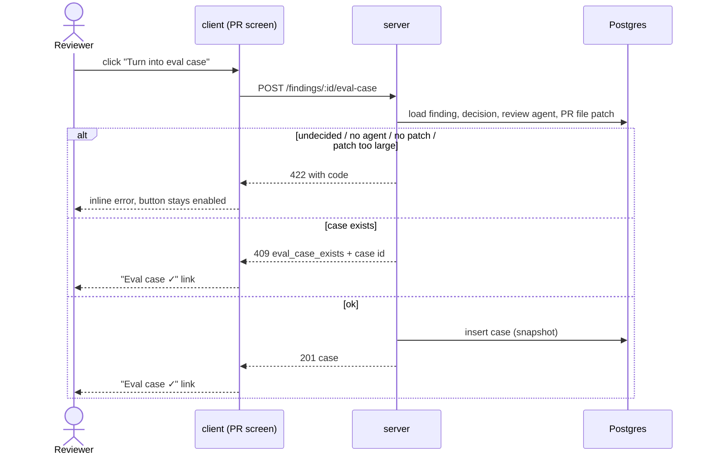
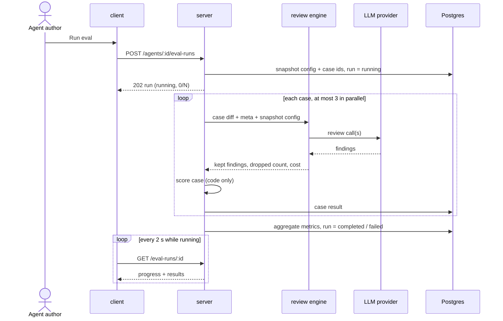

# Eval Pipeline
Spec: 2026-10-14-eval-pipeline · Modules: server, client · Status: ready-for-planning
Design sources: `specs/briefs/eval-pipeline/brief.md` (L06 homework text, course acceptance criteria, current-system facts from a researcher report of 2026-10-14 at `c836e47`); screenshots read: [S1] `01-pr-finding-card.png` — expanded FindingCard, actions Accept · Dismiss · Learn · **Turn into eval case** · Reply to author; [S2] `02-eval-dashboard.png` — sidebar "Eval Dashboard", agent rows (model chip, last run version/date/pass x/y, sparkline, recall/precision/citation %), "Recent eval runs · all agents" table, "Run all agents"; [S3] `03-agent-eval-runs.png` — one agent: header, agent picker, Run eval, regression banner, three metric tiles with delta and sparkline, metric trend chart, recent runs table with checkboxes + Compare; [S4] `04-compare-runs.png` — modal "Compare runs · v6 → v7": metric old → new with deltas, system prompt diff, Close · Promote; [S5] `05-agent-evals-tab.png` — AgentEditor Evals tab: metric tiles + "View full dashboard", "Eval cases 3/5 passing", Run all evals, case rows (name, expected/got, pass/fail/never-run, severity·category, run/edit/delete); [S6] `06-eval-case-modal.png` — eval case modal: name, input Diff/Files/PR meta, expected output JSON, last-run result, Cancel · Run case · Save. User decisions 2026-10-14 (section 16).
Related: none supersede. `evals/` at the repo root evaluates the Claude Code harness, not the product — unrelated. Reuses the review engine and its grounding gate unchanged.

## 1. Goal
Changing an agent's system prompt, model or linked skills today gives no measurable signal of whether reviews got better or worse. This feature adds a code-scored regression harness for the product's review agents: a reviewer turns a decided finding into an eval case with one click (accepted → the agent must find it, dismissed → the agent must not flag it), runs the agent over its whole case set with fixed inputs, and sees recall, precision and citation accuracy per run. Run history and a side-by-side comparison of two runs ("old prompt vs new") show whether a change helped. Scoring makes no LLM call.

## 2. Context
- Persisted eval entities already exist: eval case (workspace, owner kind skill|agent, owner id without referential link, name, input diff, input files, input meta, expected output, notes) and eval result **per case execution** (case, time, actual output, pass, recall, precision, citation accuracy, duration, cost) — `server/src/db/schema/eval.ts`, migration `0000_init.sql:116-140`. There is no run-level entity, no agent version and no config snapshot.
- Shared contracts exist in both `@devdigest/shared` copies: `EvalCase`, `EvalRun` (aggregate metrics + per-trace list), `EvalPerTrace`, `EvalOwnerKind` (`contracts/knowledge.ts:35-69`); `EvalCaseInput`, `EvalRunRecord`, `EvalRunResult`, `EvalTrendPoint`, `EvalDashboard` (`contracts/eval-ci.ts`). `expected_output` is untyped. No server route, service or client screen uses them; only skill deletion removes skill-owned cases (`server/src/modules/skills/infrastructure/repository.ts:224-233`).
- Findings carry `file`, `start_line`, `end_line` (new-side lines), `severity`, `category`, `title`; a decision is one of two mutually exclusive timestamps `accepted_at` / `dismissed_at`, set by `POST /findings/:id/accept|dismiss`; a decision can be flipped later and there is no "undecide" (`server/src/db/schema/reviews.ts:80-115`, `reviews/repository/review.repo.ts:96-118`). A finding reaches its agent only through its review's agent, which is empty for the seed review and for deleted agents (`reviews.ts:50-62`).
- The per-file patch of a PR is stored per file and may be empty (binary, not fetched) (`server/src/db/schema/pulls.ts:42-55`).
- The review engine runs on any parsed diff with a system prompt, model, provider and optional skills; temperature defaults to 0; it returns kept findings, **dropped findings with reasons** (grounding gate: file in diff and lines intersect a new-side hunk) and cost (`reviewer-core/src/review/run.ts:80-175,195,292-298`, `reviewer-core/src/grounding.ts:59-90`). The server persists only the string "k/n passed" for PR runs.
- Agent config changes (except enable/disable) bump the agent version and store a config snapshot (`server/src/modules/agents/repository.ts:105-160`); seeded agents have version 1 but no stored snapshot (`server/src/db/seed.ts:242`, `server/INSIGHTS.md:38`).
- Tests must inject an LLM double, otherwise the developer's real keys are used (`server/INSIGHTS.md:21`). The seed has one PR (#482) with 2 undecided findings and patches for 4 of 9 files (`server/src/db/seed.ts:134-175`, `server/INSIGHTS.md:13`) — it yields no eval cases.
- Client: i18n strings for the dashboard (`client/messages/en/eval.json`), the nav label (`shell.json` `nav.eval`) and the Evals tab label (`agents.json` `editor.tabs.evals`) exist; the sidebar has no Eval Dashboard item, there is no dashboard route, the AgentEditor has no Evals tab, FindingCard has no eval action.
- There is no `verify:*` script in any package; the gate aggregate is `./scripts/gates.sh`.

## 3. Scope
### In scope
- One-click case creation from an accepted or dismissed finding; one case per finding.
- Case list per agent, case view/edit (name, notes, expected line range) and delete.
- Asynchronous eval run of one agent over its whole case set with fixed inputs and progress; "Run all agents".
- Code-only scoring: per case pass/fail, per run recall, precision, citation accuracy, cases passed, cost, duration.
- Run history per agent, comparison of two runs (metric deltas, per-case flips, system prompt and config diff), regression banner.
- Eval Dashboard page in the sidebar (all agents + per-agent view with trend) and the Evals tab in the AgentEditor.
- A demo seed of decided findings (≥ 10) with patches so ≥ 8 cases can be created by clicks.
- The `verify:l06` command in the server package.
### Out of scope
- No LLM call is made to score a case or a run (no LLM judge).
- No manual "New eval case" from scratch; cases are created only from findings.
- No per-case "Run case" button; only whole-set runs.
- No "Promote version" action from the compare view.
- No date-range filter (the "30 days" control in [S3]).
- No skill-owned eval cases (owner kind `skill` stays as is, unused by this feature).
- No eval runs triggered from CI or on agent save ("Run on save" in [S6]).
- No Stats / CI tabs in the AgentEditor.
- Eval runs do not create PR review runs, reviews or findings, and do not post anything to GitHub.

## 4. User scenarios
- US1 — As a reviewer, I click "Turn into eval case" on an accepted or dismissed finding, so that my decision becomes a regression case for the agent that produced it.
- US2 — As an agent author, I open the agent's Evals tab and see all its cases with their last result, so that I know what the set covers.
- US3 — As an agent author, I start an eval run of the agent over all its cases and watch progress, so that I measure the current configuration.
- US4 — As an agent author, I see recall, precision, citation accuracy, cases passed and cost of a run, so that quality is a number, not a feeling.
- US5 — As an agent author, I open the run history and compare two runs side by side (metrics, flipped cases, prompt diff), so that I see what a prompt change did.
- US6 — As a team lead, I open the Eval Dashboard and see the latest runs of all agents and any regression, so that I spot a broken agent.
- US7 — As an agent author, I view, rename, adjust or delete a case, so that the set stays correct.

## 5. Functional requirements
- FR1 [server] — The system shall create an eval case from a finding when the finding is accepted or dismissed, its review has an agent, and the PR has a patch for the finding's file; the case belongs to that agent (US1).
- FR2 [server] — The created case shall snapshot: expectation kind (`must_find` for accepted, `must_not_flag` for dismissed), file, start and end line, severity, category, title; input = the finding file's patch as a valid single-file unified diff; meta = PR title, PR description, repo full name, PR number, head commit; source finding id, review id and PR id (US1).
- FR3 [server] — The system shall reject a second case for the same finding with a conflict that returns the existing case id (US1).
- FR4 [server] — The system shall list an agent's cases with, per case, its expectation and its result in the latest finished run that contained it (or "never run") (US2).
- FR5 [server] — The system shall let the user change a case's name, notes, start line and end line (start ≥ 1, end ≥ start), and delete a case (US7).
- FR6 [server] — Starting an eval run shall snapshot the agent's config (agent version, provider, model, system prompt, strategy, enabled linked skills with their names and bodies) and the set of case ids, persist the run as `running`, return it immediately, and execute the cases in the background (US3).
- FR7 [server] — Each case shall be executed with fixed inputs only: the case diff, the case meta (PR title and description), the snapshotted config, temperature 0; no memory, project context, intent, repo-intel or other live-repo input (US3).
- FR8 [server] — For each case the system shall persist a result: status (`passed` | `failed` | `error`), kept findings (file, lines, severity, category, title), number of dropped findings, matched/violating finding count, duration, cost, error message for `error` (US3, US4).
- FR9 [server] — Scoring shall be a deterministic code computation over kept findings, dropped count and expectations (section Glossary "Scoring"); it shall make no LLM call (US4).
- FR10 [server] — When all cases finished, the run shall store its aggregate metrics (recall, precision, citation accuracy, cases passed, cases total, cases errored, unlabeled finding count, total cost, duration) and become `completed`, or `failed` when every case errored (US4).
- FR11 [server] — The system shall reject starting a run when the agent has no cases or already has a `running` run (US3).
- FR12 [server] — The system shall return an agent's runs newest first, and a single run with its per-case results and progress (finished / total) (US3, US5).
- FR13 [server] — The system shall compare two finished runs of the same agent: metric values and deltas (B − A), cost, per-case status in each run with flips marked, and the config diff (system prompt line diff, model, strategy, skills added/removed) (US5).
- FR14 [server] — The system shall return a dashboard: per agent with ≥ 1 case or run — latest finished run metrics, version, cases passed/total, last 10 finished runs for the sparkline; the 20 most recent runs across agents; per agent — trend of the last 20 finished runs and a regression alert (US6).
- FR15 [server] — The regression alert shall be present when the latest finished run of an agent has any metric lower than the previous finished run by ≥ 0.02; it names each dropped metric and its delta (US6).
- FR16 [server] — "Run all agents" shall start a run for every agent that has ≥ 1 case and no `running` run, and report which agents were started and which skipped with the reason (US6).
- FR17 [server] — Deleting an agent shall delete its eval cases and eval runs (US7).
- FR18 [server] — Runs left `running` when the server stops shall be marked `failed` with reason "interrupted" at the next server start (US3).
- FR19 [server] — The finding record returned to the PR screen shall carry the id of the eval case created from it, or null (US1).
- FR20 [client] — FindingCard shall show "Turn into eval case"; enabled only for a decided finding of an agent's review with no case; after success it turns into "Eval case ✓" linking to the agent's Evals tab; disabled states show the reason (US1).
- FR21 [client] — The AgentEditor shall have an Evals tab with: latest-run metric tiles (recall, precision, citation accuracy, cases passed) with deltas vs the previous run, a "View full dashboard" link, the case list ("n / m passing" from the latest run), "Run all evals" with progress, and the run history (US2, US3, US4).
- FR22 [client] — A case modal shall show name, notes, expectation (kind, file, lines, severity, category, title), the input diff (read-only), PR meta and the latest result; it allows editing name, notes and lines, and deleting the case with a confirmation (US7).
- FR23 [client] — The sidebar shall have an "Eval Dashboard" item; the page shall list agents with latest metrics and sparkline, the recent runs across agents, and "Run all agents" (US6).
- FR24 [client] — The per-agent dashboard view shall show metric tiles with deltas, the regression banner, a trend chart of recall, precision and citation accuracy, the runs table with selection of exactly two finished runs, "Run eval", and "Compare" (US5, US6).
- FR25 [client] — The compare view shall show for runs A (older) → B (newer): each metric and cost old → new with signed delta, per-case flips, and the system prompt line diff with model/strategy/skills changes (US5).
- FR26 [server] — The seed shall add a demo PR reviewed by the Security Reviewer with ≥ 10 findings — ≥ 6 accepted and ≥ 4 dismissed — whose files have stored patches whose hunks contain the findings' lines; the seed stays idempotent (US1).
- FR27 [server] — `pnpm verify:l06` in the server package shall run, in order, the shared-contract drift check, server typecheck, lint, architecture check and unit tests, the eval tests, client typecheck and client tests, and exit non-zero on the first failure; integration tests run when Docker is available and are reported as skipped otherwise (course AC).

## 6. Workflow and communication

Case creation (sync):

Eval run (async):

- Case execution failure (LLM error, timeout 120 s, invalid output): that case gets status `error`; the run continues; errored cases are excluded from metric denominators and counted separately.
- Server stop during a run: FR18 at next start; the client shows the run as failed.
- Client polling failure: the tab shows a retry notice; the run continues on the server.
- Compare and dashboard are synchronous reads; no LLM.

## 7. Contracts

All request/response shapes are added to **both** `@devdigest/shared` copies; existing consumers stay valid (additive only). Errors use the existing error envelope; codes below are the `code` field.

**Expectation** `EvalExpectation`: `{kind: "must_find" | "must_not_flag", file: string, start_line: int ≥ 1, end_line: int ≥ start_line, severity: string | null, category: string | null, title: string | null}`.

**Eval case** (agent-owned) `AgentEvalCase`: `{id, agent_id, name: string (1–120), notes: string | null, expectation: EvalExpectation, input_diff: string, input_meta: {pr_title, pr_description: string | null, repo: string, pr_number: int, head_sha: string | null}, source_finding_id: string | null, source_pr_id: string | null, created_at: ISO string, last_result: {run_id, status: "passed" | "failed" | "error", ran_at} | null}`.

**Run** `EvalRunSummary`: `{id, agent_id, agent_version: int, model: string, status: "running" | "completed" | "failed", started_at, finished_at: ISO | null, cases_total: int, cases_finished: int, cases_passed: int, cases_errored: int, recall: number 0–1 | null, precision: number 0–1 | null, citation_accuracy: number 0–1 | null, unlabeled_findings: int, cost_usd: number | null, duration_ms: int | null, error: string | null}`. Metrics are null while running and when their denominator is 0.

**Case result** `EvalCaseResult`: `{case_id, case_name, expectation: EvalExpectation, status: "passed" | "failed" | "error", findings: [{file, start_line, end_line, severity, category, title, match: "hit" | "violation" | "unlabeled"}], dropped_count: int, duration_ms: int, cost_usd: number | null, error: string | null}`.

| Method · path | Request | Response | Errors |
|---|---|---|---|
| POST `/findings/:id/eval-case` | — | 201 `AgentEvalCase` | 404 `not_found`; 409 `eval_case_exists` (+ `case_id`); 422 `finding_undecided`, `finding_no_agent`, `patch_unavailable`, `patch_too_large` |
| GET `/agents/:id/eval-cases` | — | 200 `{cases: AgentEvalCase[]}` (newest first) | 404 |
| PATCH `/eval-cases/:id` | `{name?, notes?, start_line?, end_line?}` | 200 `AgentEvalCase` | 404; 422 `validation_error` (field shape); 400 `validation_error` (`end_line < start_line` against the stored values) |
| DELETE `/eval-cases/:id` | — | 204 | 404 |
| POST `/agents/:id/eval-runs` | — | 202 `EvalRunSummary` (status running) | 404; 409 `eval_run_active`; 422 `no_eval_cases`; 429 rate limit |
| GET `/agents/:id/eval-runs` | `?limit` 1–100, default 20 | 200 `{runs: EvalRunSummary[]}` newest first | 404 |
| GET `/eval-runs/:id` | — | 200 `{run: EvalRunSummary, results: EvalCaseResult[]}` | 404 |
| GET `/eval-runs/compare` | `?a=<runId>&b=<runId>` | 200 `{a: EvalRunSummary, b: EvalRunSummary, delta: {recall, precision, citation_accuracy, cost_usd: number | null}, cases: [{case_id, case_name, a: status | "absent", b: status | "absent", flipped: boolean}], config_diff: {system_prompt: [{op: "same" | "add" | "del", line: string}], model: {a, b} | null, strategy: {a, b} | null, skills_added: string[], skills_removed: string[]}}` | 404; 422 `runs_not_comparable` (different agents, or a run not finished) |
| GET `/eval/dashboard` | — | 200 `{agents: [{agent_id, name, model, cases_total, latest: EvalRunSummary | null, sparkline: [{run_id, recall, precision, citation_accuracy}] (≤ 10)}], recent_runs: (EvalRunSummary & {agent_name})[] (≤ 20)}` | — |
| GET `/agents/:id/eval/dashboard` | — | 200 `{agent_id, cases_total, latest: EvalRunSummary | null, previous: EvalRunSummary | null, trend: EvalRunSummary[] (≤ 20, oldest first), alert: {metrics: [{metric, delta}]} | null}` | 404 |
| POST `/eval-runs/run-all` | — | 202 `{started: EvalRunSummary[], skipped: [{agent_id, reason: "no_cases" | "run_active"}]}` | 429 |

- `FindingRecord` gains `eval_case_id: string | null` (FR19); consumers that ignore it are unaffected.
- Limits: input diff ≤ 200 000 characters (`patch_too_large`); ≤ 200 cases per agent (422 `eval_case_limit` on create); run start rate limit 10 per minute per workspace.
- Existing `EvalRunRecord` / `EvalDashboard` / `EvalRunResult` contracts are kept unchanged (no removals); the new shapes above are what this feature's routes return.

## 8. Data model (logical)
- **Eval case** (existing entity, extended): owned by an agent; holds the expectation snapshot, input diff, input meta, notes, source finding/review/PR ids (references may dangle after the source is deleted — the snapshot stays valid). At most one case per source finding. Deleted with its agent (FR17).
- **Eval run** (new): one execution of an agent's case set; holds agent id, agent version, config snapshot (provider, model, system prompt, strategy, skills with names and bodies), case id set, status, timestamps, aggregate metrics, cost, error. Kept until its agent is deleted.
- **Case result** (existing per-case eval result, extended): belongs to one eval run and one case; holds status, kept findings with match labels, dropped count, duration, cost, error. Deleting a case deletes its results; run aggregates stay as recorded.
- Derived, not stored: deltas, regression alert, compare diff, "n / m passing", sparklines.

## 9. States and UX
| Screen / element | Loading | Empty | Error | Degraded | Success | Notes |
|---|---|---|---|---|---|---|
| FindingCard "Turn into eval case" | button spinner, disabled | — | inline error under actions, button re-enabled | disabled + tooltip: "Accept or dismiss first" / "No agent for this review" | "Eval case ✓" link to agent Evals tab | [S1] |
| Evals tab — metric tiles | skeleton | "No runs yet" with "Run all evals" | error line + Retry | metric "—" when null | values with ▲/▼ delta vs previous run | [S5] |
| Evals tab — case list | skeleton rows | "No eval cases yet — create them from findings on a PR" | error + Retry | — | rows: name, expectation summary ("must find" / "must not flag" `file:start–end`), status icon passed/failed/error/never run, severity·category chip, open, delete | [S5] |
| Run all evals button | — | disabled when 0 cases (tooltip) | toast with error code text | — | while running: "Running x / N" progress, disabled | |
| Case modal | skeleton | — | save error inline | — | fields + read-only diff + last result | [S6]; delete asks confirmation |
| Eval Dashboard | skeleton | "No eval runs yet" + link to Agents | error + Retry | agent with cases but no run: metrics "—" | agent rows + recent runs table | [S2] |
| Per-agent dashboard | skeleton | "No runs yet" + Run eval | error + Retry | trend with 1 point shows a dot | tiles, banner, trend, runs table | [S3] |
| Compare | button disabled until exactly 2 finished runs selected | — | error in modal | prompt identical → "System prompt unchanged" | deltas, flips, diff | [S4] without Promote |

- Text from findings, PR meta, prompts and diffs is rendered as plain text, never as HTML/markdown.
- Percentages are shown as whole percents; deltas as signed points (e.g. "▼ 2pt").

## 10. Edge cases
- EC1 [server] — Finding undecided → 422 `finding_undecided` (FR1).
- EC2 [server] — Review has no agent (seed review, deleted agent) → 422 `finding_no_agent` (FR1).
- EC3 [server] — Patch for the finding's file is empty → 422 `patch_unavailable`; longer than 200 000 characters → 422 `patch_too_large` (FR1).
- EC4 [server] — Double click / two tabs create the same case → exactly one case exists; the other request gets 409 with its id (FR3).
- EC5 [server] — Decision flipped after the case was created → the case keeps its snapshot kind (FR2).
- EC6 [server] — Source finding or PR deleted → case and its results remain usable (FR2).
- EC7 [server] — Start a run while one is `running` for the agent → 409 `eval_run_active` (FR11).
- EC8 [server] — Agent edited during a run → the run uses its snapshot; the next run uses the new config (FR6).
- EC9 [server] — Case deleted during a run → its result is not recorded and it is excluded from that run's totals (FR6, FR10).
- EC10 [server] — One case's LLM call fails or exceeds 120 s → that case is `error`, other cases complete, run `completed`; all cases error → run `failed` with the first error message (FR8, FR10).
- EC11 [server] — A metric's denominator is 0 (no must_find cases, no labeled findings, no findings) → that metric is null (FR10).
- EC12 [server] — Compare runs of different agents or an unfinished run → 422 `runs_not_comparable` (FR13).
- EC13 [server] — Server restarted mid-run → run `failed`, error "interrupted" (FR18).
- EC14 [server] — Agent disabled → eval runs are still allowed (FR6).
- EC15 [client] — Fewer or more than two runs selected → Compare disabled (FR24).
- EC16 [server] — Edit end line below start line → 400 `validation_error` (FR5).

## 11. Non-functional requirements
- NFR1 [server] — Scoring makes zero LLM calls; proven by a test whose LLM double fails on any call made during scoring (FR9).
- NFR2 [server] — At most 3 cases of one run execute concurrently; per-case timeout 120 s (FR6).
- NFR3 [server] — `POST /agents/:id/eval-runs` responds within 500 ms for a set of 200 cases (work is in the background) (FR6).
- NFR4 [server] — Run start limited to 10 requests per minute per workspace (429 beyond) (FR6, FR16).
- NFR5 [server] — Cost of every case and run is recorded from the engine's usage; null when the model is unpriced; spend of an errored case is still counted when reported (FR8, FR10).
- NFR6 [server] — Logs one line at run start (run id, agent id, version, cases) and one at run end (status, metrics, duration, cost); no prompt or diff content in logs (FR6, FR10).
- NFR7 [client] — Text from findings, PR meta, prompts and diffs is rendered as plain text (untrusted, PR-author-steerable) (FR20–FR25).
- NFR8 [client] — Run selection checkboxes and Compare are keyboard-operable and labelled; metric colours are not the only signal (signed delta text) (FR24, FR25).
- NFR9 [client] — All new UI strings come from the `en` message files (FR20–FR25).
- NFR10 [server] — The same run inputs (case diff, meta, config snapshot) are passed for every run of a version; with the deterministic test LLM double two runs of the same version produce identical metrics (FR7).

## 12. Dependencies and rollout
- Shared contract change: yes — new eval shapes and `FindingRecord.eval_case_id` in both copies; drift check must stay green.
- Persisted data change: yes — new eval run entity; eval case and per-case result extended; migration required (`pnpm db:migrate`, not run on boot); seed extended (FR26).
- No feature flag. Server ships before client (client reads new routes). Existing eval rows (none in practice) remain valid.

## 13. Acceptance criteria
- AC1 [server] — Given an accepted finding of an agent's review with a stored patch, when POST `/findings/:id/eval-case`, then 201 returns a case with `expectation.kind = "must_find"`, the finding's file and lines, and `input_diff` that parses as one file whose hunk contains those lines. Traces: FR1, FR2 · Verify: integration
- AC2 [server] — Given a dismissed finding, when the case is created, then `expectation.kind = "must_not_flag"`. Traces: FR1, FR2 · Verify: integration
- AC3 [server] — Given a case already exists for a finding, when POST again, then 409 `eval_case_exists` with that `case_id`, and the agent still has one case for it. Traces: FR3, EC4 · Verify: integration
- AC4 [server] — Given an undecided finding / a review without agent / an empty patch / a 200 001-character patch, when POST, then 422 with `finding_undecided` / `finding_no_agent` / `patch_unavailable` / `patch_too_large`. Traces: FR1, EC1, EC2, EC3 · Verify: integration
- AC5 [server] — Given a case was created from an accepted finding that is later dismissed, when the cases are listed, then the case still has `must_find`. Traces: EC5, FR2 · Verify: integration
- AC6 [server] — Given the source review is deleted, when the agent's cases are listed and a run is executed, then the case is listed and scored. Traces: EC6 · Verify: integration
- AC7 [server] — Given an agent with cases and a finished run, when GET `/agents/:id/eval-cases`, then each case has its `last_result` from that run, and a case added later has `last_result: null`. Traces: FR4 · Verify: integration
- AC8 [server] — Given a case, when PATCH name/notes/lines with valid values, then 200 returns them; with `end_line < start_line`, then 400 `validation_error`; when DELETE, then 204 and it is no longer listed. Traces: FR5, EC16 · Verify: integration
- AC9 [server] — Given an agent with 8 cases and an LLM double, when POST `/agents/:id/eval-runs`, then 202 returns `status: "running"`, `cases_total: 8` within 500 ms, and polling GET `/eval-runs/:id` ends with `status: "completed"`, `cases_finished: 8` and 8 case results. Traces: FR6, FR8, FR10, FR12, NFR3 · Verify: integration
- AC10 [server] — Given the agent's system prompt is changed while its run is running, when the run completes, then the run's config snapshot holds the old prompt and version, and the next run holds the new ones. Traces: FR6, EC8 · Verify: integration
- AC11 [server] — Given an LLM double that records its inputs, when a run executes a case, then the review input contains only the case diff, PR title/description, the snapshot's system prompt, model, strategy and skill bodies, and temperature 0 — no memory, project context, intent or repo-intel. Traces: FR7, NFR10 · Verify: integration
- AC12 [server] — Given fixed findings and expectations (one must_find hit, one must_find miss, one must_not_flag violated, one must_not_flag clean, 2 unlabeled findings, 1 dropped finding of 7), when scored, then case statuses are passed/failed/failed/passed, recall = 0.5, precision = 0.5, citation_accuracy = 6/7, unlabeled = 2. Traces: FR9, FR10 · Verify: unit
- AC13 [server] — Given an LLM double that throws on any call, when the scoring of a completed run's case results is executed, then metrics are produced and the double recorded 0 calls. Traces: FR9, NFR1 · Verify: unit
- AC14 [server] — Given a run is running for an agent, when POST `/agents/:id/eval-runs` again, then 409 `eval_run_active`; given an agent with 0 cases, then 422 `no_eval_cases`. Traces: FR11, EC7 · Verify: integration
- AC15 [server] — Given one of 8 cases makes the LLM double throw, when the run finishes, then that case is `error` with a message, the run is `completed`, `cases_errored: 1`, and metrics use the other 7; given all throw, then the run is `failed`. Traces: FR8, FR10, EC10 · Verify: integration
- AC16 [server] — Given a run where no case is `must_find`, when it completes, then `recall` is null. Traces: EC11 · Verify: unit
- AC17 [server] — Given runs A and B of one agent whose prompts differ by one line, when GET `/eval-runs/compare?a=A&b=B`, then the response has deltas B − A, per-case statuses with `flipped` true where they differ, and `config_diff.system_prompt` with exactly one `add` and one `del` line; given runs of two agents, then 422 `runs_not_comparable`. Traces: FR13, EC12 · Verify: integration
- AC18 [server] — Given two finished runs where precision fell from 0.9 to 0.85 and recall rose, when GET `/agents/:id/eval/dashboard`, then `alert.metrics` is exactly `[{metric: "precision", delta: -0.05}]`; given no drop ≥ 0.02, then `alert` is null. Traces: FR14, FR15 · Verify: integration
- AC19 [server] — Given 3 agents (one with cases, one with cases and a running run, one without cases), when POST `/eval-runs/run-all`, then one run is started and two are skipped with `run_active` and `no_cases`. Traces: FR16 · Verify: integration
- AC20 [server] — Given an agent with cases and runs, when the agent is deleted, then its cases and runs are gone. Traces: FR17 · Verify: integration
- AC21 [server] — Given a run in `running` at server start, when the server boots, then that run is `failed` with error "interrupted". Traces: FR18, EC13 · Verify: integration
- AC22 [server] — Given a finding with a case, when the PR's reviews are fetched, then that finding's `eval_case_id` equals the case id; others are null. Traces: FR19 · Verify: integration
- AC23 [server] — Given a disabled agent with cases, when a run is started, then 202. Traces: EC14 · Verify: integration
- AC24 [server] — Given a freshly seeded database (seed run twice), then the demo PR has exactly one Security Reviewer review with ≥ 10 findings, ≥ 6 accepted, ≥ 4 dismissed, and each finding's lines lie inside a hunk of its file's stored patch. Traces: FR26 · Verify: integration
- AC25 [server] — Given the repo, when `cd server && pnpm verify:l06` runs, then it executes drift, server typecheck, lint, arch:check, unit tests, eval tests, client typecheck and client tests in that order and exits 0 when all pass, non-zero on the first failure. Traces: FR27 · Verify: manual
- AC26 [client] — Given an accepted finding without a case, when the user clicks "Turn into eval case", then the button shows a spinner and then "Eval case ✓" linking to `/agents/<id>?tab=evals`; for an undecided finding the button is disabled with the tooltip "Accept or dismiss first". Traces: FR20 · Verify: component
- AC27 [client] — Given an agent with 8 cases and one finished run, when the Evals tab opens, then four metric tiles show percentages with signed deltas, the header shows "n / 8 passing", and each case row shows its status icon and expectation summary. Traces: FR21 · Verify: component
- AC28 [client] — Given a run is started from the Evals tab, when progress arrives, then the button shows "Running x / 8" and is disabled until the run finishes, after which tiles and rows refresh. Traces: FR21 · Verify: component
- AC29 [client] — Given a case modal, when the user edits the name and saves, then the list shows the new name; when the user deletes and confirms, the row disappears. Traces: FR22 · Verify: component
- AC30 [client] — Given the app shell, then the sidebar shows "Eval Dashboard" linking to the dashboard page, which lists agent rows and recent runs and has "Run all agents". Traces: FR23 · Verify: component
- AC31 [client] — Given the per-agent dashboard with 3 finished runs, when exactly two are checked and Compare is clicked, then the compare view shows each metric old → new with a signed delta, flipped cases and the prompt line diff; with one or three checked, Compare is disabled. Traces: FR24, FR25, EC15 · Verify: component
- AC32 [client] — Given finding text and prompt lines containing ``, when rendered in the case list, modal and compare view, then the text is shown literally and no element is created. Traces: NFR7 · Verify: component
- AC33 [client] — Given the runs table and compare dialog, when operated by keyboard only, then rows can be selected, Compare activated and the dialog closed, and every checkbox has an accessible label. Traces: NFR8 · Verify: component
- AC34 [client] — Given the new screens, then no user-visible string is hard-coded outside the `en` message files (checked by rendering with a test message bundle). Traces: NFR9 · Verify: component
- AC35 [server] — Given a run, then exactly one start and one end log line are written with run id, status, metrics and cost, and neither contains the system prompt or diff text. Traces: NFR6 · Verify: integration
- AC36 [server] — Given a run of 8 cases with an LLM double that delays 200 ms per call and counts concurrent calls, then the maximum concurrent calls is 3; a call delayed past 120 s marks its case `error`. Traces: NFR2 · Verify: integration
- AC37 [server] — Given 11 run starts within one minute in one workspace, then the 11th gets 429. Traces: NFR4 · Verify: integration
- AC38 [server] — Given an LLM double reporting a cost per call, then each case result and the run total carry the summed cost; an unpriced model gives null. Traces: NFR5 · Verify: integration
- AC39 [manual] — Given ≥ 8 cases created by clicks from the seeded demo PR, when the Security Reviewer is run, its system prompt changed, and run again, then recall or precision differs between the two runs and the compare view shows it; after a deliberately broken prompt, precision of the next run is lower than before. Traces: FR6, FR13, FR25 · Verify: manual
- AC40 [server] — Given a run of 8 cases where one case is deleted before its execution starts, when the run completes, then it has 7 case results and `cases_total: 7`. Traces: EC9, FR6, FR10 · Verify: integration

## 14. Traceability
| Source (request / design frame / US) | Module | FR | EC / NFR | AC |
|---|---|---|---|---|
| Story 1 / [S1] / US1 | server, client | FR1, FR2, FR3, FR19, FR20 | EC1–EC6 | AC1–AC6, AC22, AC26 |
| Story 2 / [S5] / US2 | server, client | FR4, FR21 | — | AC7, AC27 |
| Story 3 / [S5], [S3] / US3 | server, client | FR6, FR7, FR8, FR11, FR12, FR18 | EC7–EC10, EC13, EC14, NFR2, NFR3, NFR10 | AC9–AC11, AC14, AC15, AC21, AC23, AC28, AC36, AC40 |
| Story 4 / US4 — code-only scoring | server | FR9, FR10 | EC11, NFR1, NFR5 | AC12, AC13, AC16, AC38 |
| Story 5 / [S3], [S4] / US5 | server, client | FR13, FR24, FR25 | EC12, EC15, NFR8 | AC17, AC31, AC33, AC39 |
| Dashboard / [S2], [S3] / US6 | server, client | FR14, FR15, FR16, FR23 | NFR4 | AC18, AC19, AC30, AC37 |
| [S5], [S6] / US7 | server, client | FR5, FR17, FR22 | EC16 | AC8, AC20, AC29 |
| ≥ 8 cases (course AC) | server | FR26 | — | AC24, AC39 |
| `pnpm verify:l06` (course AC) | server | FR27 | — | AC25 |
| Untrusted text, i18n, logging | client, server | — | NFR6, NFR7, NFR9 | AC32, AC34, AC35 |

## 15. Design review
| # | Gap / proposal | Source | Module | Decision |
|---|---|---|---|---|
| 1 | No run-level entity or config snapshot → compare impossible | `eval.ts`, brief §4.1 | server | accepted — new run entity with snapshot (D1) |
| 2 | Seeded agents lack version snapshots → old prompt unrecoverable | `server/INSIGHTS.md:38` | server | accepted — run stores its own snapshot (D1) |
| 3 | citation accuracy needs dropped findings, not persisted today | `run.ts:167-175` | server | accepted — counted per case during the run |
| 4 | Duplicate cases from double click | brief §4.4 | server, client | accepted — one per finding (D7) |
| 5 | Decision can flip after case creation | `review.repo.ts:96-118` | server | accepted — snapshot (FR2, EC5) |
| 6 | Long multi-LLM request | brief §4.8 | server, client | accepted — async + polling (D5) |
| 7 | Seed yields 0 cases | `seed.ts:134-175` | server | accepted — decided demo findings (D6) |
| 8 | Agent delete leaves orphan cases | brief §4.13 | server | accepted — cascade (FR17) |
| 9 | Run stuck `running` after restart | gap register | server | accepted — FR18 |
| 10 | Mockup extras: Promote, 30-day filter, per-case run, manual new case, Run on save | [S3]–[S6] | client | rejected (D4) |
| 11 | Delete, view/edit modal, Run all agents, regression banner | [S2], [S3], [S5], [S6] | client, server | accepted (D4) |
| 12 | Unlabeled findings invisible in precision | D3 | server, client | accepted — counted and shown separately |
| 13 | Untrusted LLM/PR text in new screens | `client/INSIGHTS.md:30` | client | accepted — NFR7 |

## 16. Decisions
- D1 — How to group runs for comparison? → New run entity with a config snapshot (agent version, provider, model, system prompt, strategy, skills); per-case results link to it (user, 2026-10-14).
- D2 — Case input? → The finding file's patch as a valid unified diff + PR title/description as meta (user, 2026-10-14).
- D3 — Precision? → Noise = labeled only: precision = hits / (hits + must_not_flag violations); other findings are "unlabeled", shown as a count, not penalised (user, 2026-10-14).
- D4 — Extras beyond the course minimum? → In: case delete, case view/edit modal, Run all agents, regression banner. Out: Promote, date filter, per-case run, manual new case, run on save (user, 2026-10-14).
- D5 — Execution? → Asynchronous: 202 + background execution + progress polling; one running run per agent (user, 2026-10-14).
- D6 — Source of ≥ 8 cases? → Seed decided findings on a demo PR; cases are created by clicks; works with real PRs too (user, 2026-10-14).
- D7 — Repeated "Turn into eval case"? → One case per finding: 409 + link to the existing case (user, 2026-10-14).
- D8 — Where does `verify:l06` live? → `server/package.json`, `cd server && pnpm verify:l06` (user, 2026-10-14).
- D9 — Spec path → `specs/eval-pipeline.md` as required by the course checklist (user, 2026-10-14).
- D10 — Open questions Q1–Q7 → defaults accepted; spec approved for planning (user, 2026-10-14).
- D11 — Error codes are lower snake_case (`eval_case_exists`, `finding_undecided`, …) to match the existing error envelope (`server/src/http/error-handler.ts:50-98`) (planner change request #1, accepted by user 2026-10-14).
- D12 — PATCH field-shape errors return 422 `validation_error` (route schema, as everywhere in the codebase); `end_line < start_line` returns 400 `validation_error` (planner change request #2, accepted by user 2026-10-14).

## 17. Open questions
- Q1 — Should a case's expectation kind be editable in the modal? — default used in this spec: no; kind comes from the decision snapshot.
- Q2 — Regression alert threshold — default: any metric drop ≥ 0.02 vs the previous finished run.
- Q3 — Trend length and sparkline length — default: last 20 finished runs (trend), last 10 (sparkline).
- Q4 — Concurrency and timeout — default: 3 cases in parallel, 120 s per case.
- Q5 — Do linked skills belong to "fixed inputs"? — default: yes, snapshotted bodies of enabled linked skills at run start.
- Q6 — Case name — default: the finding title truncated to 120 characters; editable.
- Q7 — Polling interval — default: 2 s while a run is running; stops when finished.

## Glossary
- **Match** — a kept finding matches an expectation when the file paths are equal and the line ranges `[start, end]` intersect.
- **Hit** — a kept finding that matches a `must_find` expectation of its case. **Violation** — a kept finding that matches a `must_not_flag` expectation of its case. **Unlabeled** — any other kept finding.
- **Scoring** — per case: `must_find` passes iff ≥ 1 hit; `must_not_flag` passes iff 0 violations; an `error` case is excluded. Per run over non-error cases: recall = must_find cases passed / must_find cases; precision = hits / (hits + violations); citation accuracy = kept findings / (kept + dropped findings); cases passed = passed cases; a denominator of 0 gives null.
- **Fixed inputs** — case diff, case meta, run config snapshot, temperature 0 (FR7).
