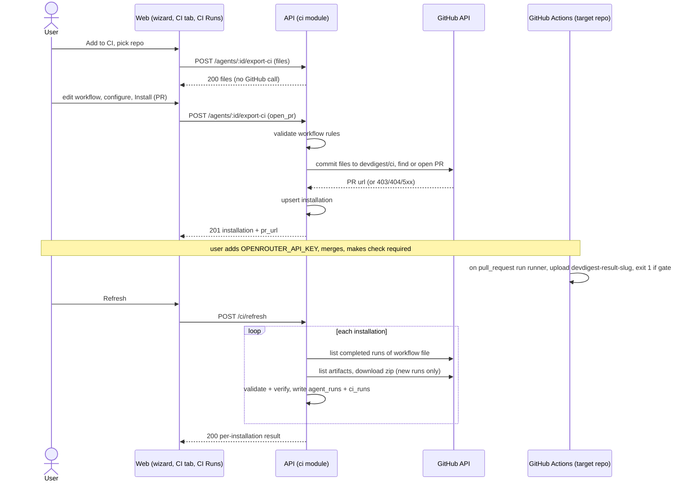

# Export to CI
Spec: export-to-ci · Modules: server, client, agent-runner · Status: ready-for-planning
Design sources: screenshots 15.png (wizard step 1 Target), 16.png (agent CI tab), 17.png (step 2 Preview), 18.png (step 3 Configure), 19.png (step 4 Install); lab 07 text (`.devdigest/research/lab-07/context.md`); research `.devdigest/research/export-to-ci/research.md`; two external research reports (GitHub Actions runs/artifacts API; PAT scopes and Actions security), 2026-10-15
Related: `specs/multi-agent-review.md` (worktree A — finding attribution this spec relies on; merges first). Reference only, not adopted: `upstream/lesson-7-lab/multiagents-finish:specs/2026-07-08-export-to-ci.md`. Supersedes nothing.

## 1. Goal
A DevDigest user wants an agent tuned in the studio to review every pull request of a repository automatically in that repository's own GitHub Actions, and to block merges on CRITICAL findings. The user exports the agent from its page through a 4-step wizard that opens a PR adding the agent manifest, skills, the bundled runner and a hardened workflow. CI results come back to the local studio on a manual Refresh and appear in a new CI Runs page and the agent's CI tab. This is a deliberately simple first version (D-simple): GitHub Actions only, pull-based ingest, counts only.

## 2. Context
- No CI module, routes or ingest exist in the server: `server/src/modules/composition.ts:29-47` has no `ci` entry (research.md "server").
- `agent-runner/` runs one agent in CI: loads exactly one `.devdigest/agents/*.yaml` (`agent-runner/src/manifest.ts:105-126`), validates it with the shared `AgentManifest` (`manifest.ts:149`), reviews through reviewer-core with OpenRouter only (`agent-runner/src/index.ts:39`), computes the gate from grounded findings and the manifest's `ci_fail_on` (`reviewer-core/src/output/to-review.ts:25-48`), writes `devdigest-result.json` before posting (`run.ts:149`) and exits 1 when the gate triggers; any hard failure exits 1 with no artifact (`run.ts:167-172`). Post mode comes from env `DEVDIGEST_POST_AS` (`index.ts:25-28`); nothing sets it today (`agent-runner/insights/INSIGHTS.md`, Open Questions 2026-07-08).
- The runner is shipped as one ncc bundle `dist/index.js` (gitignored) and runs in the target repo as `node .devdigest/runner/index.js` (`agent-runner/README.md`).
- `CiResultArtifact` has counts, cost, duration, agent, version, pr_number — no commit SHA, repository or run identity (`server/src/vendor/shared/contracts/eval-ci.ts:228-238`).
- `ci_installations` and `ci_runs` tables exist with no writers and no idempotency key (`server/src/db/schema/ci.ts:7-34`). `agent_runs.source` accepts `local|ci`; nothing writes `ci` (`server/src/db/schema/runs.ts:12,36`).
- The GitHub adapter can commit files to a branch, find an open PR by branch and open a PR (`server/src/adapters/github/octokit.ts:365-468`); it has no Actions runs/artifacts calls. The studio token comes from `GITHUB_TOKEN`/`GITHUB_PAT` (`server/src/adapters/secrets/local.ts:40`).
- The agent gate setting `ci_fail_on` exists and is edited on the Config tab (`client/src/app/agents/[id]/_components/AgentEditor/_components/ConfigTab/ConfigTab.tsx:90`); any config change bumps `agents.version` (`server/src/modules/agents/repository.ts:142-144`).
- Agent tabs are config/skills/context/evals (`client/src/app/agents/[id]/_components/AgentEditor/constants.ts`); no CI Runs page or nav item; `/ci-runs` is already mapped in `client/src/components/app-shell/helpers.ts:39`; i18n strings exist in `client/messages/en/ci.json`.
- The studio is local; GitHub cannot reach it, so results must be pulled through the GitHub API (research.md "End-to-end path").
- GitHub facts (external research): runs of one workflow are listed by file name with `event`/`status` filters and carry `id`, `run_attempt`, `head_sha`, `path`, `event`, `conclusion`, `html_url`, `repository`; `pull_requests` is empty for fork PRs; artifacts carry `expired` and `workflow_run.head_sha`/`repository_id`; download is a ZIP behind a 302 valid 1 minute; default retention 90 days; reading needs Actions:read (fine-grained) or `repo` (classic); 5,000 requests/hour. Writing `.github/workflows/*` needs classic `workflow` scope or fine-grained Workflows:write. On `pull_request`, fork PRs get no secrets and a read-only `GITHUB_TOKEN`; `GITHUB_SHA` is the merge commit, the PR head is `github.event.pull_request.head.sha`; `GITHUB_REPOSITORY_ID`, `GITHUB_RUN_ID`, `GITHUB_RUN_ATTEMPT` exist; setting any `permissions:` key sets the unlisted ones to `none`; GitHub recommends pinning actions to a full commit SHA; `ubuntu-latest` moves to Ubuntu 26.04 in November 2026.

## 3. Scope
### In scope
- Export wizard (Target → Preview → Configure → Install) for GitHub Actions, opening a PR from branch `devdigest/ci` or downloading a zip.
- Per-agent workflow, manifest and artifact; several agents per repository.
- Small agent-runner changes: manifest selection by env, richer artifact, trace header in the job log.
- Manual, pull-based ingest of CI results into `agent_runs` (`source='ci'`) and `ci_runs`.
- CI Runs page, agent CI tab, one "CI Runs" nav item.

### Out of scope
- No CircleCI, Jenkins or Generic CLI generator; the Target step shows no card for them.
- No background polling and no auto-refresh on page open; ingest runs only on a Refresh click.
- No inbound HTTP endpoint accepts CI results.
- The artifact and the studio store no finding text; no `reviews` or `findings` rows are written by ingest.
- Ingested CI runs have `agent_runs.pr_id` empty; they do not appear on the PR page, the PR feed or its cost sum.
- `.devdigest/memory.jsonl` is exported empty; no memory is produced and the runner does not read it.
- Project Context attachments and repo-intel context are not exported; CI reviews use the diff, PR text and skills only.
- Agents whose provider is not `openrouter` cannot be exported.
- A zip download creates no installation; runs of a zip-installed workflow are not ingested.
- No uninstall: the studio never deletes files from a target repo and offers no "remove installation" action.
- No live check of Actions secrets; the Configure step shows a static checklist.
- No filters, pagination or date-range on the CI Runs page beyond the newest 100 runs.
- No backfill: a refresh reads at most the 30 newest completed runs per installation.
- Install settings (post mode, triggers, edited workflow) are not stored; "Update" starts the wizard from defaults.
- No namespacing of shared repo paths (`.devdigest/skills/*`, `.devdigest/runner/index.js`, `.devdigest/memory.jsonl`); the last export wins.
- No published `devdigest/review-action`; the mockup's `uses: devdigest/review-action@v1` is not generated.
- No GitHub App; blocking merges relies on the user adding a required status check.

## 4. User scenarios
- US1 — As an agent author, I export my agent to a repository's GitHub Actions through a wizard, so that every PR there is reviewed without opening the studio.
- US2 — As an agent author, I preview and edit the generated workflow before it is committed, so that I control what runs in my CI.
- US3 — As a repo maintainer, I get a PR (never a direct push to main) with all files and setup instructions, so that I review the change like any other.
- US4 — As a repo maintainer, I make the agent's check required, so that a PR with a CRITICAL finding cannot be merged.
- US5 — As an agent author, I refresh and see CI runs (repo, PR, agent, verdict, findings, cost, duration, job link), so that I know how the agent behaves in CI.
- US6 — As an agent author, I see on the agent's CI tab where it is installed, which manifest version is deployed, its run history and its "Fail CI on" setting, so that I keep CI in sync with the studio.
- US7 — As a team, we install several agents in one repository, so that each runs as its own check.

## 5. Functional requirements
- FR1 [client] — The agent page shall have a CI tab (`?tab=ci`) showing: heading with "Active in N repos" (N = installations of this agent), "Add to CI", one row per installation (repo, "GitHub Actions", last run status and relative time, deployed manifest version, an "outdated" badge when the agent's current version is greater than the deployed one, "Update"), a "+ Add repository" row, a "Refresh" button, the agent's newest 20 CI runs, and a "Fail CI on" select. (US6)
- FR2 [client] — "Fail CI on" on the CI tab shall edit the agent's existing `ci_fail_on` through the existing `PUT /agents/:id` and show the note that CI uses the new value only after "Update". (US4, US6)
- FR3 [client] — "Add to CI", "+ Add repository" and a row's "Update" shall open the Export wizard with 4 steps Target → Preview → Configure → Install, Back/Continue navigation and a close button; "Update" preselects the row's repository. (US1)
- FR4 [client] — The Target step shall show one preselected "GitHub Actions" card and a "Target repository" select listing the workspace's imported repositories, defaulting to the active repository. (US1, US7)
- FR5 [server] — `POST /agents/:id/export-ci` with `action: "files"` shall return the generated files without calling GitHub and without writing to the database. (US2)
- FR6 [server] — The generated files for agent slug `<slug>` shall be exactly: `.devdigest/agents/<slug>.yaml`, one `.devdigest/skills/<skill-slug>.md` per attached skill in the agent's skill order, `.devdigest/memory.jsonl` (empty), `.devdigest/runner/index.js` (the built runner bundle), `.github/workflows/devdigest-review-<slug>.yml`. Only the workflow is `editable: true`. (US1, US2)
- FR7 [server] — The manifest shall be the agent serialized as `AgentManifest` (name, provider `openrouter`, model, system_prompt, skills as skill slugs, strategy, ci_fail_on, version = the agent's current version) and shall pass `AgentManifest.safeParse` before it is returned. (US1)
- FR8 [server] — The agent slug shall be derived from the agent name (lowercase, `a-z0-9` and `-`, at most 40 characters) at the first export to a repository, stored on the installation and reused on every later export to that repository, even after a rename. Skill slugs are derived the same way from skill names. (US7)
- FR9 [server] — The generated workflow shall: be named `DevDigest Review · <slug>`; trigger only on `pull_request` with the chosen types; declare top-level `permissions` of exactly `contents: read` and `pull-requests: write`; have one job named `DevDigest Review · <slug>` that is skipped when `github.event.pull_request.head.repo.full_name != github.repository`; check out the PR, set up Node 22, run `node .devdigest/runner/index.js` with env `OPENROUTER_API_KEY: ${{ secrets.OPENROUTER_API_KEY }}`, `GITHUB_TOKEN: ${{ secrets.GITHUB_TOKEN }}`, `DEVDIGEST_AGENT: <slug>`, `DEVDIGEST_POST_AS: <post_as>`, `PR_HEAD_SHA: ${{ github.event.pull_request.head.sha }}`; upload `devdigest-result.json` as artifact `devdigest-result-<slug>` with `if: always()`; pin every external action to a 40-hex commit SHA. (US1, US4)
- FR10 [client] — The Preview step shall list the files ("FILES TO CREATE"), show the selected file's contents (the runner bundle by path and size only), let the user edit the workflow, and offer "Reset to generated". (US2)
- FR11 [client] — The Configure step shall show trigger chips `pull_request:opened` (on), `pull_request:synchronize` (on), `pull_request:reopened` (off) with at least one required; a static "Secrets expected" list (`OPENROUTER_API_KEY` — add to the repo's Actions secrets; `GITHUB_TOKEN` — provided by Actions) without status badges; "Post results as" GitHub review (default, "recommended") / PR comment / None (exit code only); and the note that blocking merges needs "Fail CI on" plus a required status check named `DevDigest Review · <slug>`. Changing an option regenerates the workflow unless it was edited; when it was edited, the options are disabled with a notice pointing to "Reset to generated". (US2, US4)
- FR12 [server] — The server shall reject an edited workflow that breaks any rule of the workflow rule list (section 7) with 422 `workflow_insecure` naming the failed rule; the generated workflow shall pass every rule. (US2)
- FR13 [server] — `POST /agents/:id/export-ci` with `action: "open_pr"` shall commit all files in one commit to branch `devdigest/ci` of the target repository (created from the repository's default branch when absent, layered on the existing branch otherwise), reuse the open PR from `devdigest/ci` if one exists or else open a PR titled "Add DevDigest CI review" against the default branch whose body lists the files, the secret to add and the check name, then upsert the installation (agent, repo, `gha`) with slug and manifest version. It never writes to the default branch. (US1, US3, US7)
- FR14 [client] — The Install step shall offer "Open a PR with these files" (default, "recommended") and "Copy files as a zip"; on PR success it shows the PR link and next steps (add `OPENROUTER_API_KEY`, merge, set the required check `DevDigest Review · <slug>`); the zip option downloads `devdigest-ci-<slug>.zip` with the same files at their repo paths and makes no server write. (US1, US3, US4)
- FR15 [server] — Export shall be refused for: an agent whose provider is not `openrouter` (422 `unsupported_provider`), a target other than `gha` (422 `unsupported_target`), a repository not imported in the agent's workspace (404 `repo_not_found`), an empty or unknown trigger list (422 `invalid_triggers`), a slug already used by another agent's installation in that repository (409 `ci_slug_conflict`), two attached skills with the same slug (422 `skill_slug_conflict`), a missing runner bundle (500 `runner_bundle_missing`). (US1)
- FR16 [agent-runner] — When `DEVDIGEST_AGENT` is set, the runner shall load `.devdigest/agents/<DEVDIGEST_AGENT>.yaml` and ignore other manifests; when unset, it keeps today's "exactly one manifest" rule. (US7)
- FR17 [agent-runner] — The artifact shall be version `2` and add `commit_sha` (PR head SHA), `repository`, `repository_id`, `run_id`, `run_attempt`, `model`, `manifest_version`, `skills` (slugs) and `blockers` to today's fields, and contain no finding text. (US5)
- FR18 [agent-runner] — The runner shall print a trace header to the job log with manifest version, model, skill slugs, commit SHA and runner version, and no secret values. (US5)
- FR19 [server] — `POST /ci/refresh` shall, for each GitHub Actions installation (optionally of one agent), list the 30 newest completed `pull_request` runs of the installation's own workflow file, skip runs already stored (same run id and attempt) and ingest each new run as defined in FR20–FR22, then return a per-installation result. (US5)
- FR20 [server] — A new run with a valid artifact named `devdigest-result-<slug>` shall be stored only when the artifact passes `CiResultArtifact.safeParse`, its `commit_sha` equals the run's `head_sha`, its `repository_id` equals the run's repository id and the run's `path` equals the installation's workflow path; it is written as one `agent_runs` row and one `ci_runs` row in one transaction. (US5)
- FR21 [server] — A completed run with no artifact whose conclusion is not `skipped` or `cancelled` shall be stored as a `failed` CI run with its link; runs with conclusion `skipped` or `cancelled` are not stored. (US5)
- FR22 [server] — The `agent_runs` row of an ingested run shall have `source='ci'`, the installation's `agent_id`, the agent's workspace, `pr_id` empty, provider `openrouter`, the artifact's model, cost, duration, findings count and blockers, status `done` (or `failed` per FR21), and no review/finding rows. (US5)
- FR23 [server] — `GET /ci/runs` shall return the newest CI runs (default 100, optional `agent_id`) with repository, PR number, agent, verdict (`blocked` when blockers > 0, else `passed`), findings, cost, duration, status and the run link; `GET /agents/:id/ci-installations` shall return the agent's installations with slug, workflow path, manifest version and last run. (US5, US6)
- FR24 [client] — A CI Runs page at `/ci-runs` shall show a table (Timestamp, Repository, Pull request linking to `https://github.com/<repo>/pull/<n>`, Agent, Verdict, Findings, Cost, Duration, Status, "View" opening the run link in a new tab) and a "Refresh" button. (US5)
- FR25 [client] — The sidebar shall get one item "CI Runs" linking to `/ci-runs`. (US5)

## 6. Workflow and communication

| Caller → callee | Trigger | Sync | On failure |
|---|---|---|---|
| Web → API export (files) | Preview step | sync | error shown in step; Continue disabled |
| Web → API export (open_pr) | Install | sync | error code shown; no installation row; retry is safe (FR13 reuse) |
| API → GitHub commit/PR | export open_pr | sync, adapter timeout + retry | 403/404 → 422 `github_permission_denied`; other → 502 `github_unavailable`; no DB write |
| Workflow → runner → GitHub (post review) | `pull_request` event | async in CI | runner hard failure → exit 1, no artifact (existing) |
| Web → API refresh | Refresh click | sync, 45 s budget | one installation failing does not stop others; result `degraded: true` |
| API → GitHub runs/artifacts | refresh | sync | per-installation `error` state; stored runs untouched |

## 7. Contracts
Error body (existing): `{ error: { code, message, details } }`.

**POST `/agents/:id/export-ci`** — body `CiExportInput`: `repo` string `owner/name` (must be imported in the agent's workspace), `target` `gha` (default), `action` `files | open_pr` (default `open_pr`), `post_as` `github_review | pr_comment | none` (default `github_review`), `triggers` non-empty subset of `opened | synchronize | reopened` (client default `opened, synchronize`), `base` ignored (the repository's default branch is used), `workflow` string ≤ 64 KB, optional (edited workflow; omitted → generated).
- 200 (`files`) / 201 (`open_pr`) `CiExport`: `installation` `CiInstallation | null` (null for `files`), `files` `CiFile[]` (`path`, `contents`, `editable`), `pr_url` string | null.
- Errors: 404 `agent_not_found`, 404 `repo_not_found`, 409 `ci_slug_conflict`, 422 `unsupported_provider`, 422 `unsupported_target`, 422 `invalid_triggers`, 422 `skill_slug_conflict`, 422 `workflow_insecure` (`details.rule` ∈ rule ids below), 422 `github_permission_denied` (GitHub 403/404 on commit or PR; message names the needed token scopes `repo` + `workflow`, or Contents:write + Workflows:write + Pull requests:write), 502 `github_unavailable`, 500 `runner_bundle_missing` (message: build agent-runner), existing 500 error when no GitHub token is configured.

**Workflow rule list** (applied to edited and generated workflows; rule id → must hold):
- `invalid_yaml` — parses as YAML, ≤ 64 KB.
- `forbidden_trigger` — the only event is `pull_request`, types ⊆ {opened, synchronize, reopened}; no `pull_request_target`, `issue_comment`, `pull_request_review_comment`, `workflow_run`.
- `permissions` — top-level permissions are exactly `contents: read`, `pull-requests: write`; no job-level `permissions` grant `write` to anything else.
- `secrets` — the only `secrets.*` references are `OPENROUTER_API_KEY` and `GITHUB_TOKEN`.
- `unpinned_action` — every `uses:` is `owner/repo[/path]@<40 hex>`; no local (`./`) or `docker://` actions.
- `fork_guard` — the review job has the fork-skip `if:` of FR9.
- `untrusted_expression` — no `${{ }}` expression references `github.event.pull_request.title`, `.body`, `.head.ref`, `.head.label`, `github.head_ref` or `github.event.comment`.

**GET `/agents/:id/ci-installations`** → 200 `{ installations: CiInstallation[] }`: `id`, `agent_id`, `repo`, `target_type`, `installed_at`, `slug`, `workflow_path`, `manifest_version` int | null, `last_run` `CiRun | null`. 404 `agent_not_found`.

**GET `/ci/runs?agent_id=&limit=`** → 200 `{ runs: CiRun[] }` newest first; `limit` 1–200, default 100; 422 on invalid query. `CiRun`: `id`, `ci_installation_id`, `agent_id`, `agent` (agent name, null if deleted), `repo`, `pr_number`, `ran_at`, `status` `succeeded | no_findings | failed`, `verdict` `passed | blocked | null`, `findings_count`, `blockers`, `cost_usd`, `duration_s`, `github_url` (run page), `head_sha`, `manifest_version`, `source` `gha`.

**POST `/ci/refresh`** — body `{ agent_id?: string }` → 200 `CiRefreshResult`: `ingested` int, `degraded` boolean, `installations[]` `{ installation_id, repo, state: ok | not_installed | error | not_checked, error_code?: github_permission_denied | github_rate_limited | github_unavailable, ingested: int, skipped: [{ github_run_id, reason: artifact_expired | artifact_too_large | artifact_invalid | artifact_mismatch }] }`. `not_installed` = GitHub 404 for the workflow file; `not_checked` = the 45 s budget ran out. 404 `agent_not_found` when `agent_id` is unknown.

**Artifact `devdigest-result.json` (`CiResultArtifact`)** — existing fields plus optional `commit_sha`, `repository`, `repository_id`, `run_id`, `run_attempt`, `model`, `manifest_version`, `skills` (string[]), `blockers`; `version` `"2"`. Ingest requires `commit_sha` and `repository_id`. Uploaded as artifact `devdigest-result-<slug>`.

**Runner env (target workflow)** — adds `DEVDIGEST_AGENT` (slug) and `PR_HEAD_SHA`; `DEVDIGEST_POST_AS` is now set by the workflow. Unset `DEVDIGEST_AGENT` keeps current behaviour.

**What B relies on from worktree A (`specs/multi-agent-review.md`)**: finding attribution is derived only (findings.review_id → reviews.run_id → agent_runs: agent_id, source, multi_agent_run_id); no new finding fields. B writes `agent_runs` with `source='ci'`, the installation's `agent_id`, `pr_id` empty, no `multi_agent_run_id`, and no reviews/findings rows.

Shared contract changes (both `vendor/shared` copies): see "Base commit". `CiExport.installation` becomes nullable — no consumer reads it today (no ci module; no client usage).

## 8. Data model (logical)
- **CI installation** — one agent × one repository × target `gha`; holds slug, workflow path (derived from slug), deployed manifest version, installed-at. Unique per (agent, repo, target) and per (repo, slug). Updated on re-export; removed when the agent is deleted.
- **CI run** — one GitHub workflow run attempt of an installation; holds GitHub run id + attempt (unique), head SHA, PR number, status, findings count, cost, run link, manifest version, link to its agent run. Kept indefinitely; survives installation deletion with an empty installation link.
- **Agent run (`source='ci'`)** — the run record shared with local runs (model, cost, duration, findings count, blockers, status); no PR link, no review, no findings, no skills snapshot.
- Derived, not stored: verdict (blockers > 0), "outdated" (agent version > deployed manifest version), "Active in N repos".

## 9. States and UX
| Screen / element | Loading | Empty | Error | Degraded | Success | Notes |
|---|---|---|---|---|---|---|
| Agent CI tab | skeleton rows | "Not deployed to CI yet" + Add to CI | inline error + retry | refresh `degraded` → banner listing failing repos with error code | rows + history | "outdated" badge per row |
| Wizard Target | repo select loading | no imported repos → "Connect a repository first", Continue disabled | repos load error + retry | — | GHA card preselected | Esc/close discards wizard |
| Wizard Preview | "Generating…" | — | error code message, Continue disabled | — | file list + editor | bundle shown by size |
| Wizard Configure | — | — | "Select at least one trigger" | edited workflow → options disabled + notice | — | static secrets list |
| Wizard Install | "Installing…", buttons disabled | — | error code message (e.g. `workflow_insecure` with rule, `github_permission_denied` with scopes) | — | PR link + next steps / zip downloaded | |
| CI Runs page | skeleton table | "No CI runs yet" + body | inline error + retry | refresh `degraded` → banner | table newest first | Refresh button shows "Refreshing…" |

## 10. Edge cases
- EC1 [server] — A second agent is exported to a repository while the `devdigest/ci` PR is open → its files are added to the same branch and PR; `pr_url` is that PR. (FR13)
- EC2 [server] — Re-export of the same agent to the same repository ("Update") → same paths overwritten, the installation row updated (manifest version), no second row. (FR13)
- EC3 [server] — The agent was renamed after its first export → the stored slug is reused; no new file paths. (FR8)
- EC4 [server] — Another agent's installation in the repository has the same slug → 409 `ci_slug_conflict`, nothing committed. (FR15)
- EC5 [client] — Double click on Install or Refresh → the button is disabled while the request is pending. (FR14, FR24)
- EC6 [server] — Two refreshes run at once → no duplicate CI run (unique run id + attempt). (FR19)
- EC7 [server] — The workflow file is not on the default branch yet (GitHub 404) → installation state `not_installed`, not an error, `degraded` stays false. (FR19)
- EC8 [server] — GitHub 401/403/429/5xx/timeout for one installation → that installation `error` with code, others processed, `degraded: true`, stored runs unchanged. (FR19)
- EC9 [server] — Artifact expired, larger than the limits, schema-invalid, or failing a verification check → run skipped with reason, nothing written for it. (FR20)
- EC10 [server] — Run conclusion `skipped` (fork PR) or `cancelled` → not stored. Completed run without artifact (runner hard failure) → stored as `failed`. (FR21)
- EC11 [server] — A run is re-run on GitHub → the new attempt is stored as a separate CI run. (FR19)
- EC12 [server] — The agent is deleted → its installations disappear; its CI runs stay with `agent` null. (FR23)
- EC13 [server] — The studio token lacks `workflow` scope → 422 `github_permission_denied`, no installation row. (FR13)
- EC14 [server] — The runner bundle is not built → 500 `runner_bundle_missing`. (FR15)
- EC15 [server] — An agent has no skills → no skill files; manifest `skills: []`. (FR6)
- EC16 [server] — A pull_request run from a fork → the job is skipped by the fork guard; no secret is used, nothing is posted, no artifact. (FR9)
- EC17 [client] — The export PR triggers the agents' workflows on itself before `OPENROUTER_API_KEY` is added → its check fails; the PR body and the Install success state say to add the secret first. (FR14)
- EC18 [server] — Two agents in one repo attach the same skill at different versions → the last export's skill body is in the repo for both (known limitation). (FR6)

## 11. Non-functional requirements
- NFR1 [server] — Security: the generated workflow passes every rule of the workflow rule list (least-privilege permissions, `pull_request` only, fork guard, only the two secrets, SHA-pinned actions, no untrusted PR expressions).
- NFR2 [server] — Security: `OPENROUTER_API_KEY` appears only as `${{ secrets.OPENROUTER_API_KEY }}` in the workflow; no secret value is in any generated file, the PR body, an API response or a server log.
- NFR3 [agent-runner] — Security: the artifact contains only the contract fields (no finding title, body, snippet or suggested fix) and the job-log trace header contains no secret value.
- NFR4 [server] — Security: CI results enter the studio only by the studio's own GitHub API calls to the installation's repository and workflow file; ingest verifies schema, `commit_sha` = run head SHA, `repository_id` = run repository id, and run path. Residual risk, accepted: a same-repo PR author with write access can change the workflow in the PR and forge an artifact.
- NFR5 [server] — Limits: artifact zip ≤ 1 MB and the JSON inside ≤ 64 KB, checked before parsing; an edited workflow ≤ 64 KB.
- NFR6 [server] — Refresh stops starting GitHub calls after 45 s and reports the remaining installations as `not_checked`; per installation it makes 1 list call plus at most 2 calls per new run.
- NFR7 [server] — Observability: each skipped run and each installation error is logged with installation id, repo, GitHub run id and reason; the GitHub token and artifact bytes are never logged.
- NFR8 [client] — Untrusted text: artifact-derived strings (agent, model) and repository names render as plain text; attribution uses the installation's agent, never the artifact's agent name.
- NFR9 [server] — Cost: export and ingest make no LLM call.
- NFR10 [client] — Accessibility: the wizard traps focus, closes on Esc, steps and file list are keyboard-operable, the workflow editor has a label, table columns have headers.
- NFR11 [client] — i18n: every new user-facing string is in `client/messages/en/ci.json`.
- NFR12 [agent-runner] — Compatibility: without `DEVDIGEST_AGENT` the runner behaves as today; a version-1 artifact still passes `CiResultArtifact.safeParse`.
- NFR13 [server] — Parity: a generated manifest file parsed by the runner's manifest loader yields the same values the studio serialized (same `AgentManifest` schema).

## 12. Dependencies and rollout
- Shared contracts: yes — `eval-ci.ts` additions (base commit) and the GitHub port (worktree B), both copies, additive (except nullable `CiExport.installation`, no consumers).
- Persisted data: yes — one migration on the base branch (see "Base commit"); the CI tables have no writers today, so the new unique keys meet no duplicates.
- No feature flag. Release order: base commit → worktree A merges → worktree B rebases and merges.
- The runner bundle must be built (`cd agent-runner && pnpm build`) before export works.
- Target repos need: the studio token with `repo` + `workflow` (classic) or Contents:write, Workflows:write, Pull requests:write, Actions:read (fine-grained); the `OPENROUTER_API_KEY` Actions secret; a branch-protection required check `DevDigest Review · <slug>` to block merges.

## Worktree boundaries
Worktree B = `../devdigest-ci`, branch `feat/export-to-ci`, API 3021, web 3020, DB `devdigest_ci` (D-db).
- **Owned (B only):** `server/src/modules/ci/**` and its registration lines in `server/src/modules/composition.ts`, `server/src/modules/index.ts`, `server/test/composition.test.ts`; `server/src/adapters/github/**` (Actions runs/artifacts calls) and the GitHub port in `server/src/vendor/shared/adapters.ts` + `client/src/vendor/shared/adapters.ts`; adapter test doubles for the new port methods; `agent-runner/**`; `client/src/app/agents/[id]/**` (CI tab only); `client/src/app/ci-runs/**`; CI hooks in `client/src/lib/hooks/` (a new ci hooks file); `client/messages/en/ci.json`.
- **Forbidden for B:** `server/src/modules/reviews/**`, `client/src/app/repos/[repoId]/pulls/**`, the multi-agent pages and their hooks, any migration file, any shared contract outside `eval-ci.ts` CI types and the GitHub port.
- **Shared files:** `server|client/src/vendor/shared/contracts/eval-ci.ts` — CI types owned by B, changed only in the base commit; `server/src/db/schema/ci.ts` + the migration — base commit only; `client/src/vendor/ui/nav.ts` — both features add one item (expected conflict); B adds only "CI Runs" (lab-required exception to the client "do not touch vendor/ui" rule); `client/src/lib/hooks/keys.ts` and `client/src/lib/hooks/index.ts` — append-only, own lines only (A appends too; trivial conflict resolved by B on rebase). B does NOT edit `server/src/platform/config.ts` (A adds `REVIEW_AGENT_CONCURRENCY` there).
- **Merge order:** A (Multi-Agent Review) merges first; B rebases on it, resolves only the `nav.ts` conflict, re-runs its checks, then merges.
- **Verification (inside the worktree):** `cd server && pnpm typecheck && pnpm lint && pnpm arch:check && pnpm test:unit`; `cd client && pnpm typecheck && pnpm lint && pnpm test`; `cd agent-runner && pnpm typecheck && pnpm test && pnpm build`; `./scripts/check-shared-drift.sh`; `./scripts/gates.sh`; `./scripts/spec-lint.sh specs/export-to-ci.md`; manual end-to-end on a fork of a demo repo (export → review the PR → add `OPENROUTER_API_KEY` → merge → test PR with a CRITICAL issue → required check red → Refresh shows the run in CI Runs with its GitHub Actions link).

## Base commit (before fan-out)
Committed on `feat/multi-agents` before the worktrees exist (D-base), together with A's changes; keeps both `vendor/shared` copies identical and the base green.
1. `contracts/eval-ci.ts` (both copies): `AgentManifest.version` int nullish; `CiResultArtifact` + nullish `commit_sha`, `repository`, `repository_id`, `run_id`, `run_attempt`, `model`, `manifest_version`, `skills` (string[]), `blockers`; `CiExportInput.workflow` string ≤ 65,536 nullish; `CiExport.installation` nullable; `CiInstallation` + nullish `slug`, `workflow_path`, `manifest_version`, `last_run` (`CiRun`); `CiRun` + nullish `agent_id`, `repo`, `verdict` (`passed|blocked`), `blockers`, `head_sha`, `manifest_version`; new `CiRefreshInput` `{ agent_id? }` and `CiRefreshResult` (section 7).
2. Schema + one migration (shared with A): `ci_installations` + `slug` text, `manifest_version` integer, unique (`agent_id`, `repo`, `target_type`), unique (`repo`, `slug`); `ci_runs` + `agent_run_id` (FK `agent_runs`, set null on delete), `github_run_id` bigint, `run_attempt` integer, `head_sha` text, `manifest_version` integer, unique (`github_run_id`, `run_attempt`).
3. Not in the base: the GitHub port additions (list workflow runs, list run artifacts, download artifact) — adding port methods without implementations would break the base typecheck; B owns and adds them with the adapter.

## 13. Acceptance criteria
- AC1 [client] — Given an agent with 2 installations, when the CI tab opens, then it shows "Active in 2 repos", 2 rows with repo, "GitHub Actions", last run status, manifest version and "Update", the "+ Add repository" row and the run history.
  Traces: FR1, FR23 · Verify: component
- AC2 [client] — Given an installation with manifest version 3 and the agent at version 4, when the CI tab renders, then that row shows "outdated".
  Traces: FR1 · Verify: component
- AC3 [client] — Given the CI tab, when the user changes "Fail CI on" to `warning`, then `PUT /agents/:id` is sent with `ci_fail_on: "warning"` and the note about "Update" is visible.
  Traces: FR2 · Verify: component
- AC4 [client] — Given the CI tab, when "Add to CI" is clicked, then the wizard opens on Target with the 4 step labels, one preselected "GitHub Actions" card, no CircleCI/Jenkins/Generic CLI card, and the repository select set to the active repository; "Update" on a row preselects that row's repository.
  Traces: FR3, FR4 · Verify: component
- AC5 [client] — Given a workspace with no imported repository, when the wizard opens, then "Connect a repository first" is shown and Continue is disabled.
  Traces: FR4 · Verify: component
- AC6 [server] — Given an openrouter agent "Security Reviewer" with 2 skills, when `POST /agents/:id/export-ci` is called with `action: "files"`, then the response has `installation: null`, `pr_url: null` and exactly the files `.devdigest/agents/security-reviewer.yaml`, 2 skill files, `.devdigest/memory.jsonl` (empty), `.devdigest/runner/index.js`, `.github/workflows/devdigest-review-security-reviewer.yml`, only the workflow editable, and the GitHub test double received no call and no DB row changed.
  Traces: FR5, FR6, FR8 · Verify: integration
- AC7 [server] — Given an exported manifest file, when the agent-runner manifest loader parses it, then it yields provider `openrouter`, the agent's model, prompt, skill slugs, strategy, `ci_fail_on` and `version` equal to the agent's version.
  Traces: FR7, NFR13 · Verify: unit
- AC8 [server] — Given the generated workflow for triggers `opened, synchronize` and post mode `pr_comment`, when it is checked, then it passes every rule of the workflow rule list, its job is named `DevDigest Review · <slug>`, env has `DEVDIGEST_AGENT: <slug>` and `DEVDIGEST_POST_AS: pr_comment`, the artifact name is `devdigest-result-<slug>` with `if: always()`, and Node 22 is set up.
  Traces: FR9, NFR1 · Verify: unit
- AC9 [server] — Given each rule of the workflow rule list, when an edited workflow breaking only that rule is sent with `action: "open_pr"`, then the response is 422 `workflow_insecure` with `details.rule` equal to that rule id and GitHub receives no call.
  Traces: FR12, NFR5 · Verify: unit
- AC10 [server] — Given all generated files and the PR body, when they are searched for secret values and for `secrets.` references, then no secret value is present and the only references are `secrets.OPENROUTER_API_KEY` and `secrets.GITHUB_TOKEN`.
  Traces: NFR2 · Verify: unit
- AC11 [client] — Given the Preview step, when the user selects the workflow and edits it, then the edited text is kept, "Reset to generated" restores the generated text, and the runner bundle entry shows path and size only.
  Traces: FR10 · Verify: component
- AC12 [client] — Given the Configure step, when it renders, then opened and synchronize are on, reopened off, the secrets list shows `OPENROUTER_API_KEY` and `GITHUB_TOKEN` with no status badge, GitHub review is selected and the required-check note names `DevDigest Review · <slug>`; unselecting all triggers shows "Select at least one trigger" and disables Continue.
  Traces: FR11 · Verify: component
- AC13 [client] — Given an edited workflow, when the user opens Configure, then trigger and post options are disabled with the notice; without edits, changing a trigger changes the workflow text in Preview.
  Traces: FR11 · Verify: component
- AC14 [server] — Given a repo without branch `devdigest/ci`, when export runs with `action: "open_pr"`, then one commit with all files is made on `devdigest/ci` created from the default branch, a PR titled "Add DevDigest CI review" is opened against the default branch, no commit targets the default branch, and the response is 201 with the installation (slug, manifest version) and `pr_url`.
  Traces: FR13 · Verify: integration
- AC15 [server] — Given an open `devdigest/ci` PR from agent A's export, when agent B is exported to the same repo, then B's files are committed to `devdigest/ci`, no new PR is opened, `pr_url` is the existing PR, and 2 installations exist for the repo.
  Traces: EC1, FR13 · Verify: integration
- AC16 [server] — Given an existing installation, when the same agent is exported again after a rename and a version bump, then the stored slug and paths are reused and the single installation row has the new manifest version.
  Traces: EC2, EC3, FR8 · Verify: integration
- AC17 [server] — Given the export preconditions of FR15 (non-openrouter agent, target `circle`, unknown repo, empty triggers, slug used by another agent in the repo, duplicate skill slugs, no runner bundle), when export is called, then the response is respectively 422 `unsupported_provider`, 422 `unsupported_target`, 404 `repo_not_found`, 422 `invalid_triggers`, 409 `ci_slug_conflict`, 422 `skill_slug_conflict`, 500 `runner_bundle_missing`, with no GitHub call and no installation written.
  Traces: FR15, EC4, EC14 · Verify: integration
- AC18 [server] — Given the GitHub double answering 403 on the ref update, when export `open_pr` runs, then the response is 422 `github_permission_denied` naming the needed scopes and no installation row exists; given a 5xx, then 502 `github_unavailable`.
  Traces: EC13, FR13 · Verify: integration
- AC19 [client] — Given a successful PR install, when the result arrives, then the PR link and next steps (add `OPENROUTER_API_KEY` first, merge, required check `DevDigest Review · <slug>`) are shown; given "Copy files as a zip", then `devdigest-ci-<slug>.zip` with the same paths is downloaded and no export request with `open_pr` is sent.
  Traces: FR14, EC17 · Verify: component
- AC20 [client] — Given a pending Install or Refresh request, when the button is clicked again, then no second request is sent.
  Traces: EC5 · Verify: component
- AC21 [agent-runner] — Given two manifests in `.devdigest/agents/` and `DEVDIGEST_AGENT=b`, when the runner starts, then it reviews with `b.yaml`; given no `DEVDIGEST_AGENT` and one manifest, then it behaves as today.
  Traces: FR16, NFR12 · Verify: unit
- AC22 [agent-runner] — Given a review with findings, when the artifact is written, then it has `version: "2"`, `commit_sha` = `PR_HEAD_SHA`, `repository`, `repository_id`, `run_id`, `run_attempt`, `model`, `manifest_version`, `skills`, `blockers`, and no finding title, body or snippet; a version-1 artifact still parses.
  Traces: FR17, NFR3, NFR12 · Verify: unit
- AC23 [agent-runner] — Given env with `OPENROUTER_API_KEY=sk-test-123`, when the runner prints its trace header, then the log contains manifest version, model, skill slugs, commit SHA and runner version and does not contain `sk-test-123`.
  Traces: FR18, NFR3 · Verify: unit
- AC24 [server] — Given an installation and a completed run whose valid artifact matches head SHA, repository id and path, when `POST /ci/refresh` is called, then one `ci_runs` row and one `agent_runs` row (`source='ci'`, installation's agent, `pr_id` empty, status `done`, model/cost/duration/findings/blockers from the artifact) are written and no review or finding row is created; a second refresh writes nothing new.
  Traces: FR19, FR20, FR22, EC6 · Verify: integration
- AC25 [server] — Given new runs whose artifact is expired, over 1 MB zipped, schema-invalid, or has a mismatching `commit_sha` or `repository_id`, when refresh runs, then each is listed in `skipped` with reason `artifact_expired`, `artifact_too_large`, `artifact_invalid` or `artifact_mismatch` and nothing is written for it.
  Traces: EC9, FR20, NFR4, NFR5 · Verify: unit
- AC26 [server] — Given runs with conclusion `skipped`, `cancelled`, and `failure` without artifact, when refresh runs, then only the `failure` run is stored, as status `failed` with its run link.
  Traces: FR21, EC10, EC16 · Verify: unit
- AC27 [server] — Given a stored run (id 7, attempt 1) and GitHub now listing (id 7, attempt 2), when refresh runs, then a second CI run for attempt 2 is stored.
  Traces: EC11 · Verify: unit
- AC28 [server] — Given installation X whose workflow is a GitHub 404 and installation Y whose list call returns 403, and installation Z valid, when refresh runs, then X is `not_installed`, Y is `error` with `github_permission_denied`, Z is `ok` with its runs ingested, `degraded` is true and previously stored runs are unchanged.
  Traces: EC7, EC8, FR19 · Verify: unit
- AC29 [server] — Given a refresh whose GitHub calls exceed the 45 s budget, when the budget runs out, then installations not yet processed are `not_checked` and the response returns; for one installation with 2 new runs at most 5 GitHub calls are made.
  Traces: NFR6 · Verify: unit
- AC30 [server] — Given a skipped run and a failing installation, when refresh runs, then the log has one entry each with installation id, repo, run id and reason, and no log line contains the token or artifact contents.
  Traces: NFR7 · Verify: unit
- AC31 [server] — Given CI runs of agents A and B, when `GET /ci/runs?agent_id=A` is called, then only A's runs are returned newest first with `verdict` `blocked` for blockers > 0 and `passed` otherwise; when A is deleted, then `GET /ci/runs` still returns A's runs with `agent: null`; `GET /agents/:id/ci-installations` returns slug, workflow path, manifest version and last run.
  Traces: FR23, EC12 · Verify: integration
- AC32 [client] — Given 2 CI runs, when `/ci-runs` opens, then the table shows the 10 columns, the PR cell links to `https://github.com/<repo>/pull/<n>`, "View" opens the run link in a new tab, and an agent name containing `<b>` renders as literal text.
  Traces: FR24, NFR8 · Verify: component
- AC33 [client] — Given the app shell, when it renders, then the sidebar has one "CI Runs" item linking to `/ci-runs`.
  Traces: FR25 · Verify: component
- AC34 [client] — Given the CI Runs page and the CI tab, when a refresh returns `degraded: true`, then a banner names the failing repositories and error codes; with no runs, "No CI runs yet" is shown.
  Traces: FR24, FR1 · Verify: component
- AC35 [client] — Given the wizard, when navigated by keyboard only, then every step, file and option is reachable, focus stays inside the dialog and Esc closes it.
  Traces: NFR10 · Verify: component
- AC36 [client] — Given the new screens, when their source is checked, then no user-facing literal is outside `messages/en/ci.json` (except the vendored nav label).
  Traces: NFR11 · Verify: manual
- AC37 [server] — Given export and refresh runs with the LLM test double, when they complete, then the LLM double received zero calls.
  Traces: NFR9 · Verify: unit
- AC38 [agent-runner] — Given a fork of a demo repo with the exported, merged workflow and the `OPENROUTER_API_KEY` secret, a required check `DevDigest Review · <slug>` and `ci_fail_on: critical`, when a test PR with a CRITICAL issue is opened, then the agent posts its review, the check is red, the job log and artifact contain no secret, and after Refresh the run is in CI Runs with a working GitHub Actions link.
  Traces: FR9, FR13, FR19, NFR1, NFR2, NFR4 · Verify: manual
- AC39 [server] — Given an agent with no skills, when export `files` runs, then no `.devdigest/skills/` file is returned and the manifest has `skills: []`; given agents A and B in one repo attaching the same skill, when B is exported after A, then the skill file committed is B's version.
  Traces: EC15, EC18, FR6 · Verify: integration

## 14. Traceability
| Source | Module | FR | EC / NFR | AC |
|---|---|---|---|---|
| Lab: CI tab (16.png), US6 | client | FR1, FR2 | — | AC1–AC3, AC34 |
| Lab: wizard Target (15.png), US1, D-Q3, D-Q4 | client | FR3, FR4 | — | AC4, AC5 |
| Lab: Preview (17.png), US2 | server, client | FR5–FR8, FR10 | EC3, EC15, NFR13 | AC6, AC7, AC11, AC16 |
| Lab: workflow security, US4 | server | FR9, FR12 | NFR1, NFR2, NFR5 | AC8–AC10, AC38 |
| Lab: Configure (18.png), D-Q5, D-Q6 | client | FR11 | — | AC12, AC13 |
| Lab: Install (19.png), US3, US7 | server, client | FR13–FR15 | EC1, EC2, EC4, EC5, EC13, EC14, EC17 | AC14–AC20 |
| Runner open question, US7 | agent-runner | FR16–FR18 | NFR3, NFR12 | AC21–AC23 |
| Lab: ingest + verification, D-Q1, D-Q2 | server | FR19–FR22 | EC6–EC11, EC16, NFR4, NFR6, NFR7, NFR9 | AC24–AC30, AC37 |
| Lab: CI Runs page, US5 | server, client | FR23–FR25 | EC12, NFR8, NFR10, NFR11 | AC31–AC36 |
| Lab check (end to end) | all | FR9, FR13, FR19 | NFR1, NFR2, NFR4 | AC38 |
| D4 shared paths, EC15 | server | FR6 | EC15, EC18 | AC39 |

## 15. Design review
| # | Gap / proposal | Source | Module | Decision |
|---|---|---|---|---|
| 1 | Mockup workflow uses `devdigest/review-action@v1` and `OPENAI_API_KEY`; neither exists | 17.png, lab | server | accepted: bundled runner + `OPENROUTER_API_KEY` |
| 2 | No repository picker in the wizard | 15/19.png | client | accepted: select in Target (FR4) |
| 3 | CircleCI/Jenkins/CLI cards without generators | 15.png | client | accepted: hidden (D3) |
| 4 | "not set"/"ready" secret badges need an extra token permission | 18.png | client | accepted: static list (D6) |
| 5 | Header "Update CI config" ambiguous with several repos | 16.png | client | accepted: per-row "Update" |
| 6 | Mockup note "Block merge requires a GitHub App" contradicts 18.png | ci.json `blockMergeDesc` | client | accepted: required-check note (FR11) |
| 7 | Preview precedes Configure, so options can contradict edits | 17/18.png | client | accepted: disable options when edited (FR11) |
| 8 | Runner bundle missing from the design's file list | 17.png, runner README | server | accepted: 6th file, read-only |
| 9 | Fixed workflow path blocks several agents per repo | lab, D4 | server | accepted: per-agent workflow + artifact |
| 10 | Export PR's own run fails before the secret exists | research | client | accepted: copy in PR body + success state (EC17) |
| 11 | Agent stats counting `agent_runs` per agent will include CI runs | runs.ts | server | open (Q3) |
| 12 | "auto-refresh on" string in ci.json | ci.json | client | rejected: manual refresh only |

## 16. Decisions
- D1 — Artifact content and ingest storage → counts + metadata only; no finding text (user, 2026-10-15)
- D2 — Link CI runs to the studio PR → `agent_runs.pr_id` empty in v1; CI runs visible only on CI Runs and the CI tab (user, 2026-10-15)
- D3 — Non-GHA targets → GitHub Actions only, one preselected card (user, 2026-10-15)
- D4 — Agents per repo → several: one workflow file, check name and artifact per agent; one `devdigest/ci` branch/PR per repo; installation unique per (agent, repo, target); shared `.devdigest/skills/*`, `runner/index.js`, `memory.jsonl` — last export wins (user, 2026-10-15). Deviates from the lab's single `devdigest-review.yml` path.
- D5 — Edited workflow → server validates the fixed rule list, 422 `workflow_insecure` with the rule (user, 2026-10-15)
- D6 — Secret badges → static checklist, no GitHub call (user, 2026-10-15)
- D7 — Repository selection → imported repos of the workspace, default = active repo (user, 2026-10-15)
- D8 — Defaults accepted: empty `memory.jsonl`; openrouter-only export; no Project Context/repo-intel in CI; zip creates no installation; per-row Update; outdated = agent version only; manual refresh, 30 runs, no backfill; skip-with-reason; failed run without artifact stored; run link = run page; untrusted text rendering; logging rules (user, 2026-10-15)
- D9 — Cross-spec: attribution is derived only (findings → reviews → agent_runs); B writes `agent_runs` `source='ci'`, no reviews/findings; merge order A → B (user via multi-agent-review spec, 2026-10-15)

## 17. Open questions
- Q1 — Exact GitHub status/text when the token lacks the `workflow` scope (reports say 403 or 404) — default used in this spec: both map to 422 `github_permission_denied`.
- Q2 — Listing runs of a workflow file absent from the default branch is assumed to return 404 — default used in this spec: 404 → `not_installed`.
- Q3 — Agent-level aggregates that count `agent_runs` by agent (agent cards: runs, average cost) will include CI runs — default used in this spec: accepted, no change to those aggregates.
- Q4 — GitHub runs the PR's own version of the workflow on `pull_request` (inferred from "context of the merge commit") — default used in this spec: residual forgery risk accepted (NFR4).
- Q5 — Whether the runner calls the LLM on an empty diff (export PR) — default used in this spec: the export PR's check may be red until the secret exists (EC17).
- Q6 — The 410 status on artifact download is undocumented — default used in this spec: treated as `artifact_expired`.
