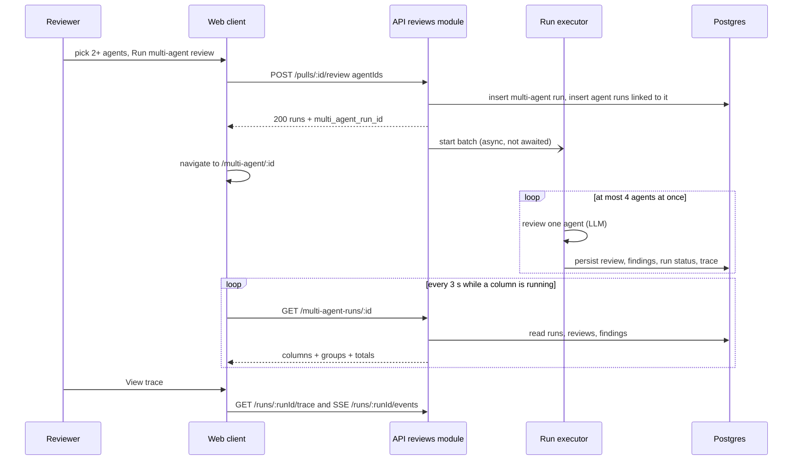

# Multi-Agent Review
Spec: multi-agent-review · Modules: server, client · Status: ready-for-planning
Design sources: screenshots 9.png (PR page agent picker), 10.png (Configure run, no PR), 11.png (Configure run, PR #482 picked), 12.png (results, Columns view), 13.png (results, Tabs view); lab 07 text and user decisions in `.devdigest/research/lab-07/context.md`; current-system map `.devdigest/research/multi-agent-review/research.md`; reference only (not adopted): `upstream/lesson-7-lab/multiagents-finish:specs/2026-07-08-multi-agent-review.md`.
Related: `specs/export-to-ci.md` (worktree B, written in parallel; reads the finding attribution defined in section 7). Supersedes nothing.

## 1. Goal
A reviewer today runs one agent or "all enabled agents", one after another, and compares results by scrolling the PR page. This feature lets the reviewer pick a set of agents, see an estimate of time and cost before starting, run them in parallel as one multi-agent run, and compare the results side by side: one column or tab per agent with live status, a per-agent trace, and a "Where agents disagree" block that groups findings by code location without losing which agent produced which finding. It is a deliberately simple first version (user decision D-simple).

## 2. Context
- Trigger: `POST /pulls/:id/review` accepts `{agentId?, all?}` only (`server/src/vendor/shared/contracts/platform.ts:255-258`); `all` → enabled agents, `agentId` → one agent (also a disabled one), neither → 400 `invalid_run_request`, unknown agent → 404 (`server/src/modules/reviews/application/review-service.ts:82-92`). Response `ReviewRunResponse {pr_id, runs[{run_id, agent_id, agent_name}], reviews}` has no parent id (`contracts/review-api.ts:49-65`). Rate limit 10/min (`modules/reviews/routes.ts:35-51`).
- Executor: diff and intent are loaded once per batch, each agent has its own abort controller, usage meter and error isolation, but agents run sequentially (`modules/reviews/application/run-executor.ts:70-131`, loop at `:116`).
- `multi_agent_runs(id, workspace_id, pr_id → pull_requests ON DELETE CASCADE, ran_at)` exists with no reader or writer; `agent_runs` has no link to it (`server/src/db/schema/runs.ts:77-87`). `agent_runs.pr_id` is nullable (`runs.ts:22`), `agent_runs.source` is `local|ci` (`runs.ts:12,36`).
- Contracts `MultiAgentRun`, `AgentColumn`, `Conflict`, `ConflictTake`, `AgentColumnFinding` exist and are unused (`contracts/observability.ts:22-87`). No grouping heuristic exists anywhere (research report, "Grouping / multi-run").
- Finding attribution today is indirect: `findings.review_id → reviews.run_id / reviews.agent_id → agent_runs` (research report; `server/src/db/schema/reviews.ts:75-111`). The current findings of a PR are the newest `kind='review'` row per agent, never `reviews[0]` (server/INSIGHTS.md:33, client/INSIGHTS.md:36).
- Live status: SSE `GET /runs/:id/events` per run with a replay buffer evicted 5 min after completion (server/INSIGHTS.md:48); the client merges N streams with `useRunEvents(runIds[])` (client/INSIGHTS.md:47).
- `RunTraceDrawer` (Trace tab: configuration, stats, prompt assembly, raw output with copy; Live log tab built on `LiveLogStream`) is hosted only by the PR page via `?trace=<runId>` (`client/src/app/repos/[repoId]/pulls/[number]/_components/PrDetailView/PrDetailView.tsx:58-61,124-133`). It picks its initial tab from `running` at mount, so a host must know `running` before mounting it (client/INSIGHTS.md:44).
- Run picker: `RunReviewDropdown` offers "Run all" + one item per agent + "Configure agents" → `/agents` (`.../_components/RunReviewDropdown/RunReviewDropdown.tsx:40-80`).
- Finding actions: only `accept` and `dismiss` routes exist (`modules/reviews/routes.ts:26`); the service rejects other actions with 400 `invalid_action` (`review-service.ts:194-217`). The client hook already types a response `{finding, memoryId?}` (`client/src/lib/hooks/reviews.ts:179-182`). Turn into eval case: `EvalCaseButton` + `POST /findings/:id/eval-case`, enabled only for a decided finding (research report, "Client").
- Memory: table `memory(workspace_id, repo_id?, scope repo|global|team, kind decision|convention|preference|fact|learning, content, embedding vector NULL, confidence?, sources jsonb, timestamps)` exists (`server/src/db/schema/knowledge.ts:22-50`); contract `MemorySource {pr?, context}` (`contracts/knowledge.ts:85-89`). Embeddings are off unless `EMBEDDINGS_ENABLED=true` (`server/src/platform/config.ts:22-23,178`).
- Estimates: `agent_runs` stores `duration_ms`, `cost_usd`, `status` per run; no per-agent aggregate endpoint exists (research report, "Estimates").
- Navigation: `NAV` has only WORKSPACE and SKILLS LAB groups (`client/src/vendor/ui/nav.ts:21-40`); `app-shell/helpers.ts:28` already maps `/multi-agent` to the `multi-agent` nav key; sidebar labels are English literals by design (client/INSIGHTS.md:27).
- i18n strings for columns, conflicts, drawer and page already exist in `client/messages/en/runs.json` (research report, "Client").

## 3. Scope
### In scope
- Multi-select agent picker on the PR page; Configure run screen; list of recent multi-agent runs; results screen with Columns and Tabs views; "Where agents disagree" block.
- Accepting a set of agent ids on the existing review trigger; one persisted parent run linking its agent runs.
- Bounded parallel execution of the agents of one batch.
- Per-agent estimate from past runs; Learn saves a finding to memory.
### Out of scope
- No new endpoint starts a review; `POST /pulls/:id/multi-agent-run` and `GET /pulls/:id/multi-agent` (named in the old contract comment) are not built.
- `agentId` and `all: true` requests never create a multi-agent run (MCP and the PR page single run behave as today).
- No new persisted field on `multi_agent_runs`; parent status and totals are derived on read.
- No semantic, embedding or LLM comparison of findings; grouping is file + line-range overlap only.
- The disagreement block shows no per-agent reason for "did not flag".
- No "cancel all" control and no per-column cancel on the results page.
- No "Reply to author" button anywhere in this feature.
- No Learn button on the PR page; Learn exists only in the results Tabs view.
- Learn computes no embedding and makes no LLM or embedding call.
- This feature does not change how memory entries are retrieved into review prompts.
- Estimates do not depend on diff size, model price changes or the selected PR.
- No per-agent stats page (`AgentStats`, Agent Performance) is built.
- No change to reviewer-core, `server/src/modules/ci/**`, `agent-runner/**`, the CI Runs page or the agent CI tab.
- The selection made in the picker or Configure run is not persisted.

## 4. User scenarios
- US1 — As a reviewer on a PR page, I pick several agents in the Run Review picker and start them, so that the PR is reviewed from several angles in one action.
- US2 — As a reviewer, I open Multi-Agent Review from the sidebar, see my recent multi-agent runs for the active repo and reopen the latest one, so that I can get back to results later.
- US3 — As a reviewer, I start a new multi-agent review from the Configure run screen (PR, agents, estimate), so that I know the time and cost before I spend them.
- US4 — As a reviewer, I watch per-agent columns update live and open any agent's trace or live log, so that I see who finished, who is running and who failed.
- US5 — As a reviewer, I switch to Tabs, expand a finding and Accept, Dismiss, Learn or turn it into an eval case, so that I triage per agent.
- US6 — As a reviewer, I read "Where agents disagree" and filter to conflicts, so that I see where agents diverge instead of reading the same finding several times.

## 5. Functional requirements
- FR1 [server] — `POST /pulls/:id/review` shall accept `agentIds` (1–20 agent ids); the server shall remove duplicate ids and run each remaining agent once, including disabled agents (same rule as `agentId`). (US1, US3)
- FR2 [server] — When the deduplicated `agentIds` has 2 or more ids, the server shall create one multi-agent run for the PR before any agent starts, link every created agent run to it, and return its id as `multi_agent_run_id`; with 1 id it shall behave as an `agentId` request and return `multi_agent_run_id: null`. (US1, US3)
- FR3 [server] — Requests with `agentId` or `all: true` shall keep their current behaviour and never create a multi-agent run. (US1)
- FR4 [server] — The executor shall run the agents of one batch in parallel with at most N concurrent agents, N configurable (`REVIEW_AGENT_CONCURRENCY`, default 4), for every batch (`agentIds`, `all`, `agentId`); the diff and intent shall still be loaded once per batch, and one agent's failure or cancellation shall not stop the others. (US4)
- FR5 [server] — `GET /multi-agent-runs/:id` shall return the multi-agent run with one column per linked agent run (status, score, verdict, summary, duration, cost, error, all findings of that run) and run totals, columns ordered by agent name ascending. (US2, US4, US5)
- FR6 [server] — The read model shall group the findings of the columns with status `done` into location groups: two findings are in one group when they are in the same file and their line ranges `[start_line, end_line]` overlap; overlap is transitive (A overlaps B and B overlaps C → one group). Groups are ordered by file, then first line. (US6)
- FR7 [server] — For each group the read model shall list one entry per `done` agent: the agent's highest severity in the group with its finding ids, or "did not flag" (`verdict: 'ignored'`, no finding ids). A group is a conflict unless every `done` agent flagged it with the same highest severity. Agents whose run is `running`, `failed` or `cancelled` get no entry. (US6)
- FR8 [server] — `GET /repos/:id/multi-agent-runs` shall return the newest multi-agent runs of the repo's PRs (default and maximum 20), newest first, each with PR number and title, agent count, number of still-running agents and total cost. (US2)
- FR9 [server] — `GET /runs/estimates` shall return, per agent with at least one finished (`done`) run, the average duration and average cost over its last 10 `done` runs (any PR, any source). (US3)
- FR10 [server] — `POST /findings/:id/learn` shall store the finding as one memory entry (kind `learning`, scope `repo`, the PR's repo, content built from title, rationale and suggested fix, confidence = finding confidence, source = PR number + `finding:<id>`, no embedding) and return the finding with its `memory_id`; repeating Learn on the same finding shall return the existing entry and create none. (US5)
- FR11 [server] — Findings in `GET /multi-agent-runs/:id` shall carry `memory_id` (the memory entry Learn created, or null). (US5)
- FR12 [client] — The PR page Run Review control shall be a multi-select picker: every agent with a checkbox and its estimated time ("~Ns", "—" without history), enabled agents checked by default, disabled agents unchecked with a "disabled" hint, "Clear" and "Select all", the merged/closed-PR warning, a run button labelled "Run review" for 1 checked agent and "Run multi-agent review (N)" for N ≥ 2, disabled at 0, and "Configure agents…" opening the Configure run screen with this PR preselected. (US1)
- FR13 [client] — Starting from the picker with N ≥ 2 shall navigate to `/multi-agent/<multi_agent_run_id>`; with N = 1 it shall stay on the PR page and behave as today's single-agent run. (US1)
- FR14 [client] — The sidebar shall show a GLOBAL group with a "Multi-Agent Review" item linking to `/multi-agent`, which lists the recent multi-agent runs of the active repo (PR number and title, time, agent count, running indicator, total cost; a row opens its results) and a "New multi-agent review" button opening the Configure run screen. (US2)
- FR15 [client] — The Configure run screen (`/multi-agent/new`, optional `?pr=<prId>`) shall offer a PR select over the active repo's PRs, then agent cards (checkbox, name, description, "time · cost" estimate), "Select all", and a run button "Run multi-agent review (N)" with a footer "≈ <max time> · <sum cost> · parallel fan-out"; the run button shall be enabled only with a PR and ≥ 2 agents; starting navigates to the results page. (US3)
- FR16 [client] — The results screen (`/multi-agent/<id>`) shall show a header with PR number and title (link to the PR page), agent count, "parallel", total time (longest column duration) and total cost, a "Configure run" link (Configure screen with this PR and these agents preselected), and a Columns/Tabs toggle kept in the URL (`?view=columns|tabs`, default columns). (US4, US5)
- FR17 [client] — Columns view: one column per agent with status (running / done / failed / cancelled), score ring, "time · cost", finding cards (severity, title, `file:line`), "N findings" or "No findings", the error text when failed, and "View trace"; the screen shall refresh the read model while any column is running. (US4)
- FR18 [client] — Tabs view: one tab per agent with its score; a summary card (score, summary, time · cost, "View trace"); expandable finding cards showing category, `file:start-end`, confidence as "NN% conf", rationale, suggested fix and the actions Accept, Dismiss, Learn ("Learned" once `memory_id` is set) and Turn into eval case (existing rule: enabled after Accept or Dismiss). (US5)
- FR19 [client] — Both views shall show "Where agents disagree" below the agents: one card per group (`file:line`, title, one cell per agent entry with severity or "did not flag" and the agent's finding title), a "Show only conflicts" toggle (off by default) that hides non-conflict groups, and an empty state when there are no groups. (US6)
- FR20 [client] — "View trace" (column footer and Tabs summary card) shall open the existing `RunTraceDrawer` for that agent run via `?trace=<runId>` on the results page, with `running` taken from the column status already loaded, the column's findings and agent name; the PR page drawer shall keep working unchanged. (US4)
- FR21 [client] — Accept, Dismiss and Learn on the results page shall show the new state on the card at once and keep it after a reload. (US5)

## 6. Workflow and communication

- Web → `POST /pulls/:id/review` (sync). On 4xx/5xx or network failure: no navigation, an error toast, the picker or Configure screen keeps the selection. Validation runs before anything is written, so a rejected request creates no parent and no agent run.
- API → executor (async, fire-and-forget as today). An executor failure for one agent is recorded on that agent run (`failed` + error); a diff-load failure fails all runs of the batch (existing `failAll`). The parent run has no status of its own.
- Web → `GET /multi-agent-runs/:id` (sync, polled every 3 s while any column is `running`, plus one refetch when a run's SSE stream reports a terminal status). On error: the screen shows the error state with Retry; polling continues on the next tick.
- Web → `GET /runs/:id/trace` and SSE `GET /runs/:id/events` through the reused drawer (unchanged behaviour, including the fallback to the persisted trace after the replay buffer is evicted).
- Web → `GET /runs/estimates` (sync, on opening the picker or Configure screen). On error: every estimate shows "—"; starting a run stays possible.
- Web → `POST /findings/:id/(accept|dismiss|learn)` (sync, optimistic). On error: the card reverts and an error toast is shown.

## 7. Contracts
All shapes live in `@devdigest/shared` (both copies, `server/src/vendor/shared` and `client/src/vendor/shared`) unless marked "server-local". All new endpoints are scoped to the caller's workspace; an id of another workspace answers 404.

**`POST /pulls/:id/review`** (changed, backwards compatible)
- Request `RunRequest`: `agentId?: string`, `all?: boolean`, `agentIds?: string[]` (new; 1–20 items). Exactly one of the three shall be given.
- Response `ReviewRunResponse`: `pr_id`, `runs[{run_id, agent_id, agent_name}]`, `reviews`, `multi_agent_run_id?: string | null` (new; set only when FR2 creates a parent).
- Errors: 400 `invalid_run_request` (none or more than one of the three options, empty `agentIds`, more than 20 ids); 404 `not_found` (PR or any listed agent unknown; nothing is created); 429 (rate limit 10/min, unchanged).

**`GET /multi-agent-runs/:id`** (new) → `MultiAgentRun`
- `id`, `pr_id`, `repo_id` (new), `pr_number?`, `pr_title?: string | null` (new), `ran_at` (ISO), `agent_count`, `total_duration_ms` (max column `duration_ms`, 0 when none), `total_cost_usd: number | null` (sum of non-null column costs; null when all are null), `columns: AgentColumn[]`, `conflicts: Conflict[]` (all location groups, conflict or not).
- `AgentColumn`: `run_id`, `agent_id`, `agent_name` (stored name; "Deleted agent" label is a client concern when the agent is gone), `provider`, `model`, `status: 'running'|'done'|'failed'|'cancelled'` (`cancelled` new), `verdict`, `score`, `summary`, `duration_ms`, `cost_usd`, `error?: string | null` (new), `findings: FindingRecord[]` (changed from `AgentColumnFinding[]`; the contract had no consumer).
- `FindingRecord` gains `memory_id?: string | null` (new; filled by this endpoint and by Learn; other endpoints may omit it).
- `Conflict` (one location group): `file`, `line` (min `start_line`), `end_line` (new, max `end_line`), `title` (title of the group's highest-severity finding; ties → first column order), `is_conflict: boolean` (new, FR7), `takes: ConflictTake[]` in column order.
- `ConflictTake`: `agent_id`, `persona` (agent name), `run_id` (new), `verdict: Severity | 'ignored'` (`ignored` = "did not flag"), `note` (title of the agent's highest-severity finding in the group, `""` when ignored), `finding_ids: string[]` (new; empty when ignored).
- Errors: 404 `multi_agent_run_not_found`.

**`GET /repos/:id/multi-agent-runs?limit=<1..20>`** (new) → `MultiAgentRunSummary[]`
- `MultiAgentRunSummary` (new): `id`, `pr_id`, `pr_number`, `pr_title`, `ran_at`, `agent_count`, `running_count`, `total_cost_usd: number | null`. Newest `ran_at` first; default limit 20.
- Errors: 404 `not_found` (repo unknown); 400 on `limit` outside 1–20.

**`GET /runs/estimates`** (new) → `AgentRunEstimate[]`
- `AgentRunEstimate` (new): `agent_id`, `sample_size` (1–10), `avg_duration_ms: number | null`, `avg_cost_usd: number | null`. Agents without a `done` run are absent (client shows "—"). No errors beyond 5xx.

**`POST /findings/:id/learn`** (new route for an existing `FindingActionKind`)
- No body. Response (server-local schema, same envelope as accept/dismiss plus the id the client hook already types): `{ finding: FindingRecord (with memory_id), memoryId: string }`. A repeat call returns 200 with the same `memoryId`.
- Errors: 404 `not_found` (unknown finding or other workspace).
- Memory entry written: `scope 'repo'`, `kind 'learning'`, `repo_id` = PR's repo, `content` = title, a blank line, rationale, and "Suggested fix: <suggestion>" when present, `confidence` = finding confidence, `sources = [{pr: <PR number>, context: "finding:<finding id>"}]`, `embedding` null. The pair (workspace, `finding:<id>`) identifies the entry for idempotency.

**Finding attribution** (read by worktree B; no new field)
- A finding's agent, run, source and parent are derived as `findings.review_id → reviews.run_id → agent_runs(id, agent_id, source 'local'|'ci', multi_agent_run_id)`; `reviews.agent_id` is the agent when the run row is gone.
- Worktree A guarantees: every agent run it creates has `source='local'`, a `pr_id`, and `multi_agent_run_id` set only for multi-agent batches; every review row it writes carries `run_id` and `agent_id`.
- Worktree B relies on: CI ingest stores counts and metadata only (no finding text), writes `source='ci'` and leaves `agent_runs.pr_id` NULL and `multi_agent_run_id` NULL. Multi-agent read models select runs only through `multi_agent_run_id`, so CI runs never appear in them. `GET /runs/estimates` includes `done` CI runs that have duration or cost.

**Configuration**: `REVIEW_AGENT_CONCURRENCY` (server env, integer ≥ 1, default 4).

## 8. Data model (logical)
- Multi-agent run (existing entity): belongs to one workspace and one PR; created once per multi-agent trigger; deleted with its PR. No status, totals or agent list are stored on it.
- Agent run → multi-agent run: optional many-to-one link (new). The link is cleared if the parent is deleted; agent runs outlive their parent.
- Location group, conflict flag, totals and parent status: derived on every read, never stored.
- Memory entry (existing entity): Learn adds at most one entry per finding; it lives until deleted by the memory feature; deleting the finding does not delete it.
- Estimate: derived from agent runs on every read.

## 9. States and UX
| Screen / element | Loading | Empty | Error | Degraded | Success | Notes |
|---|---|---|---|---|---|---|
| PR picker | agent rows skeleton; button disabled | "No agents yet" + link to Agents | toast on start failure, selection kept | estimates "—" if estimates fail | navigates (N ≥ 2) or starts in place (N = 1) | merged PR: warning row, run allowed |
| Multi-agent list `/multi-agent` | row skeletons | "No multi-agent run yet" + "New multi-agent review" | error card + Retry | — | rows newest first, running dot | no active repo → "Import a repository" CTA |
| Configure run | PR select loading | "Pick a pull request first" (design 10); repo without PRs → "No pull requests" | toast on start failure | estimates "—"; footer omits cost/time it cannot compute | navigate to results | `?pr` unknown → no preselection |
| Results header | skeleton | — | 404 → "Multi-agent run not found" + link to list | — | totals | totals update while running |
| Column / tab | spinner on status while running | "No findings" | failed: error text; cancelled label | queued agents show "running" | score, findings | horizontal scroll beyond 4 columns |
| Disagreement block | hidden until first column is done | "No conflicts — the agents agree on every flagged location." | — | note "N agents not finished or failed are not compared" | groups | toggle off by default |
| Trace drawer | existing | existing | existing | existing (replay evicted → persisted trace) | existing | opens on Live log when the column is running |
| Finding actions | button busy | — | revert + toast | — | Accepted / Dismissed / Learned | Learn disabled once learned |

## 10. Edge cases
- EC1 [server] — `agentIds` is empty, has more than 20 ids, or is combined with `agentId`/`all` → 400 `invalid_run_request`, nothing created (FR1).
- EC2 [server] — `agentIds` contains an unknown agent id → 404, no parent and no agent run created (FR1, FR2).
- EC3 [server] — `agentIds` has duplicates that reduce to one agent → single run, `multi_agent_run_id: null` (FR1, FR2).
- EC4 [server] — One agent fails, the others succeed → its column is `failed` with `error`, the others `done`; it has no entry in groups (FR4, FR7).
- EC5 [client] — All agents fail → every column shows failed with its error; the disagreement block shows its empty state (FR17, FR19).
- EC6 [server] — An agent run is cancelled from the PR page → its column is `cancelled`; siblings continue (FR4, FR5).
- EC7 [server] — A `done` agent with zero findings → "No findings" and "did not flag" in every group (FR7).
- EC8 [server] — Unknown multi-agent run id or one from another workspace → 404 `multi_agent_run_not_found` (FR5).
- EC9 [client] — The agent was deleted after the run → the column keeps the stored agent name, or shows "Deleted agent" when none (FR17).
- EC10 [server] — The PR is deleted → its multi-agent runs disappear from the list and their page answers 404 (FR5, FR8).
- EC11 [server] — Two multi-agent runs on the same PR started back to back → two independent parents, each with its own agent runs (FR2).
- EC12 [client] — A selected agent has no history → "—" for it; footer totals use only agents with an estimate; none has one → footer shows "no estimate yet" (FR12, FR15).
- EC13 [server] — Learn twice, sequentially or concurrently, on one finding → exactly one memory entry; both calls return its id (FR10).
- EC14 [server] — Learn on an unknown finding → 404 `not_found`, nothing stored (FR10).
- EC15 [server] — Findings A (lines 1–5), B (4–8), C (7–9) in one file → one group; a finding on lines 10–12 → a separate group; same lines in another file → separate group (FR6).
- EC16 [server] — One agent has two findings in a group (WARNING, CRITICAL) → its entry shows CRITICAL with both finding ids (FR7).
- EC17 [client] — More than 4 agents selected → agents above the limit wait in the queue and show "running" until they finish (FR4, FR17).
- EC18 [client] — The SSE replay buffer was evicted or the server restarted → column statuses still come from the read model; the drawer shows the persisted trace (FR17, FR20).
- EC19 [client] — "View trace" on a column that is `running` → the drawer opens on its Live log tab; on a finished column → the Trace tab (FR20).
- EC20 [server] — A CI run (`source='ci'`, `pr_id` NULL) exists for the same agent → it never appears in any multi-agent run or list (FR5, FR8).

## 11. Non-functional requirements
- NFR1 [server] — With 4 selected agents and the default limit, the batch wall-clock time shall be below 1.5 × the slowest single agent's duration (mock provider with fixed latency); at no time shall more than `REVIEW_AGENT_CONCURRENCY` agents of one batch be in their LLM phase.
- NFR2 [server] — `GET /multi-agent-runs/:id`, `GET /repos/:id/multi-agent-runs` and `GET /runs/estimates` shall make no LLM or embedding call and answer in ≤ 500 ms p95 locally for 8 agents × 50 findings.
- NFR3 [client] — A column's status shall show the terminal state within 5 s after the agent run finishes.
- NFR4 [server] — The trigger keeps its rate limit of 10 requests/min; one request starts at most 20 agent runs.
- NFR5 [server] — Cost: a multi-agent run makes one review per selected agent plus the existing once-per-batch intent work; Learn, grouping and estimates add 0 LLM calls.
- NFR6 [client] — Finding text, titles, summaries and memory content are untrusted PR-derived data: rendered as text/markdown with the same sanitisation as the PR page, never as raw HTML; Learn stores them as data only.
- NFR7 [client] — Accessibility: picker and agent cards are checkboxes with labels operable by keyboard (Space toggles, Tab moves); the view toggle, tabs and "Show only conflicts" switch are keyboard operable with accessible names; failed/running status is conveyed by text, not colour only.
- NFR8 [client] — i18n: every new visible string comes from `client/messages/en/*.json`, except the sidebar label (literal by convention, client/INSIGHTS.md:27).
- NFR9 [server] — Compatibility: existing `agentId`/`all` callers (PR page single run, MCP `run_agent_on_pr`) get the same runs and response fields as before, plus `multi_agent_run_id: null`.
- NFR10 [server] — Observability: creating a multi-agent run logs one info line with `multi_agent_run_id`, `pr_id` and the agent count; Learn logs the finding id and memory id; neither logs finding text.

## 12. Dependencies and rollout
- Shared contract change: yes — `RunRequest`, `ReviewRunResponse`, `FindingRecord`, `observability.ts` types, two new types; committed on the base branch in both copies (section "Base commit").
- Persisted data change: yes — one nullable link column on agent runs, in the single base-branch migration shared with worktree B. Learn uses the existing memory table; no further migration.
- No feature flag. Old clients keep working (all new fields optional).
- Release order: base commit → worktree A merges first → worktree B rebases (nav conflict) and merges.
- Operators run `cd server && pnpm db:migrate` after pulling the base commit (migrations do not run on boot).

## 13. Acceptance criteria
- AC1 [server] — Given a PR and agents X, Y, when `POST /pulls/:id/review {agentIds:[X,Y,X]}`, then the response has 2 runs and a non-null `multi_agent_run_id`, and both agent runs are linked to that parent.
  Traces: FR1, FR2 · Verify: integration
- AC2 [server] — Given agent X, when `POST /pulls/:id/review {agentIds:[X,X]}`, then 1 run is created and `multi_agent_run_id` is null.
  Traces: FR2, EC3 · Verify: integration
- AC3 [server] — When the body is `{agentIds:[]}`, `{agentIds:<21 ids>}` or `{agentIds:[X], all:true}`, then 400 `invalid_run_request` and no agent run or parent is stored.
  Traces: EC1, NFR4 · Verify: integration
- AC4 [server] — When `agentIds` contains an unknown id, then 404 and no agent run or parent is stored.
  Traces: EC2 · Verify: integration
- AC5 [server] — When `{all:true}` or `{agentId:X}` is posted, then the runs created are the same as before this feature and `multi_agent_run_id` is null.
  Traces: FR3, NFR9 · Verify: integration
- AC6 [server] — Given 4 agents on the mock provider with a fixed latency L and the default limit, when a multi-agent run starts, then all 4 runs reach `done` in < 1.5 × L wall-clock, and with `REVIEW_AGENT_CONCURRENCY=1` no two runs overlap.
  Traces: FR4, NFR1 · Verify: integration
- AC7 [server] — Given 3 agents where agent 2 throws, when the batch finishes, then agents 1 and 3 are `done` and agent 2 is `failed` with a non-empty `error`, and `GET /multi-agent-runs/:id` shows these statuses and the error.
  Traces: FR4, FR5, EC4 · Verify: integration
- AC8 [server] — Given a finished multi-agent run, when `GET /multi-agent-runs/:id`, then it returns one column per linked run ordered by agent name, each with all findings of that run, `total_cost_usd` = sum of column costs and `total_duration_ms` = max column duration.
  Traces: FR5 · Verify: integration
- AC9 [server] — Given an agent run cancelled from the PR page inside a multi-agent run, when the run is read, then that column has status `cancelled` and the other columns are unaffected.
  Traces: EC6 · Verify: integration
- AC10 [server] — Given findings A(f.ts 1–5), B(f.ts 4–8), C(f.ts 7–9), D(f.ts 10–12), E(g.ts 1–5) from different agents, when grouped, then the groups are {A,B,C}, {D}, {E} in that order.
  Traces: FR6, EC15 · Verify: unit
- AC11 [server] — Given 3 done agents where only agent 1 flags a location, then the group has 3 takes in column order, agents 2 and 3 have `verdict 'ignored'` and empty `finding_ids`, and `is_conflict` is true; given all 3 flag it as WARNING, `is_conflict` is false; given WARNING and CRITICAL, it is true.
  Traces: FR7, EC7 · Verify: unit
- AC12 [server] — Given one agent with a WARNING and a CRITICAL finding in one group, then its take has `verdict CRITICAL` and both finding ids.
  Traces: EC16 · Verify: unit
- AC13 [server] — Given a failed or running column, when the run is read, then that agent has no take in any group.
  Traces: FR7, EC4 · Verify: unit
- AC14 [server] — When `GET /multi-agent-runs/<unknown or other-workspace id>`, then 404 `multi_agent_run_not_found`.
  Traces: EC8 · Verify: integration
- AC15 [server] — Given 22 multi-agent runs on a repo's PRs, when `GET /repos/:id/multi-agent-runs`, then 20 summaries are returned newest first with `pr_number`, `pr_title`, `agent_count`, `running_count`, `total_cost_usd`; after deleting a PR its runs are absent and their read answers 404.
  Traces: FR8, EC10 · Verify: integration
- AC16 [server] — Given two multi-agent runs started back to back on one PR, then two parents exist, each linked only to its own agent runs.
  Traces: EC11 · Verify: integration
- AC17 [server] — Given a CI agent run (`source='ci'`, `pr_id` NULL) for an agent that is also in a multi-agent run, then neither the run read nor the list includes the CI run.
  Traces: EC20 · Verify: integration
- AC18 [server] — Given agent X with 12 `done` runs and one `failed` run, and agent Y with none, when `GET /runs/estimates`, then X has `sample_size 10` and averages over its newest 10 `done` runs, and Y is absent.
  Traces: FR9 · Verify: integration
- AC19 [server] — When `POST /findings/:id/learn`, then one memory row exists with kind `learning`, scope `repo`, the PR's repo, the finding's confidence, `sources[0].context = "finding:<id>"`, null embedding, and the response carries `memoryId` and `finding.memory_id` equal to it; no LLM or embedding call is recorded.
  Traces: FR10, NFR5 · Verify: integration
- AC20 [server] — When Learn is called twice sequentially and twice concurrently on one finding, then exactly one memory row exists and all calls return 200 with the same `memoryId`.
  Traces: EC13 · Verify: integration
- AC21 [server] — When `POST /findings/<unknown>/learn`, then 404 `not_found` and no memory row is stored.
  Traces: EC14 · Verify: integration
- AC22 [server] — Given a learned finding, when `GET /multi-agent-runs/:id`, then that finding has `memory_id` set and the others null.
  Traces: FR11 · Verify: integration
- AC23 [server] — Given a multi-agent run with 8 agents × 50 findings, when the three read endpoints are called 50 times each, then p95 ≤ 500 ms and no LLM or embedding call is made.
  Traces: NFR2, NFR5 · Verify: manual
- AC24 [server] — When a multi-agent run is created and a finding is learned, then the log contains one line with `multi_agent_run_id`, `pr_id` and agent count, and one with finding id and memory id, and no finding title or rationale.
  Traces: NFR10 · Verify: integration
- AC25 [client] — Given agents A (enabled), B (enabled), C (disabled) and estimates for A only, when the picker opens, then A and B are checked, C is unchecked with a "disabled" hint, A shows "~Ns" and B "—"; unchecking B labels the button "Run review", Clear disables it, Select all checks all three and labels it "Run multi-agent review (3)".
  Traces: FR12, EC12 · Verify: component
- AC26 [client] — Given 2 checked agents, when the run button is pressed and the API returns `multi_agent_run_id` M, then the router navigates to `/multi-agent/M`; given 1 checked agent, the request carries `agentIds` of length 1 and the PR page stays with the run streaming as today.
  Traces: FR13 · Verify: component
- AC27 [client] — Given a merged PR, when the picker opens, then the merged warning row is shown and running is still possible; "Configure agents…" navigates to `/multi-agent/new?pr=<prId>`.
  Traces: FR12 · Verify: component
- AC28 [client] — Given the API answers the trigger with 500, then no navigation happens, an error toast appears and the checked set is unchanged.
  Traces: FR13 · Verify: component
- AC29 [client] — Given the active repo has 2 multi-agent runs, when `/multi-agent` opens, then the sidebar item "Multi-Agent Review" is active, 2 rows show newest first, a row click opens `/multi-agent/<id>`, and "New multi-agent review" opens `/multi-agent/new`; with 0 runs the empty state shows the same button.
  Traces: FR14 · Verify: component
- AC30 [client] — Given `/multi-agent/new` without a PR, then the agents step shows "Pick a pull request first" and the run button is disabled; after picking a PR, agent cards show name, description and "time · cost", and with agents at (8.2 s, $0.06) and (7.4 s, $0.05) checked the footer reads "≈ 8.2s · $0.11 · parallel fan-out".
  Traces: FR15, EC12 · Verify: component
- AC31 [client] — Given `/multi-agent/new?pr=<prId>` with ≥ 2 agents checked, when Run is pressed, then `agentIds` are posted for that PR and the router navigates to the results page; with an unknown `pr` nothing is preselected.
  Traces: FR15 · Verify: component
- AC32 [client] — Given a run with 2 done columns and 1 running column, when the results page renders, then the header shows PR number and title, "3 agents · parallel", total time and cost; each column shows status, score ring, time · cost, findings with `file:line`, "N findings" and "View trace"; `?view=tabs` switches to Tabs and back keeps the run.
  Traces: FR16, FR17 · Verify: component
- AC33 [client] — Given the running column becomes done on the server, when the next poll or the SSE terminal event arrives, then the column shows done within 5 s and polling stops once no column is running.
  Traces: FR17, NFR3, EC18 · Verify: component
- AC34 [client] — Given all columns failed, then each shows its error text and the disagreement block shows its empty state; given a column with no findings it shows "No findings"; given 6 columns the row scrolls horizontally; given a column whose agent name is missing it shows "Deleted agent".
  Traces: EC5, EC9, EC17 · Verify: component
- AC35 [client] — Given the Tabs view, when a finding is expanded, then category, `file:start-end`, "NN% conf", rationale, suggested fix and Accept, Dismiss, Learn, Turn into eval case are shown and no "Reply to author" button exists.
  Traces: FR18 · Verify: component
- AC36 [client] — When Accept is clicked, then the card shows Accepted immediately and Turn into eval case becomes enabled; when Learn is clicked, the button shows "Learned" and is disabled; after a refetch both states remain; on a 500 the card reverts and a toast appears.
  Traces: FR18, FR21 · Verify: component
- AC37 [client] — Given 3 groups of which 1 is not a conflict, then both views show 3 group cards with one cell per take ("did not flag" for ignored takes); turning on "Show only conflicts" shows 2.
  Traces: FR19 · Verify: component
- AC38 [client] — Given a running column, when "View trace" is clicked, then the URL gets `?trace=<runId>` and the drawer opens on the Live log tab; for a done column it opens on Trace with that column's findings and agent name; the PR page drawer still opens from its Agent runs tab.
  Traces: FR20, EC19 · Verify: component
- AC39 [client] — Given a finding whose title contains ``, when it is shown in a column, a tab and a group cell, then the markup is rendered as text and no element is created.
  Traces: NFR6 · Verify: component
- AC40 [client] — Using only the keyboard, the reviewer can toggle agents in the picker and Configure screen, switch views, switch tabs, toggle "Show only conflicts" and open a trace; each control has an accessible name and statuses are shown as text.
  Traces: NFR7 · Verify: manual
- AC41 [client] — Under the pseudo-messages i18n test, the picker, list, Configure and results screens render no stray English literal.
  Traces: NFR8 · Verify: component
- AC42 [client] — In the worktree app with `LLM_PROVIDER_OVERRIDE=mock`, picking 2 agents on a PR page leads to the results page where both columns reach done, "View trace" opens the drawer, and `/multi-agent` lists the run first.
  Traces: FR13, FR14, FR17, FR20 · Verify: manual

## 14. Traceability
| Source | Module | FR | EC / NFR | AC |
|---|---|---|---|---|
| Lab: picker on PR page; design 9 | client, server | FR1, FR12, FR13 | EC1–EC3, EC12, NFR4, NFR9 | AC1–AC5, AC25–AC28 |
| Lab: parallel through existing trigger | server | FR3, FR4 | EC4, EC6, EC17, NFR1, NFR5 | AC5–AC7, AC9, AC34 |
| Lab: multi_agent_runs grouping | server | FR2, FR5, FR8 | EC8, EC10, EC11, EC20, NFR2 | AC1, AC8, AC14–AC17, AC23 |
| Lab: findings heuristic + disagree block; design 12–13 | server, client | FR6, FR7, FR19 | EC7, EC13–EC16 | AC10–AC13, AC37 |
| Lab: estimate; design 9, 11 | server, client | FR9, FR15 | EC12 | AC18, AC30, AC31 |
| User: back to latest run (US2) | client | FR14 | — | AC29, AC42 |
| Lab: Columns + live status; design 12 | client | FR16, FR17 | EC5, EC9, EC18, NFR3 | AC32–AC34 |
| Lab: Tabs + actions; design 13 | server, client | FR10, FR11, FR18, FR21 | EC13, EC14, NFR6 | AC19–AC22, AC35, AC36, AC39 |
| D-drawer: reuse RunTraceDrawer | client | FR20 | EC19 | AC38 |
| Quality | server, client | — | NFR7, NFR8, NFR10 | AC24, AC40, AC41 |

## 15. Design review
| # | Gap / proposal | Source | Module | Decision |
|---|---|---|---|---|
| 1 | Design 12 shows "Architecture" in groups though it was not selected | 12.png | server | accepted: only agents of this run get takes |
| 2 | "did not flag" reasons ("Not a security concern") have no data source | 12.png, 13.png | client | accepted: show "did not flag" only |
| 3 | Header says "fan-out via worktrees" — wrong mechanism | 12.png | client | accepted: "N agents · parallel" |
| 4 | "Reply to author" is not in the lab list and has no server route | 13.png | client | accepted: hidden |
| 5 | Learn rejected by server today | 13.png, code | server | accepted: minimal Learn to memory (D2) |
| 6 | "Configure agents…" goes to `/agents` today | 9.png | client | accepted: opens Configure run with this PR |
| 7 | Missing states: no PR, no agents, no history, failed/cancelled columns, 404 run | 10–12.png | client | accepted: section 9 |
| 8 | Agent card text in design 11 looks like run summaries | 11.png | client | accepted: agent description |
| 9 | Picker per-agent "~6s" needs history | 9.png | server | accepted: `GET /runs/estimates` |
| 10 | Many agents vs 4 columns in design | 12.png | client | accepted: horizontal scroll |
| 11 | No cancel-all on results page | — | client | accepted: out of scope |
| 12 | Run-all items claim "in parallel" while executor is sequential | `runs.json:134-156` | server | accepted: FR4 makes it true |

## 16. Decisions
- D1 — PR picker after start → 2+ agents create a multi-agent run and navigate to `/multi-agent/<id>`; 1 agent runs a normal review on the PR page, button "Run review" (user, 2026-10-15).
- D2 — Learn → minimal implementation: save the finding as a memory entry in the existing memory table, no embedding and no LLM call, idempotent per finding, "Learned" state; "Reply to author" hidden (user, 2026-10-15).
- D3 — Multi-Agent Review page → last 20 runs of the active repo, newest first, plus "New multi-agent review"; the empty state offers it (user, 2026-10-15).
- D4 — Grouping → same file + overlapping line ranges; "Show only conflicts" hides groups where every finished agent flagged with the same severity (user, 2026-10-15).
- D5 — Attribution → derived only via findings → reviews → agent_runs, exposed by A in the multi-run response; no new attribution field; B's CI ingest stores counts and metadata only and leaves `agent_runs.pr_id` NULL (user + export-to-ci spec, 2026-10-15).
- D6 — Concurrency → up to 4 agents at once, configurable, for every batch (user, 2026-10-15).
- D7 — All gap-register defaults (design review rows 1–4, 6–12) accepted (user, 2026-10-15).
- D-base, D-db, D-simple, D-drawer — see `.devdigest/research/lab-07/context.md` (user, 2026-10-15).

## 17. Open questions
- Q1 — When `EMBEDDINGS_ENABLED=true`, should Learn also compute an embedding? — default used in this spec: no; the entry is always stored with a null embedding.
- Q2 — Should estimates include CI runs (`source='ci'`)? — default: yes, any `done` run with duration or cost.
- Q3 — Poll interval for the results page while running — default: 3 s.
- Q4 — Column order — default: agent name ascending (the picker order is not kept).

## Worktree boundaries
Worktree A = `../devdigest-review`, branch `feat/multi-agent-review`.

**Owned by A (may create and edit)**
- `client/src/app/repos/[repoId]/pulls/[number]/**` — PR page: picker replacing `RunReviewDropdown`, and the `RunTraceDrawer` move.
- `client/src/app/multi-agent/**` — list, Configure run (`new`) and results (`[id]`) routes and their components.
- The shared location the `RunTraceDrawer` (and its helpers/tests) moves to, chosen by the plan under `client/src/components/**`, as a move only (no behaviour change).
- `client/src/lib/hooks/reviews.ts`, `client/src/lib/hooks/trace.ts`, a new multi-agent hooks file under `client/src/lib/hooks/`.
- `client/messages/en/runs.json`, `client/messages/en/prReview.json`.
- `server/src/modules/reviews/**` — trigger, executor, multi-run service and repository, grouping, estimates, Learn, routes, schemas, and their tests under `server/test/**` for these areas.

**Forbidden for A**
- `server/src/modules/ci/**`, `agent-runner/**`, the CI Runs page, the agent page CI tab (`client/src/app/agents/**`), `client/messages/en/ci.json`, any migration file or the drizzle journal, `reviewer-core/**`.

**Shared files (owner and rule)**
- Shared contracts, both copies (`server/src/vendor/shared/contracts/*`, `client/src/vendor/shared/contracts/*`): changed only in the base commit. A owns `observability.ts` (multi-agent types), `RunRequest` in `platform.ts`, `ReviewRunResponse` and `FindingRecord` in `review-api.ts`. Changes are additive (new optional fields, new types); the one non-additive change is `AgentColumn.findings`, which has no consumer. After the base commit A may only add optional fields to its own types, in both copies, keeping `./scripts/check-shared-drift.sh` clean.
- DB migration: one migration on the base branch for both features (D-base). A needs only: `agent_runs.multi_agent_run_id` (uuid, nullable, FK `multi_agent_runs.id` ON DELETE SET NULL, indexed) and the matching drizzle schema field. Worktrees add no migration.
- `client/src/vendor/ui/nav.ts`: A adds the GLOBAL group with only its "Multi-Agent Review" item (`/multi-agent`). B adds "CI Runs" to that group on rebase — the expected conflict.
- `client/src/lib/hooks/keys.ts`, `client/src/lib/hooks/index.ts`, `server/src/platform/config.ts` (`REVIEW_AGENT_CONCURRENCY`), `server/.env.example`: append-only, own lines only; trivial conflicts resolved by B on rebase.
- The executor's bounded concurrency is injected in `server/src/modules/reviews/composition.ts` (owned by A). A does NOT edit `server/src/modules/composition.ts` or `server/src/modules/index.ts` — B adds the `ci` module registration there.

**Merge order**
1. Base commit on `feat/multi-agents` (section below), then create both worktrees from it.
2. A merges first: B's ingest relies on the attribution chain and on `multi_agent_run_id` staying NULL for CI runs (section 7).
3. B rebases on the result, resolves only `nav.ts` and the append-only files, re-runs its checks, merges.

**Verification (inside `../devdigest-review`)**
- `cd server && pnpm typecheck && pnpm lint && pnpm arch:check && pnpm test:unit`
- `cd server && pnpm test:integration` (against `devdigest_review`)
- `cd client && pnpm typecheck && pnpm lint && pnpm test`
- `./scripts/check-shared-drift.sh` · `./scripts/gates.sh` · `./scripts/spec-lint.sh specs/multi-agent-review.md`
- `git -C ../devdigest-review diff --name-only feat/multi-agents...` lists no forbidden path.
- Manual: DB `devdigest_review`, API on 3011 (`API_PORT=3011`, `WEB_PORT=3010`, `DATABASE_URL` pointing at `devdigest_review`), web on 3010 (`cd client && NEXT_PUBLIC_API_BASE=http://localhost:3011 pnpm exec next dev -p 3010`), `cd server && pnpm db:migrate`; run with `LLM_PROVIDER_OVERRIDE=mock` for a key-free run, then AC42.

## Base commit (before fan-out)
Committed on `feat/multi-agents` before `git worktree add`, together with B's items:
1. Migration (single, shared with B): `agent_runs.multi_agent_run_id` uuid NULL → `multi_agent_runs.id` ON DELETE SET NULL, plus an index on it; drizzle schema updated to match.
2. `platform.ts`: `RunRequest.agentIds?: string[]` (min 1, max 20).
3. `review-api.ts`: `ReviewRunResponse.multi_agent_run_id?: string | null`; `FindingRecord.memory_id?: string | null`.
4. `observability.ts`: `AgentColumn.status` adds `cancelled`; `AgentColumn.error?: string | null`; `AgentColumn.findings: FindingRecord[]`; `ConflictTake.run_id`, `ConflictTake.finding_ids: string[]`; `Conflict.end_line`, `Conflict.is_conflict`; `MultiAgentRun.repo_id`, `MultiAgentRun.pr_title?: string | null`; new `MultiAgentRunSummary`, new `AgentRunEstimate`; header comment names the real endpoints.
5. Steps 2–4 applied identically to both `vendor/shared` copies; `./scripts/check-shared-drift.sh` clean.
